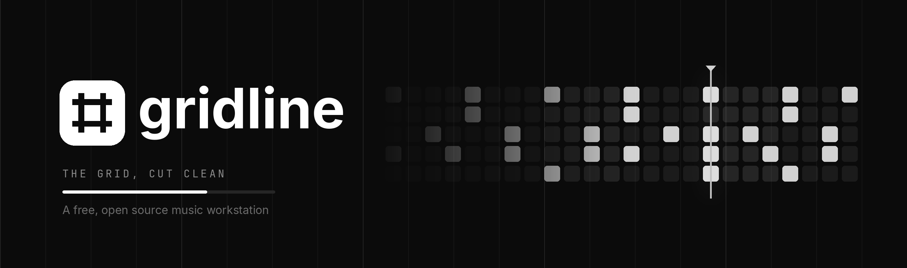
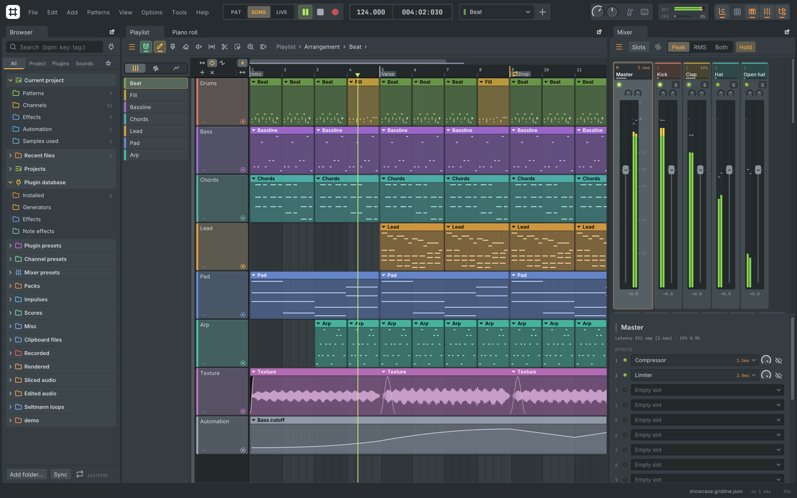
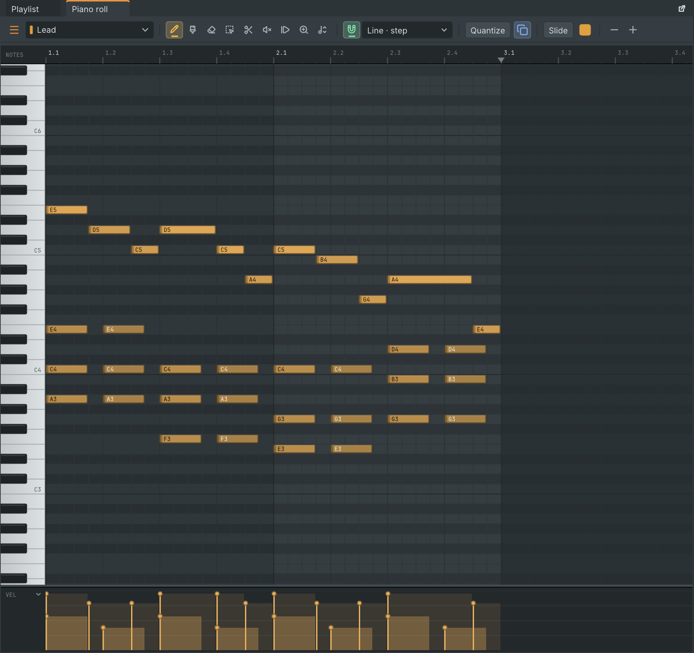
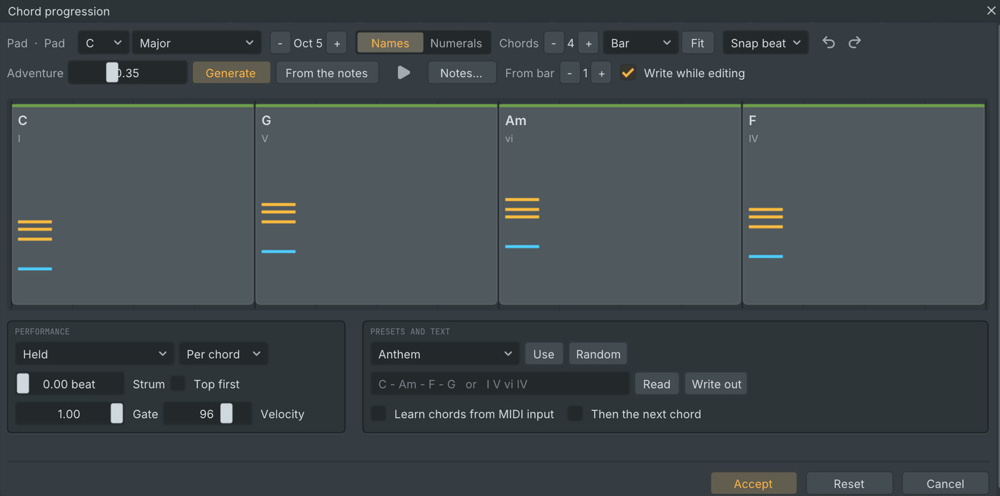
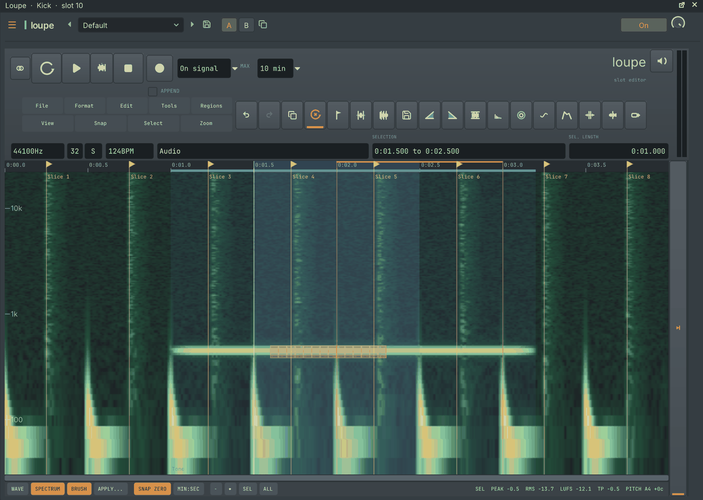
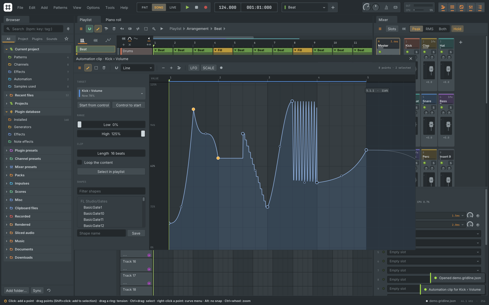
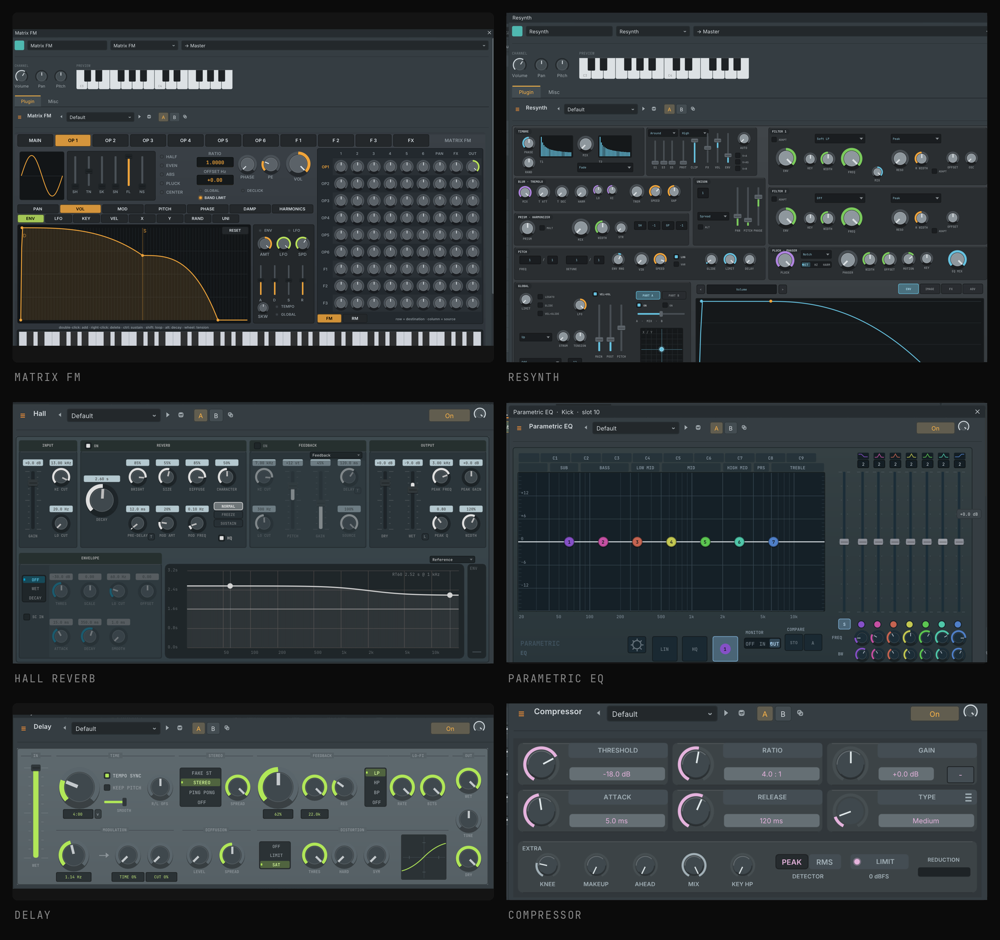
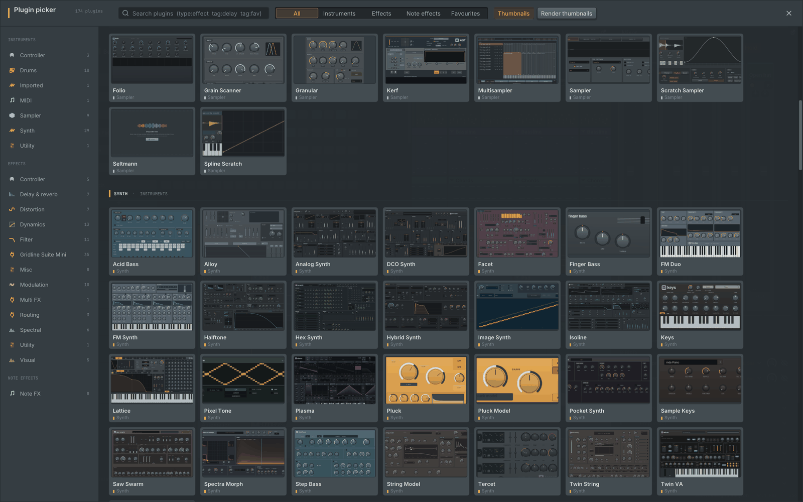

<p align="center">
  
</p>

<p align="center">
  
  
  
  
</p>

<p align="center">
  <b>A free, open source music workstation built around the grid.</b><br>
  Channel rack, step sequencer, piano roll, playlist and mixer, written from scratch in C++17<br>
  for the operating systems that usually get left out.
</p>

<br>

<p align="center">
  
</p>

## Highlights

<table>
<tr>
<td width="50%" valign="top">

**Pattern workflow.** Build loops in the channel rack, arrange them as clips in the playlist and mix them on inserts. Patterns, audio and automation all live on the same tracks.

**128 built-in instruments and effects.** Synths from subtractive to six-operator FM, additive and resynthesis, physical models, samplers and slicers, drum machines, reverbs, delays, dynamics, EQs and modulators. Every one has its own editor.

**Real plugins, real interfaces.** VST3, CLAP, VST2 and AU instruments and effects open with their own interface, can run sandboxed in a separate process, and are checked by a built-in compatibility sweep.

</td>
<td width="50%" valign="top">

**A mixer that keeps time.** Plugin delay compensation, parallel processing on several cores, sends, sidechains, groups, stems and a per-track EQ. Offline renders are bit-identical whatever the buffer size.

**Recording and editing.** Audio input with latency compensation, takes and comping, an audio editor with spectral view, automation clips with curves and an LFO tool, MIDI learn on every control.

**Scripting and templates.** Sandboxed Lua scripts for the piano roll and for hardware controllers, project templates, and a background sample browser with tempo and key search.

</td>
</tr>
</table>

## A closer look

<table>
<tr>
<td width="50%"></td>
<td width="50%"></td>
</tr>
<tr>
<td><b>Piano roll.</b> Slides, per-note properties, ghost notes, scale highlighting and a full set of tools: quantize, chop, strum, arpeggiate, randomize and more.</td>
<td><b>Chord progressions.</b> Pick a key, generate or type a progression, shape the rhythm and voicing, and write it straight into the pattern.</td>
</tr>
<tr>
<td width="50%"></td>
<td width="50%"></td>
</tr>
<tr>
<td><b>Audio editor.</b> Waveform and spectral views, markers and regions, time stretch and pitch shift, noise reduction, beat slicing and loudness readouts.</td>
<td><b>Automation.</b> Points with thirteen curve shapes, tension handles, an LFO tool, a shape library and recording straight from knob moves.</td>
</tr>
</table>

### Instruments and effects

<p align="center">
  
</p>

<p align="center">
  <br>
  <sub>The plugin picker shows every instrument and effect with a preview of its editor.</sub>
</p>

## Build

Gridline needs CMake, a C++17 compiler and SDL2. Everything else (Dear ImGui, Lua, RtMidi, the plugin interfaces and the audio decoders) is bundled in `third_party/`.

```sh
# macOS
brew install cmake sdl2

# Debian / Ubuntu
sudo apt install cmake libsdl2-dev libasound2-dev libjack-jackd2-dev

cmake -S . -B build -DCMAKE_BUILD_TYPE=Release
cmake --build build -j
ctest --test-dir build          # 71 test suites
./build/gridline-app            # start the app
```

`./build.sh` is a quicker path for the core alone: it builds the command line tool, runs the core tests and renders the demo song.

## Command line

```sh
build/gridline info    demo/song.json                        # inspect a project
build/gridline render  demo/song.json -o out.wav --bits 24    # render to audio
build/gridline export-midi demo/song.json -o song.mid        # write a MIDI file
build/gridline import-midi song.mid -o song.json             # read a MIDI file
build/gridline zip     demo/song.json -o song.zip            # project plus samples
build/gridline plugin-check --all --json report.json         # plugin compatibility sweep
build/gridline bench   demo/song.json                        # load, save and render timings
```

## Plugin hosting

`src/host/` hosts third-party plugins through one interface, `host::Backend`.

| Format | Type id | Where Gridline looks |
|---|---|---|
| VST3 | `vst3:<class uid>` | `~/Library/Audio/Plug-Ins/VST3`, `/Library/Audio/Plug-Ins/VST3`; on Linux `~/.vst3`, `/usr/lib/vst3` |
| CLAP | `clap:<plugin id>` | `.../Plug-Ins/CLAP`; on Linux `~/.clap`, `/usr/lib/clap`; `$CLAP_PATH` |
| VST2 | `vst2:<unique id>` | `.../Plug-Ins/VST`; on Linux `~/.vst`, `/usr/lib/vst`; `$VST_PATH` |
| AU (macOS) | `au:<type>/<subtype>/<manufacturer>` | the system component registry |

- **Opening a plugin** shows its own interface at the size it asks for, with a slim Gridline bar underneath for presets, bypass, sandbox, CPU and latency. The window follows the plugin when it resizes.
- **Scanning** happens in a child process, so a plugin that crashes or hangs is blocked until it changes instead of taking Gridline down.
- **The sandbox** runs a plugin in its own process. Audio and events travel through shared memory with a lock-free handshake. If the plugin crashes, Gridline keeps playing, the plugin is silenced and you can reload it.
- **What plugins get from the host:** transport and tempo, sample-accurate notes and parameter changes, sidechain input, MIDI output into other channels, offline render mode, latency reporting into delay compensation, CLAP parameter modulation and preset discovery.
- **Compatibility sweep:** `gridline plugin-check` loads every scanned plugin at several sample rates and buffer sizes, feeds it silence, noise and notes, checks for invalid output, round-trips its state, sweeps its parameters and opens and closes its editor.

Interfaces: the VST 3 SDK interface headers (`third_party/vst3/pluginterfaces`, MIT) and the CLAP headers (`third_party/clap`, MIT). VST2 support uses Gridline's own description of the binary interface (`src/host/vst2/Vst2Abi.h`); no VST2 SDK code is included. No plugin binaries are shipped.

## FL Studio project compatibility

Gridline opens FL Studio projects (`.flp`) and presets (`.fst`), so existing work can be brought across:

- channels, patterns, notes, playlist clips, automation, markers and mixer routing are imported;
- FL Studio's own instruments and effects are mapped to their Gridline equivalents with their settings;
- third-party plugins load as the installed plugin with their saved state, or stay as placeholders until the plugin is installed;
- **File, Import, FL Studio presets** converts the presets of a local FL Studio installation into Gridline's preset library on your computer.

Projects can also be saved back to `.flp` with **File, Export, FL Studio project**: unchanged parts are written back exactly as they were imported, and FL Studio's own plugins are saved with their settings. Nothing from FL Studio is bundled with Gridline.

## Architecture

| Area | Where | What it does |
|---|---|---|
| Model | `src/core/Song`, `Types`, `Document`, `Undo` | Channels, patterns, clips and mixer with stable ids. Every edit is an undoable command. |
| Project files | `src/core/Project`, `Json` | Versioned JSON with migration from older versions, validation and atomic saves. |
| Engine | `src/engine/AudioEngine`, `Program`, `ProgramGraph` | Real-time engine with delay compensation and a parallel mixer graph. |
| Plugins | `src/packs/`, `src/engine/` | The built-in instruments and effects, one pack per family. |
| Hosting | `src/host/` | VST3, CLAP, VST2 and AU backends, scanning, sandbox and native editor windows. |
| Interface | `src/app/` | SDL2, OpenGL 3 and Dear ImGui. Every control and icon is drawn in code. |
| Import and export | `src/core/flp/`, `src/core/MidiFile`, `src/engine/Export` | Project import, MIDI, audio export and stems. |

Project files are JSON (`"format": "gridline-project"`). Older files are upgraded on load, and `gridline upgrade` rewrites them in the current schema.

## License

Gridline is free software, released under the GNU General Public License v3.0 (see `LICENSE`).
Bundled third-party libraries keep their own licences, all GPL-compatible: Dear ImGui (MIT), Lua 5.4 (MIT), RtMidi (MIT-style), CLAP headers (MIT), VST3 plug-in interfaces (MIT), dr_libs and stb_vorbis (public domain or MIT-0). See each folder under `third_party/`.

Gridline is an independent project and is not affiliated with or endorsed by Image-Line. "FL Studio" is a trademark of Image-Line Software and is mentioned only to describe file compatibility.

<sub>The README artwork is generated by `tools/make_readme_art.py` from Gridline's brand assets and screenshots of the app.</sub>
