<p align="center">
  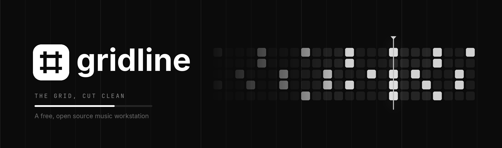
</p>

<h3 align="center">A free, open source music workstation built around the grid.</h3>

<p align="center">
  Channel rack, step sequencer, piano roll, playlist and mixer, written from scratch in C++17 and built to run everywhere.
</p>

<p align="center">
  
  
  
  
  
</p>

<p align="center">
  <a href="https://github.com/lolitemaultes/Gridline/releases/latest"></a>
  &nbsp;
  <a href="https://discord.gg/hGXRCcNvjC"></a>
  &nbsp;
  <a href="https://www.reddit.com/r/GridlineDAW/"></a>
</p>

<p align="center">
  <a href="#highlights">Highlights</a> &middot;
  <a href="#download">Download</a> &middot;
  <a href="#screenshots">Screenshots</a> &middot;
  <a href="#features">Features</a> &middot;
  <a href="#building-from-source">Build</a> &middot;
  <a href="#documentation">Docs</a> &middot;
  <a href="#community">Community</a>
</p>

<br>

<p align="center">
  <a href="https://www.youtube.com/watch?v=DCNx7LjV0Pc">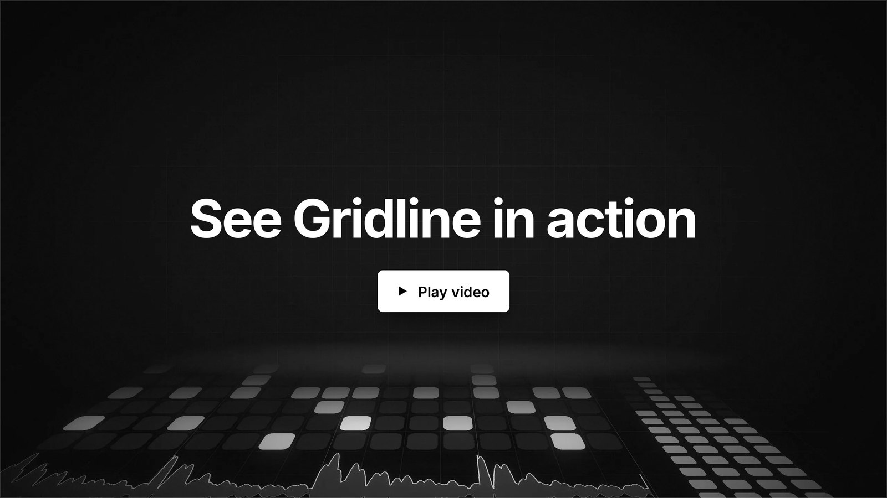</a>
</p>

## Highlights

<table>
<tr>
<td width="33%" valign="top">

**Make music together**<br>
Work on one project live with other people, peer to peer and end-to-end encrypted. No server, no account.

</td>
<td width="33%" valign="top">

**179 instruments and effects**<br>
Led by the flagships Plasma, Seltmann, Platter, Tideline, Chater and Loupe, each with its own editor.

</td>
<td width="33%" valign="top">

**The Gridline Suite**<br>
121 of Gridline's own instruments and effects as VST3, CLAP and AU plugins for any DAW.

</td>
</tr>
<tr>
<td valign="top">

**Real plugins, real interfaces**<br>
Host VST3, CLAP, VST2, AU and LV2 plugins with their own interface, optionally sandboxed.

</td>
<td valign="top">

**DJ decks and a sample chopper**<br>
Platter puts two decks and a mixer on a channel. Seltmann finds the tempo, chops and flips any audio.

</td>
<td valign="top">

**One smooth stretch engine**<br>
Clips, the sampler, slices and Platter share one engine that sounds the same live and in a render.

</td>
</tr>
<tr>
<td valign="top">

**Split stems on your computer**<br>
Separate any clip into vocals, drums, bass and other, right onto new tracks.

</td>
<td valign="top">

**A mixer that keeps time**<br>
Delay compensation, parallel processing, sidechains and a Stage view. Renders are bit-identical.

</td>
<td valign="top">

**Runs everywhere**<br>
Windows, macOS, Linux, FreeBSD, OpenBSD and NetBSD, on x86 and ARM.

</td>
</tr>
</table>

## Download

Get the files for your system from the [latest release](https://github.com/lolitemaultes/Gridline/releases/latest).

| System | Architectures | Files |
|---|---|---|
| **Windows 10 / 11** | x64, ARM64 | `-setup.exe` installer or portable `.zip` |
| **macOS 11 or later** | Apple Silicon and Intel (universal) | `.dmg` with the app, the command line tool and the VST3, CLAP and AU plugins |
| **Linux** | x86_64, aarch64 | `.AppImage`, `.deb` (Debian, Ubuntu), `.rpm` (Fedora, openSUSE) or `.tar.gz` |
| **Debian 11 to 13, Ubuntu 22.04+** | amd64, arm64 | `.deb`, see [docs/debian.md](docs/debian.md) |
| **FreeBSD, OpenBSD, NetBSD** | x86_64 | `.tar.gz`, built and tested on each system |
| **Chromebooks** | Intel, AMD, ARM | the Linux `.deb` in the Linux development environment, see [docs/chromeos.md](docs/chromeos.md) |

Every app download also carries the [Gridline Suite](docs/gridline-suite.md) and Gridline Suite Mini plugins.

### Only the plugins

For other music programs, without the app. Gridline Suite (121 instruments and effects) and Gridline Suite Mini (35 compact effects) each come two ways:

| Way | macOS | Windows | Linux | FreeBSD, OpenBSD, NetBSD |
|---|---|---|---|---|
| **Installer**: tick the plugins and formats you want | `Gridline-Suite-<version>-macos-universal.pkg` | `Gridline-Suite-<version>-windows-setup.exe` (x64 and ARM64) | `Gridline-Suite-<version>-linux-x86_64-setup.run` (or `aarch64`) | `Gridline-Suite-<version>-<system>-x86_64-setup.run` |
| **All plugins**: every plugin and format, no installer | `Gridline-Suite-<version>-macos-all.zip` | `...-windows-all.zip` | `...-linux-all.zip` | `...-bsd-all.zip` |

Suite Mini files are named the same way with `Gridline-Suite-Mini-`. Formats: VST3 and CLAP everywhere, Audio Unit on macOS.

**Which file do I want?**

- You want Gridline itself: take the app download for your system. It includes every Gridline plugin.
- You only want the plugins in another music program: take the **installer** for your system and tick the plugins and formats you want, even just one. Run it again to change your picks.
- You cannot or do not want to run an installer: take the **all plugins** zip and copy the folders yourself (a README inside says where).
- Not sure about the format: CLAP or VST3 work in most programs; Audio Unit is for macOS programs that only take Audio Units.

<details>
<summary><b>Install notes: checksums, unsigned builds, Wayland and betas</b></summary>

<br>

- **Checksums.** Every release lists SHA-256 checksums in `Gridline-<version>-SHA256SUMS`.
- **Unsigned builds.** The builds are not signed by Apple or Microsoft. On macOS, open the app the first time with right-click, Open. On Windows, choose "More info", then "Run anyway" in the SmartScreen prompt.
- **Plugin installer on macOS.** The `.pkg` is not signed by Apple either. If macOS says it cannot verify it, open System Settings > Privacy & Security, scroll down and click Open Anyway, then open the installer again. Plugins copied from a zip may need the download flag removed before a music program can open them: `xattr -dr com.apple.quarantine ~/Library/Audio/Plug-Ins/VST3/Gridline\ Suite` (the same for the CLAP and Components folders). The installer does not need this.
- **Plugin installer on Linux and BSD.** Run it with `sh Gridline-Suite-<version>-linux-x86_64-setup.run`. It installs for your user (`~/.vst3`, `~/.clap`) without root, or system-wide with `--system`; `--help` lists the scripted options, and `--uninstall` removes it.
- **Plugin update check.** The plugins look for a new version at most once a day, send no personal data, show a notice with a Download button and never install anything by themselves. Turn it off in any plugin's menu or in the installer ([docs/updates.md](docs/updates.md)).
- **Debian and Ubuntu.** Install with `sudo apt install ./Gridline-<version>-linux-amd64.deb`.
- **Wayland.** Gridline runs natively through SDL. Hosted plugin interfaces are X11 windows and open through XWayland. Windows outside the main window need X11 or XWayland (`SDL_VIDEODRIVER=x11`). See [docs/wayland.md](docs/wayland.md).
- **Beta versions** are published as GitHub [Pre-releases](https://github.com/lolitemaultes/Gridline/releases). The update check offers them only when **Include beta versions** is ticked in Settings > General > Updates. It never installs anything by itself ([docs/updates.md](docs/updates.md)).

The [release notes](https://github.com/lolitemaultes/Gridline/releases/latest) have the install steps for each system.

</details>

## Screenshots

<table>
<tr>
<td width="50%">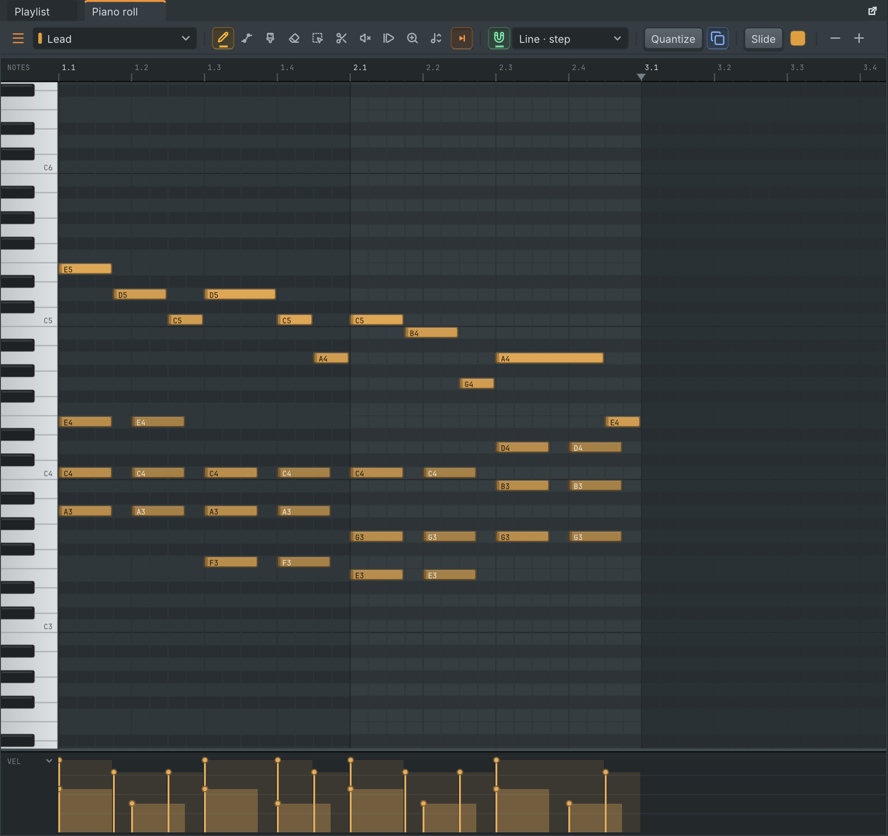</td>
<td width="50%">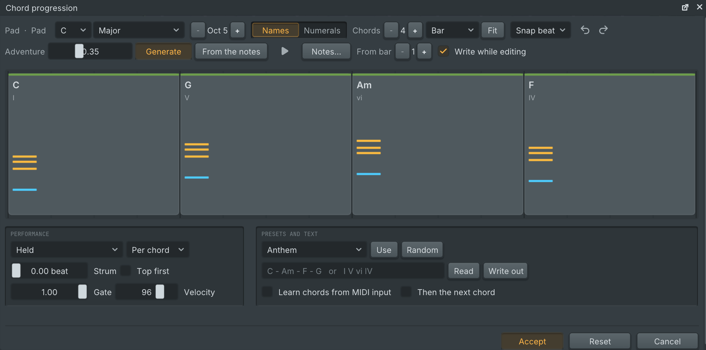</td>
</tr>
<tr>
<td><b>Piano roll.</b> Slides, pitch bend drawn on each note, ghost notes, scale highlighting, and tools to quantize, chop, strum, arpeggiate and randomize.</td>
<td><b>Chord progressions.</b> Pick a key, generate or type a progression, shape rhythm and voicing, and write it into the pattern.</td>
</tr>
<tr>
<td width="50%">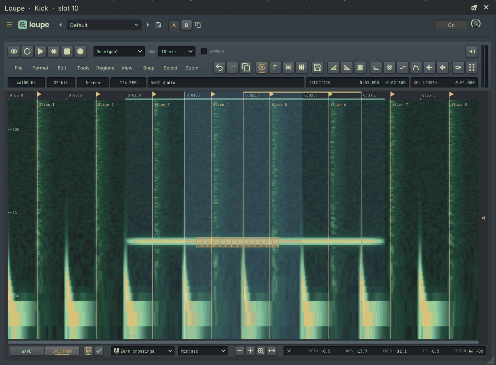</td>
<td width="50%">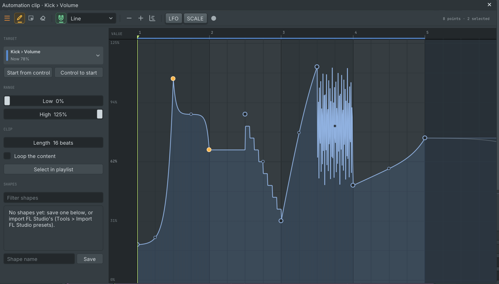</td>
</tr>
<tr>
<td><b>Loupe, the audio editor.</b> Waveform and spectral views, markers, time stretch and pitch shift, noise reduction, beat slicing and loudness readouts.</td>
<td><b>Automation.</b> Thirteen curve shapes, tension handles, an LFO tool, a shape library and recording from knob moves, in the playlist or inside a pattern.</td>
</tr>
<tr>
<td width="50%">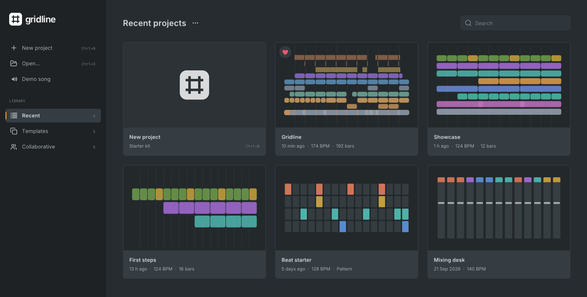</td>
<td width="50%">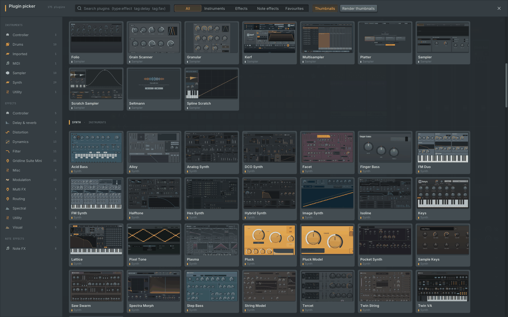</td>
</tr>
<tr>
<td><b>Welcome screen.</b> Recent projects with a sketch of each arrangement, favourites, templates, search and the Collaborative view.</td>
<td><b>Plugin picker.</b> Every instrument and effect with a preview of its editor, by category, with search and favourites.</td>
</tr>
</table>

<p align="center">
  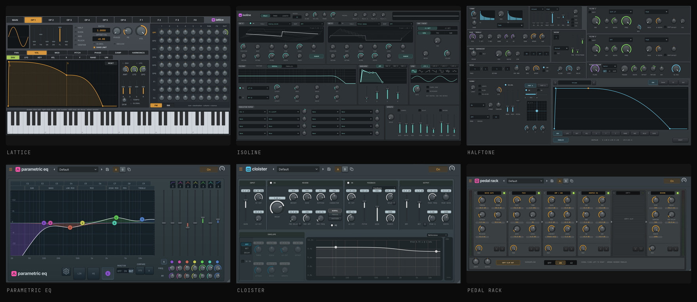
</p>

## Features

### Workflow

- **Pattern workflow.** Build loops in the channel rack, arrange them as clips in the playlist and mix them on inserts. Patterns, audio and automation share the same tracks.
- **Four window layouts.** Arrange the main window as Studio, Clips (a launch grid and a device band), Smooth (the tracks in the centre and one shared pane below) or Tracker (a pattern editor typed from the keyboard), always in your own theme. All four show the same project, so you can switch at any time.
- **Meter changes, MPE and slides.** A song can change meter as it goes. MPE keyboards play every built-in instrument note by note, and each note's pressure and timbre record, edit and play back. Slide notes glide on every instrument.
- **Layers and SFZ.** Layer channels split and stack instruments by key and velocity. The Multisampler plays SFZ instruments.
- **Tracker modules.** Open `.xm` and `.mod` modules as projects, played by the Tracker Sampler, which also works as a sampler for your own sounds.
- **Welcome screen.** Recent projects, favourites, templates and the demo song. Big projects load in a window that counts every sample and plugin, and Cancel takes you back.
- **Windows on every monitor.** Pop the mixer, piano roll, browser or any Gridline plugin editor out into its own window and put it on another screen.
- **Your look, your sounds.** Five control styles (Slate, Graphite, Hairline, Lumen and Classic), light and dark themes, your own accent and role colours, and interface sound themes.

### Recording, editing and mixing

- **Recording.** Audio input with latency compensation and input monitoring, take lanes you comp by dragging, quick punch, a Record window with every setting, and MIDI learn on every control.
- **Clip editing.** Several selected audio clips change together. Stretched clips follow the project tempo; clips you never stretched keep their audio when the tempo changes.
- **Stretch and pitch.** One continuous engine, from half speed to four times and an octave either way. Pick Stretch, Resample or, for clips and the sampler, Rubber Band.
- **Mixer.** Smooth swing, plugin delay compensation, parallel processing on several cores, sends, sidechains, groups, stems and a per-track EQ.
- **Stage view.** Place tracks on a stage: left and right, near and far, how wide. Split a big project into rooms. See [docs/stage-view.md](docs/stage-view.md).
- **Hardware.** Mackie Control and HUI surfaces, Hardware Insert for outboard gear with its round trip measured, MIDI Out to other channels, and MIDI devices picked up when you plug them in. See [docs/midi-devices.md](docs/midi-devices.md).
- **Split stems and Import from URL.** Separate a clip into four or six stems on your own computer ([docs/stems.md](docs/stems.md)), or bring a web page's audio in as a lossless WAV clip ([docs/import-url.md](docs/import-url.md)).
- **Track Receipt.** Help > Track Receipt... measures which parts of which original recordings a project plays and writes a spreadsheet and a PDF for sample licensing. A helper, not legal advice.

### Instruments and effects

179 built-in instruments and effects. Every one has its own editor, every gesture in it is one undo step, and double-clicking a knob resets it (or lets you type a value when it is already at its default).

<details>
<summary><b>The instruments and effects</b></summary>

<br>

**Flagships**

| Name | What it is |
|---|---|
| **Plasma** | Wavetable hybrid synth |
| **Seltmann** | Automatic sample chopper |
| **Platter** | Two DJ decks and a mixer |
| **Tideline** | Tempo-synced ducking, triggered by a mixer track, a channel's notes and clips or MIDI |
| **Chater** | Dreamy, spacey glitch: soft breaks, glitter, tape haze and a long shimmering hall |
| **Loupe** | Audio editor |

**More instruments and effects**

| Name | What it is |
|---|---|
| **Lattice** | Six-operator FM |
| **Isoline** | Wavetable |
| **Facet** | Additive |
| **Halftone** | Resynthesis |
| **Tercet** | Three-oscillator synth |
| **Abacus** | Drum pads |
| **Kerf** | Region slicer that cuts on the beat grid |
| **Pixel Tone** | Plays your own pictures |
| **Turntable** | Scratch a sample on a platter |
| **Folio** | Sampler |
| **Shuttle** | Time and volume |
| **Tracer** | Delay |
| **Cloister** | Reverb |
| **Crest** | Mastering |
| **Cipher** | Vocoder |
| **Plumb** | Pitch correction |
| **Junction** | Patching: modules and cables, parallel paths, sidechains, feedback and eight macros |
| **Graticule** | Scope |

Around them: plain-named EQs, dynamics, modulation, physical models and utilities, plus Gridline Suite Mini, 35 compact single-purpose effects.

</details>

<details>
<summary><b>Plasma, the wavetable hybrid synth</b></summary>

<br>

<p align="center">
  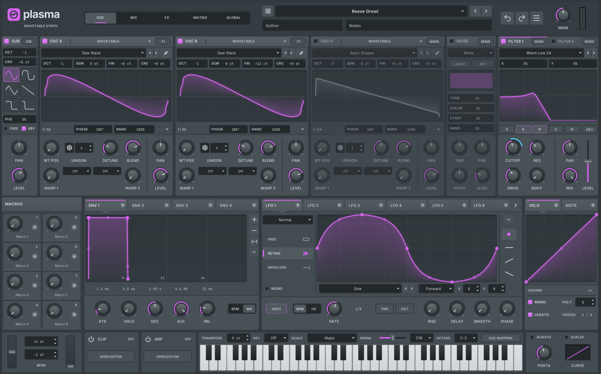
</p>

- **Sources.** Three layers that each play a wavetable, a multisample, a sample, a granular cloud or a spectral resynthesis, plus a Root oscillator and a Texture layer.
- **Morphing.** Two morph slots per layer with 103 modes (FM, PD, AM and RM among them), and stacks of up to 16 voices.
- **Filters.** Two filters with 106 types.
- **Movement.** 4 envelopes, 10 drawable LFOs, 8 macros and key, touch and chance sources. Drag a source's dot onto any control to link it: 64 links in all.
- **Effects and play.** Three effect lanes with up to 24 effects, an arpeggiator, a phrase player and a table editor.
- **Two views.** The Synth tab shows blocks in signal order. Press Tab for the Patch view, which draws the same sound as boxes and wires.
- **Presets.** Plasma can also read presets of some third-party wavetable synths. Nothing from another product ships with Gridline.

<p align="center">
  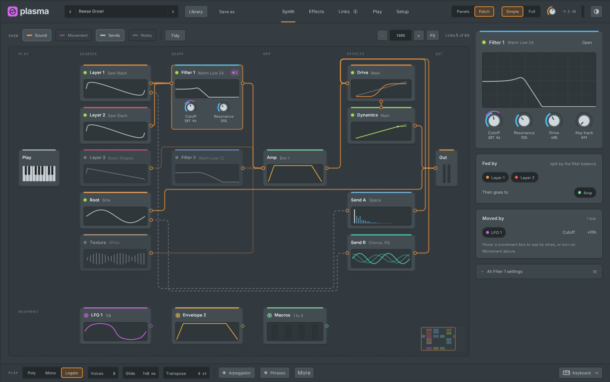
</p>

See [docs/plugins/plasma.md](docs/plugins/plasma.md).

</details>

<details>
<summary><b>Platter, two DJ decks on a channel</b></summary>

<br>

<p align="center">
  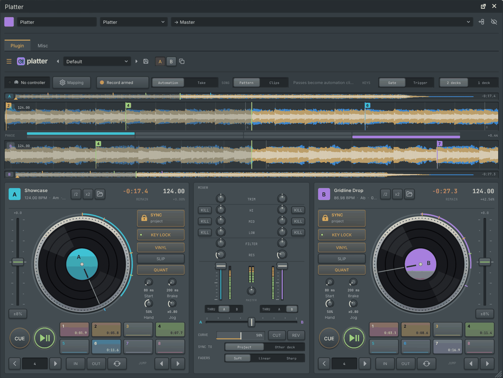
</p>

- **Decks.** Drop a track and Platter finds its tempo and beat grid. Key lock, cue and play, eight hot cues, loops, beat jumps, slip mode, motor start and brake, and stacked three-band colour waveforms.
- **Mixer.** Trim, a three-band EQ with kills, a filter per channel, channel faders and a crossfader with assign, curve, cut and reverse.
- **Scratching.** A jog wheel sets the record's speed, a mouse drag follows the hand, and a fast release throws the record.
- **DJ controllers.** Ready mappings for the Pioneer DDJ-200, Hercules DJControl Inpulse 200 and Numark Mixtrack Pro FX, with LEDs that follow each deck. Any other controller maps through MIDI learn.
- **Recorded performances.** What you play becomes plain, editable automation that replays exactly as played. See [docs/plugins/platter-recording.md](docs/plugins/platter-recording.md).

Platter is part of the Gridline Suite, so it also runs in other DAWs.

</details>

<details>
<summary><b>Seltmann, the automatic sample chopper</b></summary>

<br>

<p align="center">
  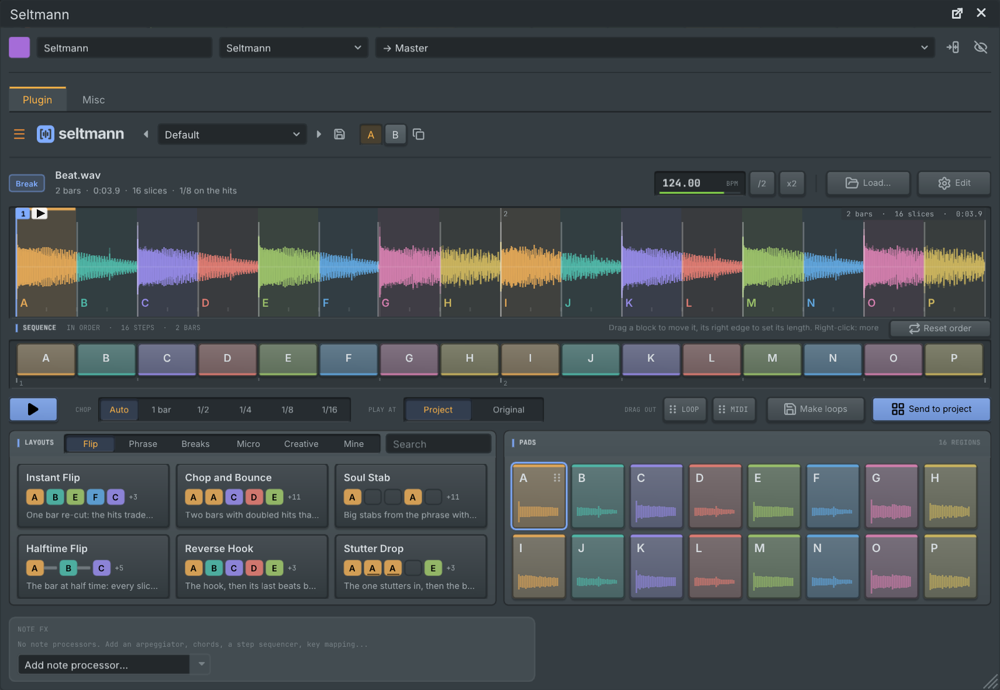
</p>

Drop in any audio (a break, a loop, a whole song, a one-shot or a texture). Seltmann works out what it is, its tempo and where bar 1 starts, chops it into lettered regions, and plays as soon as you pick one of 59 layout cards.

- **Sequence lane.** Reorder, split and join regions; drag the cut between two regions to resize both.
- **Per-region and per-step pitch.** Drag a readout or turn the mouse wheel over it.
- **Steps with their own length.** Drag a block's right edge to shorten or lengthen that step.
- **Record from an input** with pause, a level meter and the take drawn as it records.
- **Drag out** the result as a loop, MIDI or a pattern. See [docs/plugins/seltmann.md](docs/plugins/seltmann.md).

</details>

### Work together

<p align="center">
  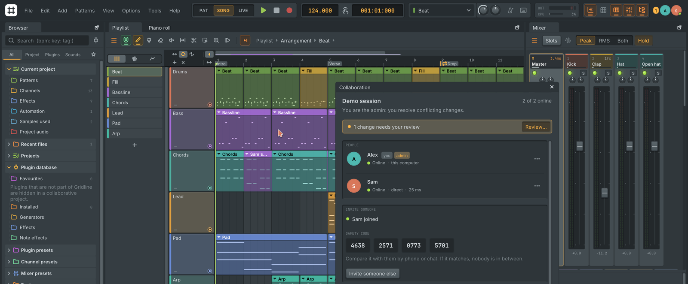
</p>

Two or more people can work on one project at the same time, on the same network or across the internet. Invite someone with a one-time code; each collaborator gets a colour, a cursor and a picture, and everyone keeps their own windows, transport and sound.

<details>
<summary><b>How collaboration works</b></summary>

<br>

<p align="center">
  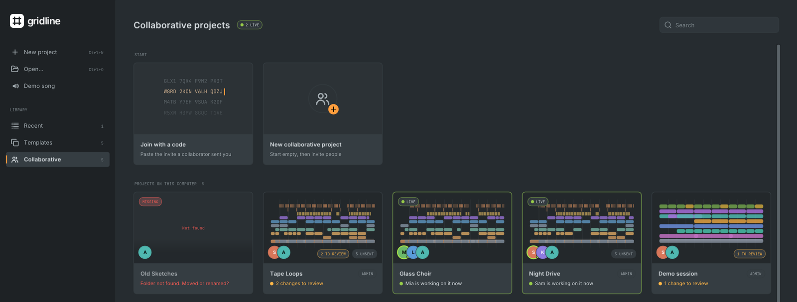
</p>

- **No server, no account.** Computers connect peer to peer: directly, by hole punching (ICE with STUN), through automatic router port opening (UPnP-IGD, NAT-PMP, PCP), through another collaborator or an optional TURN relay. **Test my connection** reports what your network allows.
- **Invites** are one-time codes that expire (15 minutes to 24 hours). Both sides see the same safety code to compare.
- **Real-time sync.** Channels, notes, the playlist, the mixer, automation, Gridline plugin settings and audio files sync in a fraction of a second. **Follow their playhead** listens along.
- **Presence.** Collaborators' cursors point at the same track, note, step or knob on every screen, and their changes flash in their colour.
- **Safe.** End-to-end encrypted (X25519, XChaCha20-Poly1305), every change signed by its author, saved in a crash-safe log. Undo takes back only your own changes.
- **The Collaborative view** on the welcome screen lists every collaborative project with its members, your role and who is working on it right now.
- Collaborative projects use Gridline's own plugins only, and everyone needs the same, newest Gridline version.

See [docs/collaboration.md](docs/collaboration.md).

</details>

### Plugins

<details>
<summary><b>The Gridline Suite: Gridline's plugins for any DAW</b></summary>

<br>

Every download carries the **Gridline Suite**: 121 instruments and effects (52 instruments, 69 effects) in one bundle per format: `Gridline Suite.vst3`, `Gridline Suite.clap` and, on macOS, `Gridline Suite.component`. **Gridline Suite Mini**, 35 compact effects, ships beside it the same way.

- Same DSP and the same resizable, HiDPI editor as inside Gridline.
- Every parameter named and automatable; effects add **Mix** and **Bypass**.
- Sidechain inputs where an effect uses one, factory presets, and latency reported to the host.
- State is saved the way Gridline saves it, so a sound moves between hosts unchanged.

The Windows, `.deb` and `.rpm` installers put the suite where hosts find it. On macOS, the AppImage and the `.tar.gz` builds, Gridline offers to copy it into your plug-in folders on first launch. See [docs/gridline-suite.md](docs/gridline-suite.md).

</details>

<details>
<summary><b>Plugin hosting: VST3, CLAP, VST2, AU and LV2</b></summary>

<br>

<p align="center">
  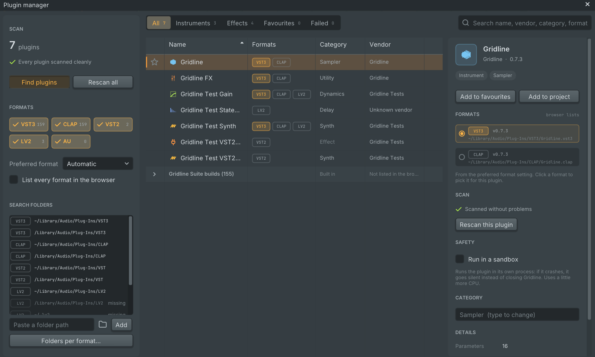
</p>

- **Plugin manager.** Each plugin once, with its formats, a clean category, favourites and a details panel. Pick a preferred format globally or per plugin.
- **Own interfaces.** A plugin opens with its own interface and a slim Gridline bar for presets, bypass, sandbox, CPU and latency. Edits in it can be undone.
- **Safe scanning.** Plugins are scanned in a child process, so a plugin that crashes, hangs or uses too much memory is blocked instead of taking Gridline down.
- **Sandbox.** Run a plugin in its own process. If it crashes, Gridline keeps playing and you can reload it.
- **Host features.** Transport and tempo, sample-accurate notes and parameters, sidechain input, MIDI output, offline render mode, latency reporting, CLAP parameter modulation and preset discovery.
- **LV2** is read directly from each bundle's Turtle files, with presets, state, the worker and latency.
- **Missing plugins.** A few popular third-party synths and effects that are not installed play through a Gridline stand-in, while the original and its state stay in the project untouched. Installed plugins are always hosted as themselves.
- **Compatibility sweep.** `gridline plugin-check` tests every scanned plugin at several sample rates and buffer sizes.

| Format | Where Gridline looks |
|---|---|
| VST3 | `~/Library/Audio/Plug-Ins/VST3`, `/Library/Audio/Plug-Ins/VST3`; Windows `Common Files\VST3`, `%LOCALAPPDATA%\Programs\Common\VST3`; Linux / BSD `~/.vst3`, `/usr/lib/vst3`, `/usr/local/lib/vst3` |
| CLAP | `.../Plug-Ins/CLAP`; Windows `Common Files\CLAP`, `%LOCALAPPDATA%\Programs\Common\CLAP`; Linux / BSD `~/.clap`, `/usr/lib/clap`, `/usr/local/lib/clap`; `$CLAP_PATH` |
| VST2 | `.../Plug-Ins/VST`; Windows `Program Files\VSTPlugins`, `Program Files\Steinberg\VSTPlugins`, `Common Files\VST2`; Linux / BSD `~/.vst`, `/usr/lib/vst`; `$VST_PATH` |
| AU (macOS) | the system component registry |
| LV2 | `~/Library/Audio/Plug-Ins/LV2`, `/Library/Audio/Plug-Ins/LV2`, `~/.lv2`, `/usr/local/lib/lv2`; on Linux `~/.lv2`, `/usr/local/lib/lv2`, `/usr/lib/lv2`; `$LV2_PATH` |

VST2 support uses Gridline's own description of the binary interface; no VST2 SDK code is included. No plugin binaries are shipped.

</details>

<details>
<summary><b>Gridline as a plugin inside another DAW</b></summary>

<br>

The same build produces Gridline itself as a CLAP, VST3 and (on macOS) Audio Unit plugin, so the whole workstation runs inside another host.

| Plugin | Kind | Audio | MIDI |
|---|---|---|---|
| **Gridline** | instrument | stereo out, plus 15 stereo outputs for mixer inserts 1 to 15 | in |
| **Gridline FX** | effect | stereo in, sidechain in, stereo out | in (CLAP, VST3) |

- **Transport.** Follows the host's transport, tempo and position by default.
- **MIDI input** plays the selected channel, or MIDI channels 1 to 16 play rack channels 1 to 16.
- **Host parameters** are 16 macros. Right-click any control and choose **Link to host macro**.
- **State** is the whole project. Latency is reported to the host, and renders are identical from run to run.
- **Installed plugins** scanned by the Gridline app load inside it with their own interfaces.

```sh
cmake --build build --target gridline_clap gridline_vst3   # build/plugins/Gridline.clap, Gridline.vst3
cmake --build build --target gridline_au                   # macOS: build/plugins/Gridline.component
cmake --build build --target install-plugins               # copy the bundles into your user plugin folders
```

</details>

### Projects and files

- **Demo song.** File > New from template > Demo song opens "Gridline", a 4:25 liquid drum & bass track at 174 BPM made only with the built-in instruments, effects and automation: no samples.
- **Project files** are versioned JSON, saved as `.gridline` (or `.gridlinez`, zipped with their samples). Older files are upgraded on load.
- **Import and export.** MIDI files, DAWproject files, audio export (WAV, FLAC, MP3, OGG, M4A) and stems.
- **Scripting and remote control.** Sandboxed Lua scripts, an optional, off by default MCP server for AI assistants, and OSC in and out.

<details>
<summary><b>Opening and saving <code>.flp</code> projects</b></summary>

<br>

Gridline opens `.flp` projects, zipped loop packages (`.zip`) and `.fst` presets, so existing work can be brought across. **File, Open** (or drag and drop) opens them like any project; saving asks where and in which format, so the original is never overwritten unasked.

- Channels, patterns, notes, playlist clips, automation, markers and mixer routing are imported.
- Stock instruments and effects are mapped to their Gridline equivalents with their settings.
- Third-party plugins load as the installed plugin with their saved state, or stay as placeholders until installed.
- Projects can be saved back to `.flp`, or as a zipped loop package with every sample. Unchanged parts are written back exactly as imported.
- Gridline instruments without a counterpart are written as Gridline Suite plugins (VST3), with muted audio copies by default, or as Suite plugins only, or rendered to audio.

From the command line: `gridline export-flp song.gridline -o song.flp --gridline-plugins fallback|suite|render`.

</details>

<details>
<summary><b>Command line</b></summary>

<br>

```sh
build/gridline demo    song.gridline                        # write the demo song to a project file
build/gridline info    song.gridline                        # inspect a project
build/gridline render  song.gridline -o out.wav --bits 24   # render to audio (also .flac, .mp3, .ogg, .m4a, --stems)
build/gridline export-midi song.gridline -o song.mid        # write a MIDI file
build/gridline import-midi song.mid -o song.gridline        # read a MIDI file
build/gridline zip     song.gridline -o song.gridlinez      # project plus samples
build/gridline export-flp-zip song.gridline -o song.zip     # zipped .flp loop package
build/gridline plugin-check --all --json report.json        # plugin compatibility sweep
build/gridline bench   song.gridline                        # load, save and render timings
build/gridline seltmann-analyse loop.wav                    # tempo, kind and slices Seltmann hears
build/gridline track-receipt song.gridline --out receipt/   # which parts of which original recordings are used
build/gridline mcp     song.gridline                        # MCP server for AI assistants (docs/mcp.md)
build/gridline collab-run --test-connection                 # router type, port mapping and IPv6 for collaboration
build/gridline suite status|install|remove                  # manage the Gridline Suite plugins
```

</details>

## Building from source

Gridline needs CMake, a C++17 compiler and SDL2. Everything else is bundled in `third_party/`.

```sh
# macOS
brew install cmake sdl2

# Debian / Ubuntu
sudo apt install build-essential cmake pkg-config libsdl2-dev libgl-dev libasound2-dev libjack-jackd2-dev libx11-dev

cmake -S . -B build -DCMAKE_BUILD_TYPE=Release
cmake --build build -j4         # a fixed job count: a bare -j can run out of memory
ctest --test-dir build          # 305 tests
./build/gridline-app            # start the app
```

<details>
<summary><b>Other systems and build options</b></summary>

<br>

```sh
# Fedora
sudo dnf install cmake gcc-c++ SDL2-devel alsa-lib-devel libX11-devel mesa-libGL-devel
# Arch
sudo pacman -S cmake sdl2 alsa-lib libx11 mesa
# FreeBSD
pkg install cmake ninja sdl2 libX11 sndio
# OpenBSD
pkg_add cmake ninja sdl2
```

On **Windows** (Visual Studio 2022 or its Build Tools, from a developer command prompt), SDL2 is built from source:

```bat
cmake -S . -B build -G Ninja -DCMAKE_BUILD_TYPE=Release -DGRIDLINE_BUNDLED_SDL2=ON
cmake --build build
ctest --test-dir build
build\gridline-app.exe
```

- **Plugins.** `cmake --build build --target gridline_suite_gridline` builds the Gridline Suite into `build/plugins/`.
- **Core only.** `./build.sh` builds the command line tool, runs the core tests and renders the demo song.
- **CI.** Every change is built and tested on each system above; `tools/ci/install-deps.sh` installs the dependencies.
- **Audio and MIDI.** Audio goes through SDL (Core Audio, WASAPI, ALSA / PulseAudio / PipeWire / JACK, sndio / OSS). MIDI goes through RtMidi (CoreMIDI, Windows Multimedia, ALSA, JACK) and sndio on the BSDs. See [docs/midi-devices.md](docs/midi-devices.md).

</details>

<details>
<summary><b>Architecture</b></summary>

<br>

| Area | Where | What it does |
|---|---|---|
| Model | `src/core/Song`, `Types`, `Document`, `Undo` | Channels, patterns, clips and mixer with stable ids. Every edit is an undoable command. |
| Project files | `src/core/Project`, `Json` | Versioned JSON with migration, validation and atomic saves. |
| Engine | `src/engine/AudioEngine`, `Program`, `ProgramGraph` | Real-time engine with delay compensation and a parallel mixer graph. |
| Plugins | `src/packs/`, `src/engine/` | The built-in instruments and effects, one pack per family. |
| Hosting | `src/host/` | VST3, CLAP, VST2, AU and LV2 backends, scanning, sandbox and editor windows. |
| Collaboration | `src/collab/` | Invites, connections, encryption, the shared change log and file transfer. |
| Gridline as a plugin | `src/plugin/` | CLAP, VST3 and Audio Unit entry points, transport, macros, state and the embedded editor. |
| Interface | `src/app/` | SDL2, OpenGL 3 and Dear ImGui. Controls are drawn in code; icons are SVG files rasterised at the screen's pixel size. |
| Import and export | `src/core/flp/`, `src/core/MidiFile`, `src/engine/Export` | Project import, MIDI, audio export and stems. |

</details>

## Documentation

| Topic | Guides |
|---|---|
| **Editing** | [Automation](docs/automation.md), [Piano roll](docs/piano-roll.md), [Playlist](docs/playlist.md), [Mixer](docs/mixer.md), [Stage view](docs/stage-view.md), [Layers](docs/layers.md), [Slide notes](docs/slide-notes.md), [Meter changes](docs/meter-changes.md) |
| **Audio** | [Recording](docs/recording.md), [Split stems](docs/stems.md), [Import from URL](docs/import-url.md), [Warp markers](docs/warp-markers.md), [Freeze](docs/freeze.md), [Loop files](docs/loop-files.md), [SFZ](docs/sfz.md), [Drum kits](docs/drum-kits.md), [Sound library](docs/sound-library.md), [Speech](docs/speech.md) |
| **Plugins** | [Gridline Suite](docs/gridline-suite.md), [Plasma](docs/plugins/plasma.md), [Chater](docs/plugins/chater.md), [Seltmann](docs/plugins/seltmann.md), [Tideline](docs/plugins/tideline.md), [Synths pack](docs/plugins/synths.md), [Platter recording](docs/plugins/platter-recording.md), [Plugin window](docs/plugin-window.md) |
| **Working together** | [Collaborative projects](docs/collaboration.md) |
| **Interface** | [Themes](docs/themes.md), [Detachable windows](docs/detachable-windows.md), [Command palette](docs/command-palette.md), [Workspaces](docs/workspaces.md), [Typing keyboard](docs/typing-keyboard.md) |
| **Hardware** | [MIDI devices](docs/midi-devices.md), [MPE](docs/mpe.md), [CV and gate](docs/cv-gate.md), [ASIO on Windows](docs/asio.md), [Game controller](docs/game-controller.md) |
| **Systems** | [Debian and Ubuntu](docs/debian.md), [Chromebooks](docs/chromeos.md), [Wayland](docs/wayland.md), [Opening files](docs/opening-files.md), [DAWproject](docs/dawproject.md), [Updates](docs/updates.md) |
| **Automation and scripting** | [Lua scripting](docs/scripting.md), [AI assistants (MCP)](docs/mcp.md), [OSC](docs/osc.md) |

[CHANGELOG.md](CHANGELOG.md) lists what changed in each version.

## Community

<p>
  <a href="https://discord.gg/hGXRCcNvjC"></a>
  &nbsp;
  <a href="https://www.reddit.com/r/GridlineDAW/"></a>
</p>

Join the [Gridline Discord](https://discord.gg/hGXRCcNvjC) or [r/GridlineDAW](https://www.reddit.com/r/GridlineDAW/) on Reddit to share tracks, ask questions, report bugs and follow development.

**Contributing.** Bug reports, ideas and pull requests are welcome on [GitHub](https://github.com/lolitemaultes/Gridline). Please build and run the tests (`ctest --test-dir build`) before opening a pull request.

## License

Gridline is free software, released under the GNU General Public License v3.0 (see `LICENSE`).

<details>
<summary><b>Third-party licences and credits</b></summary>

<br>

- Bundled libraries keep their own licences, all GPL-compatible: Dear ImGui (MIT), Lua 5.4 (MIT), RtMidi (MIT-style), Signalsmith Stretch and Signalsmith Linear (MIT), the Rubber Band Library (GPL-2.0-or-later, used under the GPL-3.0), CLAP headers (MIT), VST3 plug-in interfaces (MIT), LV2 headers (ISC), dr_libs and stb_vorbis (public domain or MIT-0), nanosvg (zlib), and for collaborative projects libjuice and libplum (MPL-2.0), Monocypher (BSD-2-Clause or CC0), stb_image and stb_image_write (public domain or MIT). See `third_party/NOTICE.md` and each folder under `third_party/`.
- The ASIO backend on Windows uses Steinberg's ASIO interface under the GPLv3 option of its dual licence; no SDK file is included (see [docs/asio.md](docs/asio.md)). ASIO is a trademark of Steinberg Media Technologies GmbH.
- The interface icons in `assets/icons/ui/` use geometry from Lucide (ISC) and Tabler Icons (MIT); see `assets/icons/ui/NOTICE.md`.
- Platter's scratch mechanics follow the approach of [Mixxx](https://github.com/mixxxdj/mixxx) (GPL-2.0-or-later); no Mixxx code is included.
- Gridline is an independent project. Trademarks of other products are used only to describe file and plugin compatibility.

</details>

<sub>The README artwork is generated by `tools/make_readme_art.py` from Gridline's brand assets and screenshots of the app taken by `tools/readme_shots.sh`.</sub>
