<p align="center">
  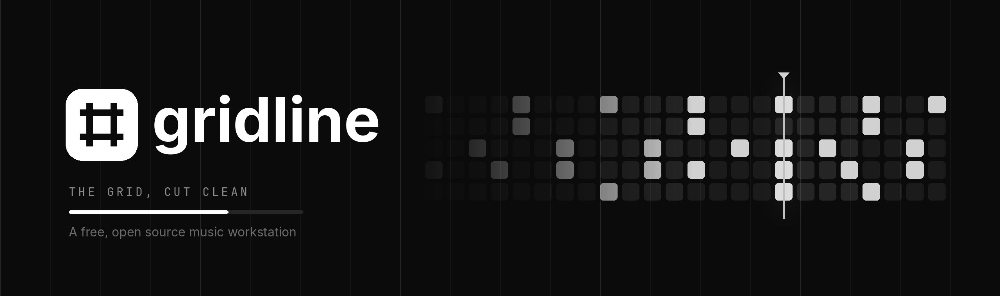
</p>

<p align="center">
  
  
  
  
</p>

<p align="center">
  <b>A free, open source music workstation built around the grid.</b><br>
  Channel rack, step sequencer, piano roll, playlist and mixer,<br>
  written from scratch in C++17 and built to run everywhere.
</p>

<p align="center">
  <a href="https://github.com/lolitemaultes/Gridline/releases/latest"><b>Download the latest release</b></a>
  &nbsp;&middot;&nbsp; Windows, macOS, Linux, FreeBSD, OpenBSD and NetBSD, on x86 and ARM
</p>

<br>

<p align="center">
  <a href="https://www.youtube.com/watch?v=DCNx7LjV0Pc">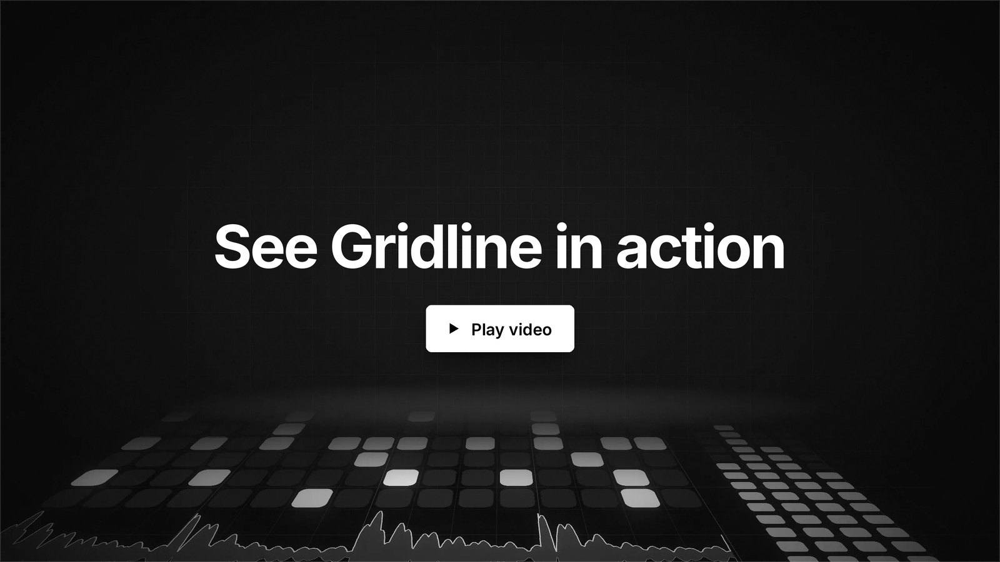</a>
</p>

## Download

Get the files for your system from the [latest release](https://github.com/lolitemaultes/Gridline/releases/latest):

- **Windows 10 / 11** (x64 and ARM64): `-setup.exe` installer, or a portable `.zip`.
- **macOS 11 or later**: one `.dmg` with a universal app for Apple Silicon and Intel, the command line tool and the VST3, CLAP and AU plugins. Every download also carries the [Gridline Suite](docs/gridline-suite.md), Gridline's instruments and effects as plugins for other DAWs.
- **Linux** (x86_64 and aarch64): `.AppImage` for most distributions, `.deb` for Debian and Ubuntu, `.rpm` for Fedora and openSUSE, or a `.tar.gz`.
- **Debian 11, 12 and 13, Ubuntu 22.04 and later** (amd64 and arm64): the `.deb`, installed with `sudo apt install ./Gridline-<version>-linux-amd64.deb`. See [docs/debian.md](docs/debian.md).
- **FreeBSD, OpenBSD, NetBSD** (x86_64): a `.tar.gz` built and tested on each system.
- **Chromebooks** (Intel, AMD and ARM): the Linux `.deb`, installed in ChromeOS's Linux development environment. See [docs/chromeos.md](docs/chromeos.md).

Every release lists SHA-256 checksums in `Gridline-<version>-SHA256SUMS`. The builds are not signed by Apple or Microsoft: on macOS open the app the first time with right-click, Open; on Windows choose "More info", then "Run anyway" in the SmartScreen prompt. On Wayland Gridline runs natively through SDL; the interfaces of hosted plugins are X11 windows and open through XWayland, and windows outside the main window need X11 or XWayland (`SDL_VIDEODRIVER=x11`). The [release notes](https://github.com/lolitemaultes/Gridline/releases/latest) have the install steps for each system.

**Beta versions** are published as GitHub [Pre-releases](https://github.com/lolitemaultes/Gridline/releases), next to the stable ones. Gridline's update check offers them only when **Include beta versions** is ticked in Settings > General > Updates; it never installs anything by itself ([docs/updates.md](docs/updates.md)).

## Highlights

<table>
<tr>
<td width="50%" valign="top">

**Make music together.** Work on one project live with other people, on the same network or across the internet, peer to peer and end-to-end encrypted, with no server and no account. Invite someone with a one-time code; each collaborator gets a colour, a cursor and a picture, and everyone keeps their own windows, transport and sound. [More below](#work-together).

**The Gridline Suite.** Gridline's own instruments and effects run in any DAW: 121 plugins as VST3, CLAP and, on macOS, Audio Unit, plus Gridline Suite Mini, 35 compact effects. Every download carries both. [More below](#the-gridline-suite).

**Platter, Seltmann and Turntable.** Platter puts two DJ decks and a mixer on a channel, with scratching that feels like a record, DJ controller mappings and performances recorded as editable automation. Seltmann takes any audio you drop on it or record into it, finds the tempo, chops it and flips it with ready-made layouts. Turntable scratches a sample on a platter.

**Track Receipt.** Help > Track Receipt... measures which parts of which original recordings a project actually plays, merged per song across stems, samplers and plugins, and writes a spreadsheet and a PDF for filling in sample licenses, for example on Tracklib. A helper, not legal advice.

**Junction.** Wire instruments, effects and note processors by hand on a map of modules and cables: parallel paths, sidechains, several outputs, feedback, and eight macros on a panel of their own.

**178 built-in instruments and effects.** A family of flagships with their own names: Plasma (wavetable hybrid), Platter (two DJ decks and a mixer), Lattice (six-operator FM), Isoline (wavetable), Facet (additive), Halftone (resynthesis), Tercet, Abacus (drum pads), Kerf (a region slicer that cuts on the beat grid), Pixel Tone (plays your own pictures), Turntable (scratch a sample on a platter), Folio (sampler), Loupe (audio editor), Shuttle (time and volume), Tracer (delay), Cloister (reverb), Crest (mastering), Cipher (vocoder), Plumb (pitch correction), Junction (patching), Graticule (scope), Tideline (tempo-synced ducking, triggered by a mixer track, a channel's notes and clips or MIDI) and Seltmann (drop in any audio and it finds the tempo, chops it and flips it with ready-made layouts). Around them, plain-named studio tools: EQs, dynamics, modulation, physical models and utilities, and Gridline Suite Mini, 35 compact single-purpose effects. Every one has its own editor with its own wordmark, and every gesture in it (a knob drag, a wheel turn, a drawn stroke, a preset load) is one undo step. Double-click any knob to reset it, or to type a value when it is already at its default.

**Real plugins, real interfaces.** VST3, CLAP, VST2, AU and LV2 instruments and effects open with their own interface, can run sandboxed in a separate process, and are checked by a built-in compatibility sweep. Edits made in a plugin's own interface can be undone too.

</td>
<td width="50%" valign="top">

**Pattern workflow.** Build loops in the channel rack, arrange them as clips in the playlist and mix them on inserts. Patterns, audio and automation all live on the same tracks, and mixer tracks, playlist tracks and channels take icons from a searchable set of 139.

**Window layouts and tracker modules.** Arrange the main window as Studio, or try the Live and Logic previews, always in your own theme. Open .xm and .mod modules as projects, played by the Tracker Sampler, which also works as a sampler for your own sounds with a key map, envelopes and sample editing.

**A welcome screen.** Gridline opens on your recent projects, each with a sketch of its arrangement, its tempo and its length. Mark favourites, start from a template or the demo song, and see in the Collaborative view who is working on a shared project right now. Big projects never freeze the window while they open: a loading window counts every sample and plugin as it loads, logs how long each took, and Cancel takes you back to the project you had open.

**A mixer that keeps time.** Smooth swing for steps and notes alike, plugin delay compensation, parallel processing on several cores, sends, sidechains, groups, stems and a per-track EQ. Offline renders are bit-identical whatever the buffer size.

**Recording and editing.** Audio input with latency compensation, takes drawn with their waveform live as they record, comping, Loupe (the audio editor) with spectral view, automation clips with curves and an LFO tool, on the playlist or inside patterns, MIDI learn on every control. Several selected audio clips change together: a level, fade or pitch change moves each of them by the same amount. Stretched clips follow the project tempo, and clips you never stretched keep their audio when the tempo changes.

**Split stems and Import from URL.** Separate any audio clip into vocals, drums, bass and other (or six stems with guitar and piano) on your own computer, right onto new tracks under the clip ([docs/stems.md](docs/stems.md)). Bring the audio of a web page into the project as a lossless WAV clip ([docs/import-url.md](docs/import-url.md)).

**One smooth stretch and pitch engine.** Clips, the sampler, slices, the audio editor, Platter and the pitch and time effects share one continuous engine that sounds the same live and in a render, from half speed to four times and an octave either way. Pick Stretch (time and pitch apart), Resample (like a turntable) or, for clips and the sampler, Rubber Band. A clip keeps its length when you change its pitch, and Rubber Band notes and clips do their start-up work ahead of time, so a chord or several clips on one beat start without crackles.

**Your look, your sounds.** Five control styles (Slate, the default, plus Graphite, Hairline, Lumen and Classic), light and dark themes with your own accent and role colours, and sound themes for the interface sounds, all in Settings > Theme.

**Windows on every monitor.** Pop the mixer, piano roll, browser or any Gridline plugin editor out into a window of its own and put it on another screen. Detached panels come back where you left them; a plugin window opens inside the main window again until you pop it out. Zooming glides and dragged clips and notes glide between grid lines.

**Scripting, templates and AI assistants.** Sandboxed Lua scripts for the piano roll and for hardware controllers, project templates, a background sample browser with tempo and key search, and an optional, off by default MCP server so AI assistants can read and edit a project.

</td>
</tr>
</table>

**Demo song.** File > New from template > Demo song (or Help > Load demo song) opens "Gridline", a 4:25 liquid drum & bass track (it also greets a new install on its first launch) at 174 BPM made only with the built-in instruments, effects and automation: no samples. It is a full project to take apart, from the felted wooden mallet lead and the moving reese to the rain bed, the buses, the sidechains and the automation lanes. `gridline demo song.gridline` writes it to a file; `tools/make_demo_song.py` is the script that composes it.

## Work together

<p align="center">
  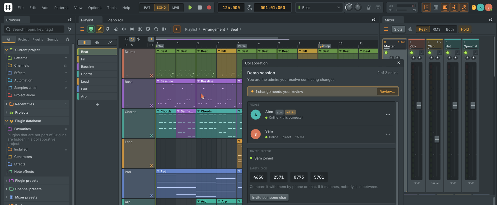
</p>

Collaborative projects let two or more people work on one project at the same time, on the same network or across the internet. See [docs/collaboration.md](docs/collaboration.md).

<p align="center">
  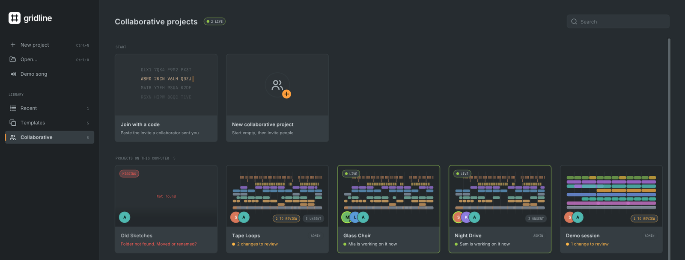
</p>

- **No server, no account.** Computers connect peer to peer: directly, by hole punching (ICE with STUN), through automatic router port opening (UPnP-IGD, NAT-PMP, PCP), through another collaborator or an optional TURN relay. **Test my connection** reports what your network allows.
- **Invites** are one-time codes that expire (15 minutes to 24 hours). The invitee pastes the code in File > Join collaborative project... and both sides see the same safety code to compare.
- **Live:** channels, notes, the playlist, the mixer, automation, Gridline plugin settings and audio files sync in a fraction of a second. Each person keeps their own windows, zoom and transport, and sound stays on each computer; **Follow their playhead** listens along.
- **Presence:** collaborators appear in the top bar with their picture or initials; their cursors, in their colour, point at the same track, note, step or knob on every screen whatever the layout or zoom, and their changes flash in their colour.
- **Safe:** end-to-end encrypted (X25519, XChaCha20-Poly1305), every change signed by its author, saved continuously in a crash-safe log. Undo takes back only your own changes; edits made while apart that touch the same thing go to the admin's Sync review.
- **The Collaborative view** on the welcome screen joins with a code, starts or shares a project and lists every collaborative project on this computer with its members, your role, a Sync review or unsent changes waiting and who is working on it right now. Presence is asked of your collaborators directly, encrypted and only while the view is shown; turn off **Show that I am online to collaborators** to stay out of it.
- Collaborative projects use Gridline's own plugins only, and everyone in a session needs the same, newest Gridline version.

## The Gridline Suite

Every Gridline download also carries the **Gridline Suite**: 121 of Gridline's own instruments and effects (52 instruments, 69 effects), each as a plugin of its own for any DAW (vendor "Gridline"), in one bundle per format: `Gridline Suite.vst3`, `Gridline Suite.clap` and, on macOS, `Gridline Suite.component`. Gridline Suite Mini, 35 compact effects, ships beside it in the same way (`Gridline Suite Mini.vst3`, `.clap`, `.component`). Each plugin is the same DSP and the same editor as inside Gridline:

- **Parameters:** every parameter of the plugin, named, with its range, steps and value text (`1.20 kHz`, `-6.0 dB`), automatable; effects add **Mix** and **Bypass**.
- **Instruments** take MIDI; **effects** have a sidechain input where the effect uses one (Compressor, Limiter, Sidechain Ducker, Cipher, Cloister, Tideline, Transient Split, Hit Repeater); effects that play from notes (Cipher, Plumb, Tideline) also take MIDI.
- **Presets:** the factory presets in the editor's preset menu (and as Audio Unit factory presets).
- **State** is the plugin's state as Gridline saves it, so a sound moves between Gridline and another host unchanged. Latency is reported to the host.
- **Editor:** the plugin's own editor from Gridline, resizable (it zooms to the window) and sharp on HiDPI screens.

The installers put the suite where hosts find it: the Windows installer into `Common Files\VST3` and `Common Files\CLAP`, the `.deb` and `.rpm` into `/usr/lib/vst3` and `/usr/lib/clap`. On macOS, with the AppImage and with the `.tar.gz` builds, Gridline asks on first launch whether to copy the suite into your plug-in folders and keeps it up to date (**Settings, Files, Gridline Suite**, or `gridline suite status|install|remove`). The members, their identifiers and the folders per system are in [docs/gridline-suite.md](docs/gridline-suite.md).

```sh
cmake --build build --target gridline_suite_gridline   # build/plugins/Gridline Suite.{vst3,clap,component}
build/gridline suite-info gridline                     # members, identifiers and categories
```

## Platter

<p align="center">
  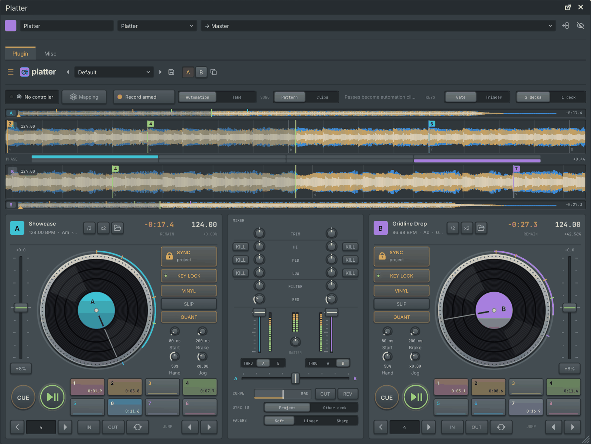
</p>

Platter is a two-deck DJ setup on a channel: deck A and deck B with a mixer between them, or one deck as a layout.

- **Decks.** Drop a track on a deck (from the browser, your desktop or the playlist's clip list) and Platter finds its tempo and beat grid, then plays it in time with the project or with the other deck; drum and bass reads at its own tempo, /2 and x2 buttons correct a track heard at half or double time, and the padlock frees it to its own tempo. Each deck has key lock, cue and play, eight hot cues, loops and beat jumps, slip mode, motor start and brake times and a pitch fader, with stacked three-band colour waveforms, beat grids and a phase meter.
- **Mixer.** Trim, a three-band EQ with kills and a filter per channel, channel faders with meters and a curve, a crossfader with assign, curve, cut and reverse, and the master level. The EQ and master knobs have 0 dB at 12 o'clock, like a DJ mixer, and a track on one deck at the default settings plays at its own level.
- **Scratching.** The platter follows the scratch mechanics of Mixxx: a jog wheel sets the record's speed from how fast its ticks arrive, a mouse drag follows the hand and a fast release throws the record, touching a playing record catches it and letting go ramps it back up. The Jog and Hand feel knobs set how far and how heavily it moves.
- **DJ controllers.** Ready mappings for the Pioneer DDJ-200, Hercules DJControl Inpulse 200 and Numark Mixtrack Pro FX drive both decks and the mixer at once, with LEDs that follow each deck; any other controller maps through MIDI learn. Mappings are saved with the project and as presets.
- **Recorded performances.** While Gridline records, what you play becomes plain automation: one clip per control you used (the record's position, play, the wheel and its touch, the mouse, loops, every fader and knob), kept together in a pattern. In song mode each pass is a new pattern placed once on the playlist where you played it, so you see the wheel moving on that clip; double-click a curve to edit it (or pick Clips to get separate playlist clips). The clips hold the decks' state, so playback can start anywhere in a pass, and you can cut, trim, move and copy it. Left as recorded, a pass replays exactly as played, at any buffer size; edit a curve and the sound follows. A second pass never records over the first: it gets a pattern of its own, and the pass patterns' clips also show as channel rack rows. **Record as: Take** keeps a performance as one note instead. See [docs/plugins/platter-recording.md](docs/plugins/platter-recording.md).

Platter is part of the Gridline Suite too, so it also runs in other DAWs.

## Seltmann

<p align="center">
  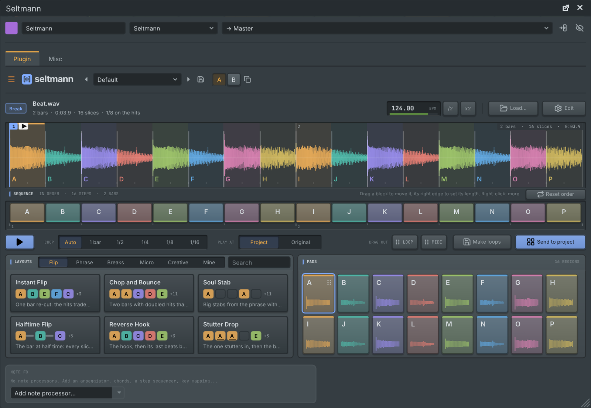
</p>

Seltmann is an automatic sample chopper. Drop in any audio (a break, a melodic loop, a whole song, a one-shot or a texture): it works out what the sound is, its tempo and where bar 1 starts, chops it into lettered regions at a size that suits it, and plays as soon as you pick one of 59 layout cards.

- **The sequence lane** reorders, splits and joins regions; drag the cut between two regions right in the waveform to resize both.
- **Pitch each region where it is**: drag the small readout on a pad or a region, or turn the mouse wheel over it.
- **Start the sequence on any cell**, and the loop keeps its length.
- **Steps with their own length and pitch**: drag a sequence block's right edge to shorten or lengthen that step without changing its region, and turn the wheel over it to pitch just that step. Once a step has its own length, the loop lasts whole bars.
- **Record from an input**: Record, next to Load on the start screen, records a take from any audio input, with pause, a level meter and the take drawn as it records, then chops it like any file.
- It plays as an instrument in time with the project, and the result drags out as a loop, MIDI or a pattern. See [docs/plugins/seltmann.md](docs/plugins/seltmann.md).

## A closer look

<table>
<tr>
<td width="50%">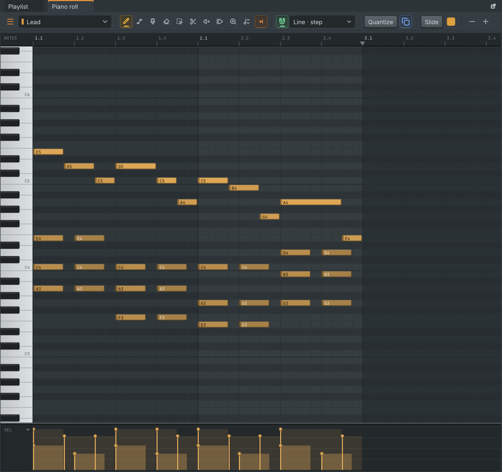</td>
<td width="50%">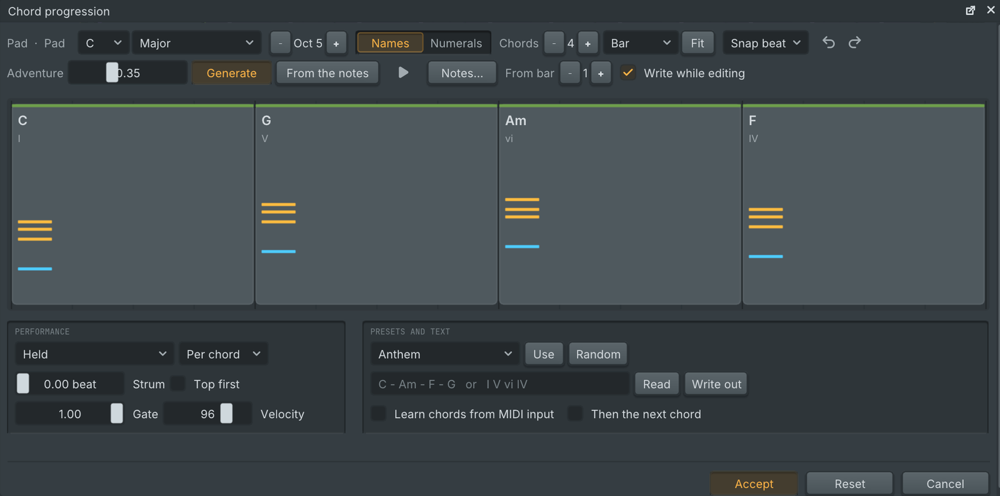</td>
</tr>
<tr>
<td><b>Piano roll.</b> Slides, pitch bend drawn on each note, per-note properties, ghost notes, scale highlighting and a full set of tools: quantize, chop, strum, arpeggiate, randomize and more.</td>
<td><b>Chord progressions.</b> Pick a key, generate or type a progression, shape the rhythm and voicing, and write it straight into the pattern.</td>
</tr>
<tr>
<td width="50%">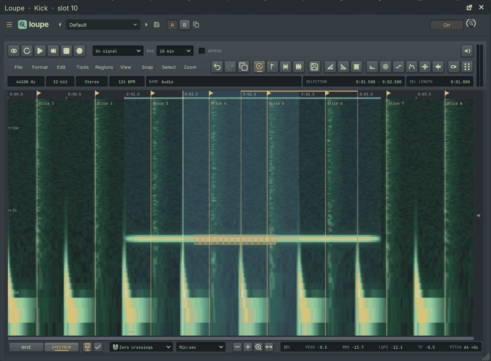</td>
<td width="50%">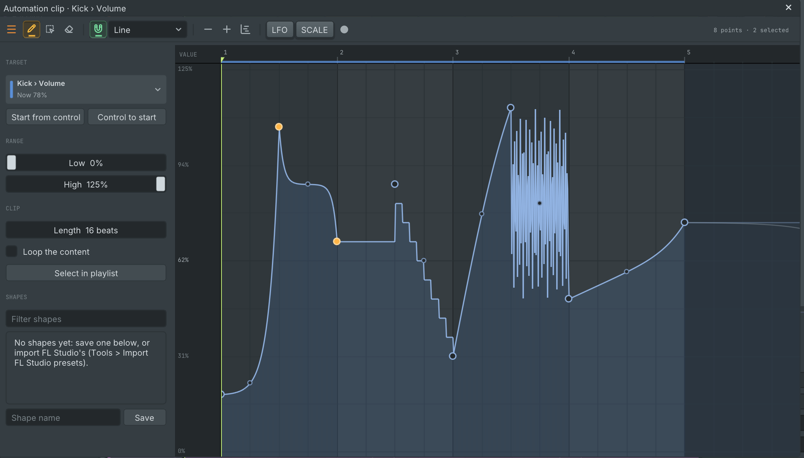</td>
</tr>
<tr>
<td><b>Loupe, the audio editor.</b> Waveform and spectral views, markers and regions, time stretch and pitch shift, noise reduction, beat slicing and loudness readouts.</td>
<td><b>Automation.</b> Points with thirteen curve shapes, tension handles, an LFO tool, a shape library and recording straight from knob moves. Clips live in the playlist or inside a pattern, where they play wherever the pattern plays and show on its clips next to the notes.</td>
</tr>
<tr>
<td width="50%">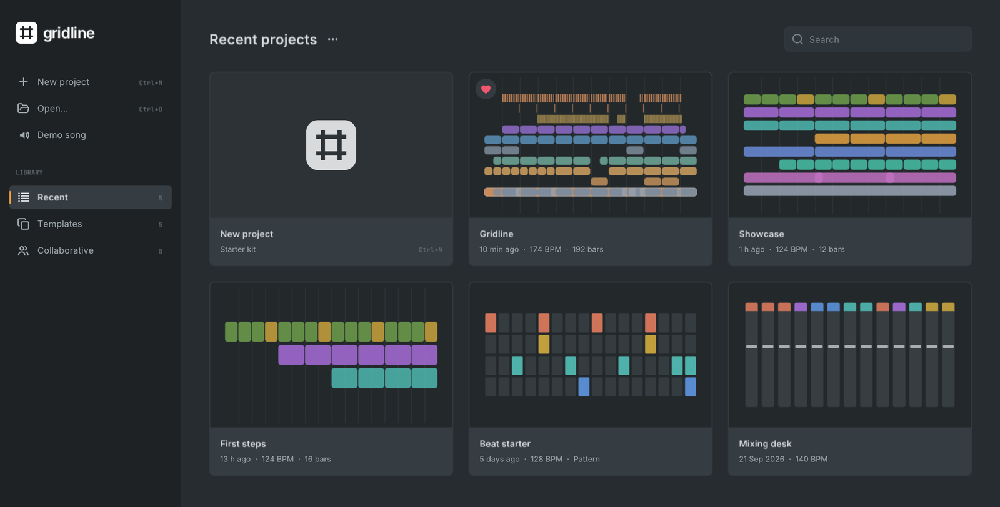</td>
<td width="50%">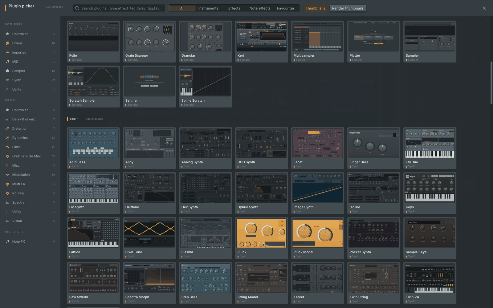</td>
</tr>
<tr>
<td><b>Welcome screen.</b> Recent projects with a sketch of each arrangement, favourites that stay on the list, templates, search and the Collaborative view, by mouse or keyboard. A click on the Gridline logo brings it back.</td>
<td><b>Plugin picker.</b> Every instrument and effect with a preview of its editor, by category, with search and favourites.</td>
</tr>
</table>

### Instruments and effects

<p align="center">
  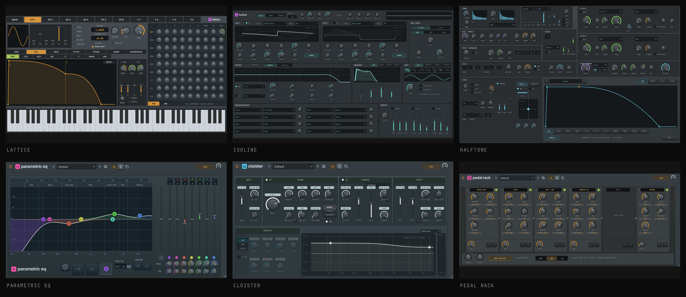
</p>

An instrument opens in its channel window with the channel strip (volume, pan, pitch and a preview keyboard) tucked away, which leaves the room to the editor; the eye button at the right of the window's header slides it in and out. Every Gridline editor can be popped out into its own window with the button in its title bar.

### Plasma

<p align="center">
  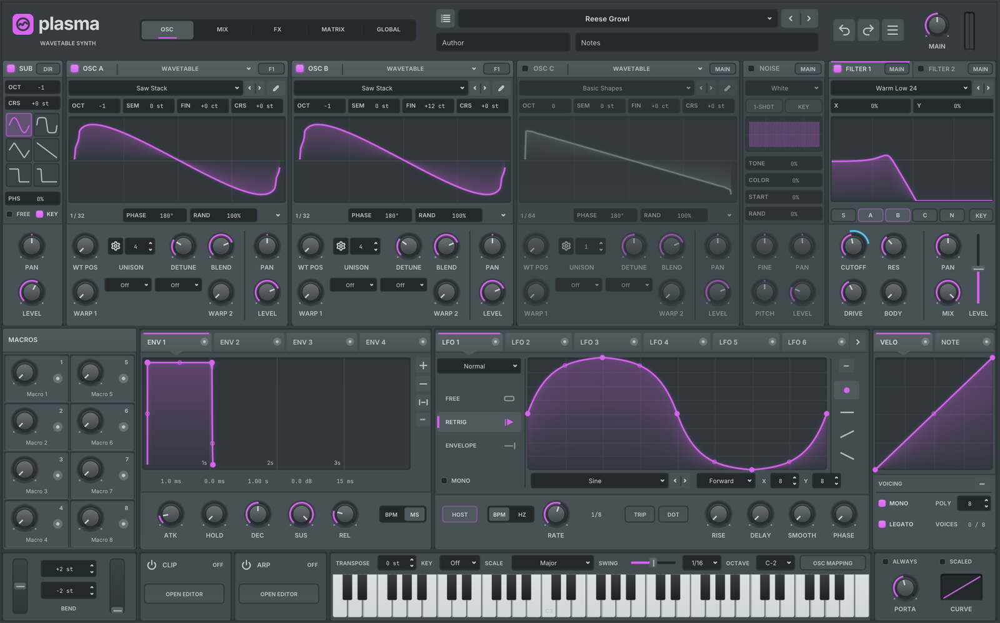
</p>

Plasma is Gridline's wavetable hybrid synth: three layers that each play a wavetable, a multisample, a sample, a granular cloud or a spectral resynthesis, with two morph slots each (103 modes, FM, PD, AM and RM between sources among them) and stacks up to 16 voices, plus a root oscillator, a texture layer and two filters with 106 types. Its editor follows the sound from top to bottom: a signal path of tiles, a large stage for the part you pick, a motion dock with 4 envelopes, 10 drawable LFOs, 8 macros and the key, touch and chance sources, and a play bar. Link any source to any control by dragging its grip, or switch on Link mode and set the depth right on the control; 64 links in all. Three effect lanes with up to 24 effects, an arpeggiator, a phrase player and a table editor (partials, drawing tools, morphing, formulas, WAV import and export) complete it.

Plasma can also read your own Serum 2 presets (`.SerumPreset`) and Serum `.fxp` files through the same Open path as any preset: it reads the settings stored in the preset, with the wavetables, samples and other audio it carries, and sets up a Plasma sound from them. Plasma is its own synth with its own engine, so the result is Plasma's sound, not a copy of the other synth; anything that could only be approximated or not mapped is listed behind an info mark next to the preset name. Its Library lists the Serum preset folders found on your computer as a folder tree, indexed in the background. Nothing from another product ships with Gridline. See [docs/plugins/plasma.md](docs/plugins/plasma.md).

## Build

Gridline needs CMake, a C++17 compiler and SDL2. Everything else (Dear ImGui, Lua, RtMidi, Signalsmith Stretch, the Rubber Band Library, the plugin interfaces, the audio decoders, the SVG icon rasteriser and the networking and encryption libraries for collaboration) is bundled in `third_party/`. The CI builds and tests every change on the systems below (`.github/workflows/ci.yml`); `tools/ci/install-deps.sh` installs the dependencies on each.

```sh
# macOS
brew install cmake sdl2

# Debian / Ubuntu
sudo apt install build-essential cmake pkg-config libsdl2-dev libgl-dev libasound2-dev libjack-jackd2-dev libx11-dev

# Fedora: sudo dnf install cmake gcc-c++ SDL2-devel alsa-lib-devel libX11-devel mesa-libGL-devel
# Arch:   sudo pacman -S cmake sdl2 alsa-lib libx11 mesa
# FreeBSD: pkg install cmake ninja sdl2 libX11 sndio    OpenBSD: pkg_add cmake ninja sdl2

cmake -S . -B build -DCMAKE_BUILD_TYPE=Release
cmake --build build -j4           # a fixed job count: a bare -j starts every compile at once and can run out of memory
ctest --test-dir build          # 305 tests
./build/gridline-app            # start the app
```

On Windows (Visual Studio 2022 or its Build Tools, from a developer command prompt), SDL2 is built from source:

```bat
cmake -S . -B build -G Ninja -DCMAKE_BUILD_TYPE=Release -DGRIDLINE_BUNDLED_SDL2=ON
cmake --build build
ctest --test-dir build
build\gridline-app.exe
```

Audio goes through SDL (Core Audio, WASAPI, ALSA / PulseAudio / PipeWire / JACK, sndio / OSS on the BSDs); MIDI devices through RtMidi (CoreMIDI, Windows Multimedia, ALSA, JACK) and sndio on the BSDs. See [docs/midi-devices.md](docs/midi-devices.md).

`./build.sh` is a quicker path for the core alone: it builds the command line tool, runs the core tests and renders the demo song.

## Command line

```sh
build/gridline demo    song.gridline                        # write the demo song to a project file
build/gridline info    song.gridline                        # inspect a project
build/gridline render  song.gridline -o out.wav --bits 24   # render to audio (also .flac, .mp3, .ogg, .m4a, --stems)
build/gridline export-midi song.gridline -o song.mid        # write a MIDI file
build/gridline import-midi song.mid -o song.gridline        # read a MIDI file
build/gridline zip     song.gridline -o song.gridlinez      # project plus samples
build/gridline export-flp-zip song.gridline -o song.zip     # FL Studio zipped loop package
build/gridline plugin-check --all --json report.json        # plugin compatibility sweep
build/gridline bench   song.gridline                        # load, save and render timings
build/gridline seltmann-analyse loop.wav                    # tempo, kind and slices Seltmann hears
build/gridline track-receipt song.gridline --out receipt/   # which parts of which original recordings are used (spreadsheet + PDF)
build/gridline mcp     song.gridline                        # MCP server for AI assistants (docs/mcp.md)
build/gridline collab-run --test-connection                 # router type, port mapping and IPv6 for collaboration
```

## Plugin hosting

`src/host/` hosts third-party plugins through one interface, `host::Backend`.

<p align="center">
  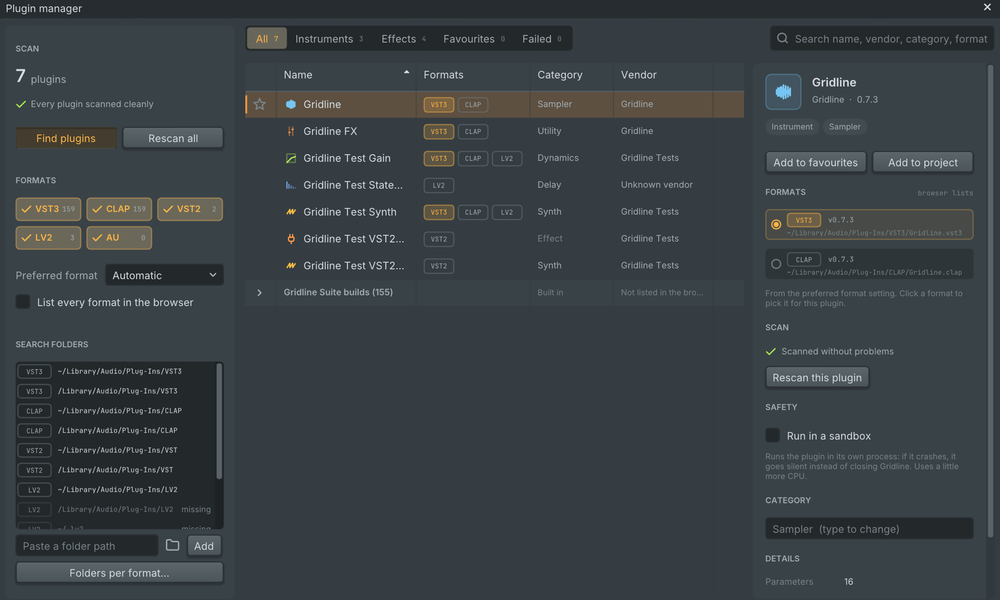
</p>

| Format | Type id | Where Gridline looks |
|---|---|---|
| VST3 | `vst3:<class uid>` | `~/Library/Audio/Plug-Ins/VST3`, `/Library/Audio/Plug-Ins/VST3`; Windows `Common Files\VST3`, `%LOCALAPPDATA%\Programs\Common\VST3`; Linux / BSD `~/.vst3`, `/usr/lib/vst3`, `/usr/local/lib/vst3` |
| CLAP | `clap:<plugin id>` | `.../Plug-Ins/CLAP`; Windows `Common Files\CLAP`, `%LOCALAPPDATA%\Programs\Common\CLAP`; Linux / BSD `~/.clap`, `/usr/lib/clap`, `/usr/local/lib/clap`; `$CLAP_PATH` |
| VST2 | `vst2:<unique id>` | `.../Plug-Ins/VST`; Windows `Program Files\VSTPlugins`, `Program Files\Steinberg\VSTPlugins`, `Common Files\VST2`; Linux / BSD `~/.vst`, `/usr/lib/vst`; `$VST_PATH` |
| AU (macOS) | `au:<type>/<subtype>/<manufacturer>` | the system component registry |
| LV2 | `lv2:<plugin URI>` | `~/Library/Audio/Plug-Ins/LV2`, `/Library/Audio/Plug-Ins/LV2`, `~/.lv2`, `/usr/local/lib/lv2`; on Linux `~/.lv2`, `/usr/local/lib/lv2`, `/usr/lib/lv2`; `$LV2_PATH` |

- **The plugin manager** shows each plugin once, with the formats it is installed in, a clean category, a favourite star and a details panel: every format's version and location, scan problems with a retry, the sandbox switch, a category override and Add to project. Choose a preferred format, or one per plugin; the browser and the plugin picker list each plugin in that format.
- **Opening a plugin** shows its own interface at the size it asks for, with a slim Gridline bar underneath for presets, bypass, sandbox, CPU and latency. The window follows the plugin when it resizes and reopens on the monitor you left it on.
- **Undo:** an edit gesture in the plugin's own interface, together with the state the plugin reports right after it, is one undo step, and following an undo or redo never clears the redo history.
- **Scanning** happens in a child process, so a plugin that crashes, hangs or uses too much memory while it loads is blocked until it changes instead of taking Gridline (or the computer) down. Each plugin's check may use a quarter of the computer's memory (2 to 8 GB) and stops early if the computer runs low on memory; anything the plugin starts during its check ends with it.
- **The sandbox** runs a plugin in its own process. Audio and events travel through shared memory with a lock-free handshake. If the plugin crashes, Gridline keeps playing, the plugin is silenced and you can reload it.
- **What plugins get from the host:** transport and tempo, sample-accurate notes and parameter changes, sidechain input, MIDI output into other channels, offline render mode, latency reporting into delay compensation, CLAP parameter modulation and preset discovery.
- **LV2:** Gridline reads each bundle's Turtle files itself (no lilv). Control ports become parameters with their ranges, enumerations, toggles and logarithmic scales; MIDI travels in atom sequences both ways; plugins get `time:Position`, the worker, state (saved in the project), options with the block sizes, `lv2:enabled` bypass and `lv2:freeWheeling` during exports; the latency port feeds delay compensation; `lv2:Preset`s, also from other bundles, appear as the plugin's presets. A bundle of hundreds of plugins is checked one plugin at a time, reading only that plugin's own files, so the check takes about the memory of one plugin. A plugin that will not start in a file or bundle of many (LV2, VST3, CLAP, a VST2 shell) is listed with the failed plugins on its own, and the rest load. Plugin interfaces open in the plugin window: CocoaUI on macOS, WindowsUI on Windows, X11UI on Linux and the BSDs, and external (kxstudio) interfaces in their own window. The Windows and X11 interface paths are built and unit-tested on CI but have not been used by hand yet; everything else is tested with in-tree test plugins on every system.
- **Missing Serum, Kickstart or Kilohearts effects:** a project whose Serum or Serum 2 is not installed plays it with Plasma, a missing Kickstart or Kickstart 2 plays with Tideline, and a missing Kilohearts single effect plays with its Gridline Suite Mini counterpart. The saved state is mapped onto the stand-in and automation follows; the original plugin and its state stay in the project untouched, so a computer that has the plugin installed hosts it again. **Replace with Plasma** (or Tideline) in the plugin window keeps the stand-in for good. Installed plugins are always hosted as themselves.
- **Compatibility sweep:** `gridline plugin-check` loads every scanned plugin at several sample rates and buffer sizes, feeds it silence, noise and notes, checks for invalid output, round-trips its state, sweeps its parameters and opens and closes its editor.

Interfaces: the VST 3 SDK interface headers (`third_party/vst3/pluginterfaces`, MIT), the CLAP headers (`third_party/clap`, MIT) and the LV2 specification headers (`third_party/lv2`, ISC). VST2 support uses Gridline's own description of the binary interface (`src/host/vst2/Vst2Abi.h`); no VST2 SDK code is included. No plugin binaries are shipped.

## Gridline as a plugin

The same build also produces Gridline as a plugin, so the whole workstation (channel rack, piano roll, playlist, mixer, every built-in instrument and effect) runs inside another DAW. Each bundle holds two plugins:

| Plugin | Kind | Audio | Notes |
|---|---|---|---|
| **Gridline** | instrument | stereo out, plus 15 stereo outputs carrying mixer inserts 1 to 15 | MIDI in |
| **Gridline FX** | effect | stereo in (enters mixer insert 1), sidechain in (inputs 3 and 4), stereo out | MIDI in (CLAP, VST3) |

```sh
cmake --build build --target gridline_clap gridline_vst3   # build/plugins/Gridline.clap, build/plugins/Gridline.vst3
cmake --build build --target gridline_au                   # macOS: build/plugins/Gridline.component (Audio Unit v2)
cmake --build build --target install-plugins               # copy the bundles into your user plugin folders
cmake --install build --component plugins --prefix /usr    # or install for a package (lib/clap, lib/vst3)
```

`install-plugins` copies to `~/Library/Audio/Plug-Ins/CLAP`, `.../VST3` and `.../Components` on macOS, and to `~/.clap` and `~/.vst3` on Linux. The build and the tests never install anything. Each bundle carries the app icon and Gridline's assets (fonts, sounds, templates, translations), so it works on its own.

- **Formats:** CLAP and VST3, both written against the interface headers only, and on macOS an Audio Unit (v2) written against Apple's AudioToolbox headers only. The Audio Units are `aumu GrIn GrLn` (Gridline) and `aufx GrFx GrLn` (Gridline FX); both pass `auval -strict`.
- **Transport:** with **Follow the host transport** on (the default), Gridline starts and stops with the host, takes its tempo and moves to its position: pattern mode plays the pattern at the host position within the pattern, song mode plays the arrangement at the host's song position. Turn it off and Gridline's own transport plays the pattern or the song. The Audio Unit reads the transport through the host callbacks.
- **MIDI input** plays the selected channel, or with **By MIDI channel**, MIDI channel 1 to 16 plays rack channel 1 to 16. Every format carries notes, controllers, channel pressure and pitch bend at their sample positions: CLAP and AU as MIDI messages, VST3 through MIDI controller mapping (each controller of each MIDI channel is a hidden parameter that Gridline turns back into MIDI), so the VST3 build plays exactly like the CLAP one.
- **Host parameters** are 16 macros. Right-click any control and choose **Link to host macro**, or press **Link** in the **Host link** panel to link the control you touched last. The host automates the macro and Gridline applies it to the linked control every 64 samples; the host shows the linked control's value, such as `62%` or `1.20 kHz`.
- **State** is the whole project: the project JSON with the paths of the samples it uses, the macro links and the plugin settings (for the Audio Unit, inside its ClassInfo). Samples stay where they are on disk.
- **Latency:** the project's delay compensation is reported to the host and updated when it changes.
- **Offline render** and **sample rate or buffer size changes** are supported; renders are identical from run to run.
- **Editor:** Gridline's interface in the host's plugin window, resizable, sharp on HiDPI screens (an NSView on macOS, also the Audio Unit's Cocoa view, an X11 child window on Linux).
- **Installed plugins inside Gridline:** the plugin loads the plugins the Gridline application scanned (VST3, CLAP, VST2, AU, LV2), and each opens its own interface, never a stand-in: a window owned by the host's plugin window (on macOS a child window that stays above it, on Linux a transient window), with the plugin's interface on top and Gridline's control bar under it (presets, bypass, sandbox, generic, CPU and latency, settings), as in the application. The windows hide with Gridline's editor and close with it; closing one gives the keyboard back to the host's window.

The **Host link** panel (a tab beside the browser) shows the transport, MIDI and output settings, the reported latency and the 16 macros. `gridline plugin-check Gridline` runs the compatibility sweep on the built bundles once they are in the plugin cache.

The same bundles also carry the [Gridline Suite](#the-gridline-suite), each of Gridline's instruments and effects as a plugin of its own.

## FL Studio project compatibility

Gridline opens FL Studio projects (`.flp`), FL Studio zipped loop packages (`.zip`) and presets (`.fst`), so existing work can be brought across. **File, Open** (or drag and drop) opens `.flp` and `.zip` files like any project; saving one asks where to keep it and in which format, so the original is never overwritten unasked:

- channels, patterns, notes, playlist clips, automation, markers and mixer routing are imported, also from projects saved by FL Studio 2026;
- FL Studio's own instruments and effects are mapped to their Gridline equivalents with their settings; Slicex chops arrive in Kerf exactly, each region on its key, in its order, with its start, end and name;
- a Serum, Serum 2, Kickstart or Kickstart 2 that is not installed plays through Plasma or Tideline, with the plugin and its settings kept for when it is installed (installed plugins are always hosted as themselves);
- third-party plugins load as the installed plugin with their saved state, or stay as placeholders until the plugin is installed;
- **File, Import, FL Studio presets** converts the presets of a local FL Studio installation into Gridline's preset library on your computer.

Projects can also be saved back to `.flp` with **File, Export, FL Studio project** (or **File, Save as**), or as an FL Studio zipped loop package (the `.flp` plus every sample it uses, with relative sample paths) with **File, Export, FL Studio zipped loop package**: unchanged parts are written back exactly as they were imported, FL Studio's own plugins are saved with their settings, and third-party plugins such as Serum 2 keep their original plugin host settings. Nothing from FL Studio is bundled with Gridline.

Gridline instruments and effects that FL Studio has no exact counterpart for go into the project the way **Settings, Project, FL Studio export** says; the export window shows the choice and can change it for one export or for the project:

- **Gridline Suite plugins, with muted audio copies** (the default): instruments that would otherwise be rendered, and effects that would otherwise be left out, are written as the matching [Gridline Suite](docs/gridline-suite.md) plugin (VST3) with all their settings, so FL Studio opens them live and editable where the Suite is installed. Each such instrument also gets a muted copy of its channel that plays it rendered to audio, for computers without the Suite. Instruments and effects that a close FL Studio plugin can stand in for keep that stand-in;
- **Gridline Suite plugins only**: every Gridline plugin without an exact FL Studio counterpart is written as its Gridline Suite plugin, including the ones a close FL Studio plugin would only approximate, and no audio copies are made;
- **Rendered to audio**: instruments are rendered to samples and effects become the closest FL Studio effect, as in earlier versions.

Samples a Gridline Suite plugin uses travel inside its settings, up to 64 MB of files per plugin, and the plugin writes them into its cache on the other computer when the original files are not there; larger files are copied into the sample folder next to the project. Playlist automation clips of a Suite plugin's parameters carry over; automation recorded inside patterns on those parameters is not written yet. Without the Suite, FL Studio reports the plugins as missing. Gridline opens such a project with its own plugins again, with their exact settings. The export report (**File, Export, FL Studio export report**) lists how each channel and effect was written. From the command line: `gridline export-flp song.gridline -o song.flp --gridline-plugins fallback|suite|render`.

## Documentation

- [Split stems](docs/stems.md) and [Import from URL](docs/import-url.md).
- [Automation](docs/automation.md): clips in the playlist and inside patterns, where to add, see and edit them.
- [Collaborative projects](docs/collaboration.md): inviting, joining, connections, offline work, removing someone, privacy.
- [Windows outside the main window](docs/detachable-windows.md) and [the plugin window's channel strip](docs/plugin-window.md).
- [The Gridline Suite](docs/gridline-suite.md): Gridline's instruments and effects as plugins for other DAWs, and where they are installed.
- [Plasma](docs/plugins/plasma.md), [Seltmann](docs/plugins/seltmann.md), [Tideline](docs/plugins/tideline.md), [the synths pack](docs/plugins/synths.md) and [recording Platter performances](docs/plugins/platter-recording.md).
- [Loop files](docs/loop-files.md): REX2 sliced loops and Apple Loops in the browser, the channel rack and the playlist.
- [Opening files from the file manager](docs/opening-files.md): double-clicking projects and tracker modules on Linux, macOS and Windows, and choosing Gridline once where the system asks.
- [Gridline on Debian and Ubuntu](docs/debian.md): installing the `.deb` with apt, the supported versions, Debian 11's archived updates.
- [Gridline on a Chromebook](docs/chromeos.md): installing in ChromeOS's Linux environment, sound, shared folders, MIDI devices and plugins.
- [ASIO on Windows](docs/asio.md): using an audio interface's ASIO driver, its buffer sizes, sample rates, inputs and outputs.
- [Lua scripting](docs/scripting.md), [AI assistants (MCP)](docs/mcp.md) and [the update check](docs/updates.md).
- [CHANGELOG.md](CHANGELOG.md) lists what changed in each version.

## Architecture

| Area | Where | What it does |
|---|---|---|
| Model | `src/core/Song`, `Types`, `Document`, `Undo` | Channels, patterns, clips and mixer with stable ids. Every edit is an undoable command. |
| Project files | `src/core/Project`, `Json` | Versioned JSON with migration from older versions, validation and atomic saves. |
| Engine | `src/engine/AudioEngine`, `Program`, `ProgramGraph` | Real-time engine with delay compensation and a parallel mixer graph. |
| Plugins | `src/packs/`, `src/engine/` | The built-in instruments and effects, one pack per family. |
| Hosting | `src/host/` | VST3, CLAP, VST2, AU and LV2 backends, scanning, sandbox and native editor windows. |
| Collaboration | `src/collab/` | Peer-to-peer sessions: invites, connections (ICE, port mapping, relays), encryption, the shared change log and audio file transfer. |
| Gridline as a plugin | `src/plugin/` | CLAP, VST3 and Audio Unit entry points, host transport, macros, state, the embedded editor and the windows of plugins hosted inside it. |
| Interface | `src/app/` | SDL2, OpenGL 3 and Dear ImGui, with windows that can move out onto other monitors. Controls are drawn in code; icons are SVG files (`assets/icons/ui/`) rasterised at the screen's exact pixel size. |
| Import and export | `src/core/flp/`, `src/core/MidiFile`, `src/engine/Export` | Project import, MIDI, audio export and stems. |

Project files are JSON (`"format": "gridline-project"`), saved as `.gridline` (zipped with their files: `.gridlinez`; files named `.gridline.json` by earlier versions still open). Older files are upgraded on load, and `gridline upgrade` rewrites them in the current schema.

## License

Gridline is free software, released under the GNU General Public License v3.0 (see `LICENSE`).
Bundled third-party libraries keep their own licences, all GPL-compatible: Dear ImGui (MIT), Lua 5.4 (MIT), RtMidi (MIT-style), Signalsmith Stretch and Signalsmith Linear (MIT, time stretching and pitch shifting), the Rubber Band Library (GPL-2.0-or-later, used under the GPL-3.0; the Rubber Band time mode), CLAP headers (MIT), VST3 plug-in interfaces (MIT), LV2 headers (ISC), dr_libs and stb_vorbis (public domain or MIT-0), nanosvg (zlib), and for collaborative projects libjuice and libplum (MPL-2.0), Monocypher (BSD-2-Clause or CC0), stb_image and stb_image_write (public domain or MIT). See `third_party/NOTICE.md` and each folder under `third_party/`.
The ASIO backend on Windows uses Steinberg's ASIO interface under the GPLv3 option of its dual licence; no SDK file is included (see [docs/asio.md](docs/asio.md)). ASIO is a trademark of Steinberg Media Technologies GmbH.
The interface icons in `assets/icons/ui/` use geometry from Lucide (ISC) and Tabler Icons (MIT); see `assets/icons/ui/NOTICE.md`.
Platter's scratch mechanics follow the approach of [Mixxx](https://github.com/mixxxdj/mixxx) (GPL-2.0-or-later); no Mixxx code is included.

Gridline is an independent project and is not affiliated with or endorsed by Image-Line. "FL Studio" is a trademark of Image-Line Software and is mentioned only to describe file compatibility.

Gridline is not affiliated with or endorsed by Xfer Records. "Serum" is a trademark of Xfer Records and is mentioned only to describe which preset and project files Gridline can read.

<sub>The README artwork is generated by `tools/make_readme_art.py` from Gridline's brand assets and screenshots of the app taken by `tools/readme_shots.sh`.</sub>
