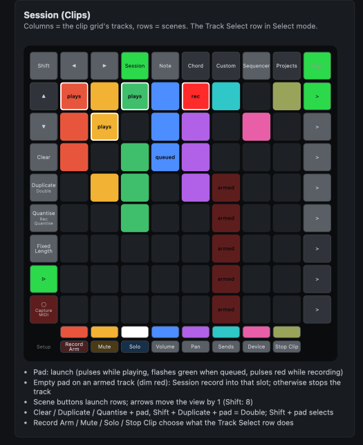
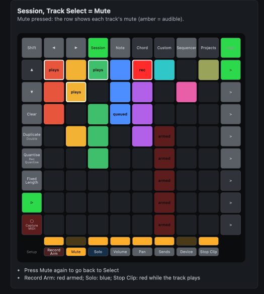
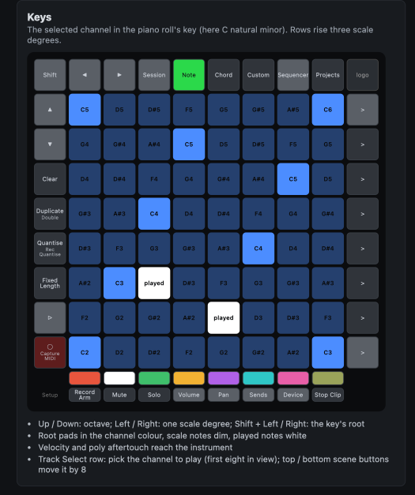
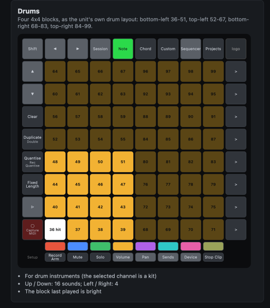
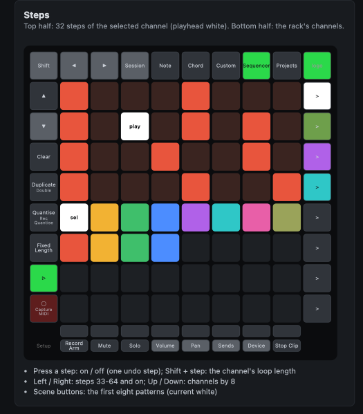
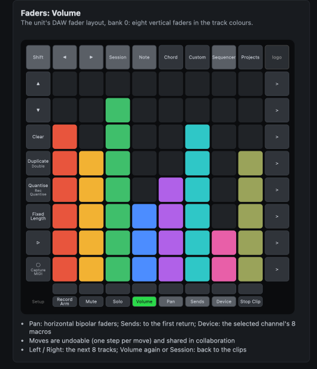
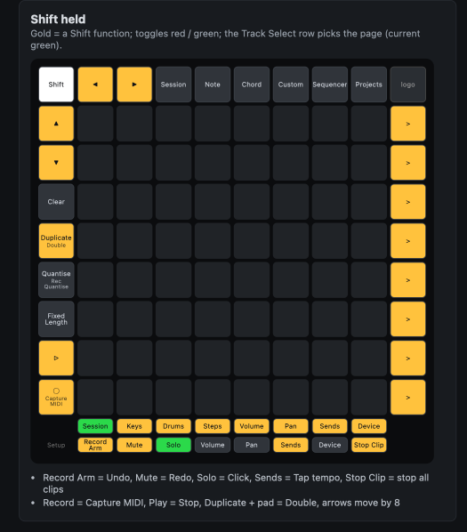

# Novation Launchpad Pro [MK3]

Gridline uses the Launchpad Pro [MK3] as a full controller: the clip grid in Clips, an overview of the
arrangement in Studio and Smooth, the patterns in the Tracker, an in-key keyboard, drum pads, a step
sequencer and the unit's touch faders for volume, pan, sends and macros. It runs on macOS, Linux and
Windows.

## Setting it up

1. Connect the unit by USB and start Gridline (or plug it in while Gridline runs).
2. That is all. Gridline finds the unit's **DAW** port by its name and switches the unit to its DAW mode:
   the grid lights up with your project.

The unit has three ports. Gridline only takes the **DAW** port. The **MIDI** port (the unit's own Note,
Chord, Custom and Sequencer modes) and the **DIN** port stay ordinary MIDI inputs that play the selected
instrument, like any keyboard.

If the DAW port has an unusual name on your system, open **Settings > MIDI**, find the port in the list and
set its **Controller type** to **Novation Launchpad Pro [MK3]** (under **Control surfaces**).

When Gridline quits, when you unplug the unit, switch its input off or give it another controller type,
Gridline puts the unit back in its standalone mode. Plugged in again, or after **Rescan devices**, it is set
up again. Several units work at once: each one has its own page and view.

### Options

Under the input list in **Settings > MIDI**, each connected unit has its own options:

| Option | What it does |
| --- | --- |
| Note and Sequencer open Gridline's pages | On (default): the unit's Note button opens Gridline's Keys or Drums page and Sequencer opens the Steps page. Off: they open the unit's own modes. |
| Keys and Drums pages, Steps page, Faders | Turn a page off if you do not want it. |
| Pad velocity | As played, Soft, Hard or Fixed (the fixed velocity of Settings > MIDI). |
| LED brightness | Full, Medium or Low. |
| Exact clip colours (RGB) | Sends each clip's own colour instead of the nearest of the unit's 128 colours. |

## Pages

Pick a page with **Shift + the Track Select buttons** (the row under the grid): 1 Session, 2 Keys,
3 Drums, 4 Steps, 5 to 8 the Volume, Pan, Sends and Device faders. The printed **Session**, **Note**,
**Sequencer**, **Volume**, **Pan**, **Sends** and **Device** buttons open them too. **Chord**, **Custom**
and **Projects** are always the unit's own.

### Session: Clips

- Columns are the clip grid's tracks, rows its scenes. Each pad has its clip's colour.
- A playing clip pulses. A clip waiting to start or stop flashes green. A recording clip pulses red.
  An empty slot of an armed track is dim red.
- **Press a clip** to launch it, as its launch button on screen. **Press an empty slot** of an armed track to
  record into it; on any other track it stops the track.
- **Shift + pad** selects the slot without launching. **Clear + pad** deletes the clip. **Duplicate + pad**
  copies it into the slot below. **Shift + Duplicate + pad** doubles the clip (its notes play twice).
  **Quantise + pad** moves its notes to the sixteenth. Each is one undo step.
- The **scene buttons** on the right launch their scene.
- The **arrows** move the view by one track or scene, or by eight with Shift.
- **Record Arm**, **Mute**, **Solo** and **Stop Clip** choose what the Track Select row does: arm, mute
  (amber while the track plays), solo (blue) or stop each track. Press the same button again to go back to
  selecting tracks.

### Session: Studio and Smooth

The grid shows the arrangement: rows are tracks, columns are bars, and each pad has the colour of the clip
on that track at that bar. The bar under the play position is lit.

- **Press a pad** to move the play position to that bar and select the clip there.
  **Shift + pad** selects without moving.
- The **scene buttons** act on the row's track (select, arm, mute or solo, as chosen with the track control buttons).
- The **Track Select row** moves the play position to the bar of that column.

### Session: Tracker

Each pad is a pattern, in order. The current pattern is white, and it pulses while it plays. Press a pad to
select that pattern. The Track Select row picks one of the first eight instruments.

### Keys

Plays the selected instrument, like a MIDI keyboard, so recording and step recording work as usual.

- When the piano roll has a scale, the pads only play notes in the key: each row runs up the scale and the
  row above starts three notes higher. The root notes are lit in the instrument's colour, the other notes
  dimmer, and the pads you hold are white. Without a scale, the pads are chromatic with rows a fourth apart.
- **Up** and **Down** change the octave. **Left** and **Right** move the layout by one note.
  **Shift + Left / Right** changes the key's root.
- The **Track Select row** picks the instrument. The top and bottom scene buttons show the next eight.

### Drums

Opens instead of Keys for drum instruments. Four blocks of 4 by 4 pads: bottom left plays notes 36 to 51,
top left 52 to 67, bottom right 68 to 83 and top right 84 to 99. **Up** and **Down** move by 16 notes,
**Left** and **Right** by 4.

### Steps

- The top four rows are 32 steps of the selected channel in the current pattern. Press a step to switch it
  on or off (one undo step). While the pattern plays, the step playing is white.
- **Shift + step** sets the channel's loop length to that step.
- The bottom four rows pick the channel. The scene buttons pick one of the first eight patterns.
- **Left** and **Right** show the next 32 steps. **Up** and **Down** move through the channels by eight.

### Faders

The unit's own touch faders, in the colours of the tracks.

| Button | Faders |
| --- | --- |
| Volume | the volume of eight tracks (in Clips the clip grid's columns, elsewhere the mixer tracks) |
| Pan | their pan, as horizontal faders from the centre |
| Sends | their send to the first return track |
| Device | the eight macros of the selected channel |

Faders follow changes made in Gridline (automation, the mouse, a collaborator), except the one you are
touching. Each move is one undo step and reaches everyone in a collaboration session. **Left** and **Right**
show the next eight tracks. Press the button again, or Session, to go back. Hold the button instead to use
the faders only while you hold it.

## Buttons

| Button | Alone | With Shift |
| --- | --- | --- |
| Play | play or pause | stop |
| Record | record (in Clips: record into the clip grid) | capture the notes you just played |
| Fixed Length | a new take per loop on or off | |
| Record Arm | arm mode for the Track Select row | undo |
| Mute | mute mode | redo |
| Solo | solo mode | metronome on or off |
| Sends | Sends faders | tap tempo |
| Stop Clip | stop mode | stop all clips |

While Gridline plays, the logo pulses green; while it records, red.

## Good to know

- Gridline speaks to the unit in its DAW mode, as described in Novation's Programmer's Reference Guide.
  The unit's own Note mode keeps its own scale, so Gridline's Keys page draws the in-key layout itself.
- Scale, aftertouch and velocity settings in the unit's own setup menu apply to its own modes; Gridline's pad
  velocity option applies to Gridline's pages.
- On Windows the DAW port is the unit's third MIDI interface (listed as MIDIIN3 with the unit's name).
