# A guide to the instruments

Gridline comes with its own instruments. This page lists each one with the kind of sound engine it
is, what it is good for and a picture of its window, so you can pick the right one quickly. The
flagships come first; after them the instruments are grouped by how they make sound.

Pointing at an instrument in the instrument menus or the plugin picker shows its line from this
guide, and **Guide to the instruments...** in the instrument menus (or **Instrument guide** in the
plugin picker) opens this page.

## Quick picks

| You want | Start with |
| --- | --- |
| A big modern synth for leads, basses and pads | Plasma, Isoline |
| A simple subtractive synth | Tercet, Warm Trio, Analog Synth |
| Additive or resynthesis | Facet, Halftone, Spectra Morph |
| Chopping a loop or a song | Seltmann, Kerf |
| Playing samples across the keyboard | Sampler, Multisampler |
| Drums from your own samples | Abacus |
| Drums made from scratch | Drum Model, Membrane Kit, Kick Sculptor |
| Guitar, harp and plucked sounds | String Model, Pluck Model |
| Electric piano and bells | Keys, Lattice, FM Synth |
| DJ mixing and scratching | Platter |

Tideline, Chater, Loupe and Terrace are effects. They are among the flagships because they lead Gridline's
own sound; the other effects are in the plugin picker.

## Flagships

### Plasma

Plugin type `gl.plasma`.

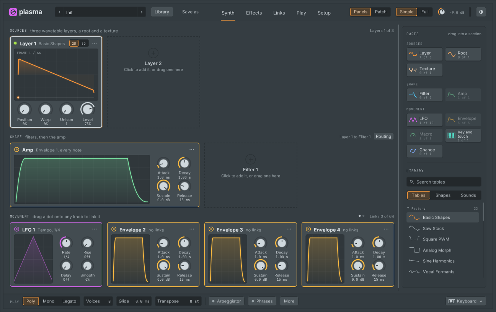

**Engine:** Wavetable hybrid synth: three layers of wavetables, samples, grains or resynthesis, two filters and effect lanes.  
**Good for:** modern leads, basses, pads and sound design.

More: [Plasma's manual](plugins/plasma.md).

### Seltmann

Plugin type `gl.seltmann`.

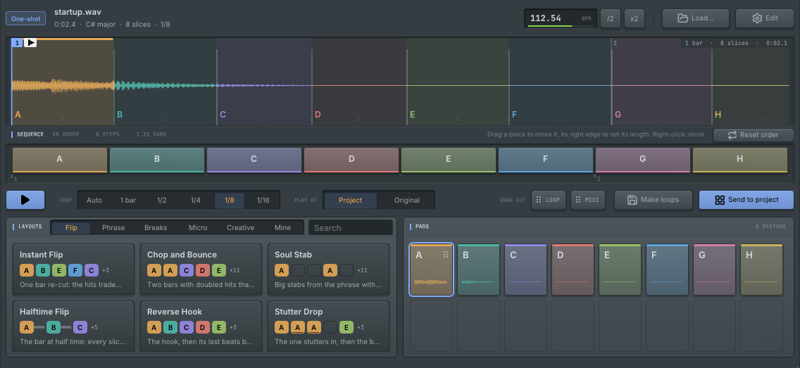

**Engine:** Automatic sample chopper: finds the tempo, the bars and the hits, then plays a chop layout in time.  
**Good for:** flipping breaks, loops, vocals and whole songs.

More: [Seltmann's manual](plugins/seltmann.md).

### Platter

Plugin type `gl.platter`.

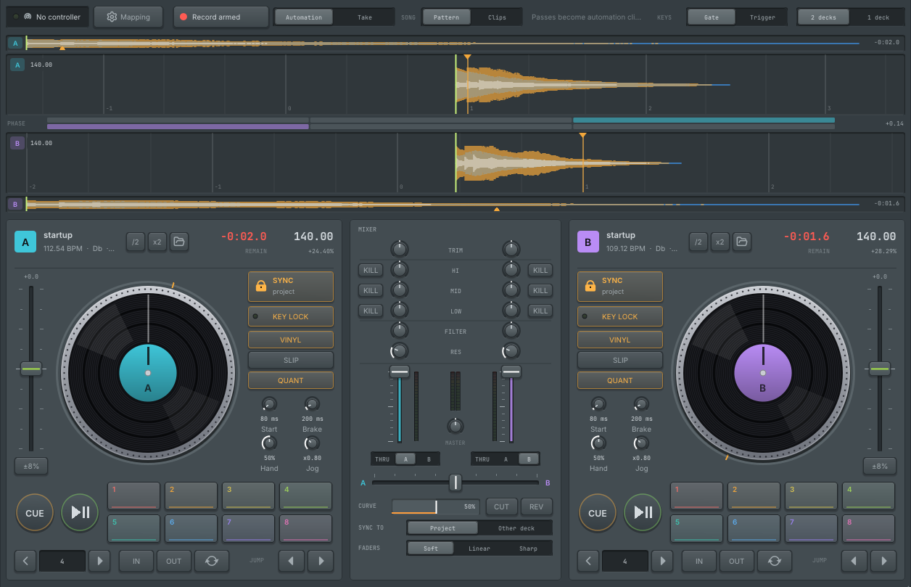

**Engine:** Two DJ decks and a mixer with cues, loops, beat jumps and scratching.  
**Good for:** mixing tracks live, scratching and recording DJ sets.

More: [Recording with Platter](plugins/platter-recording.md), [Scratching and nudging](plugins/platter-scratching.md).

### Tideline

Plugin type `gl.tideline`.

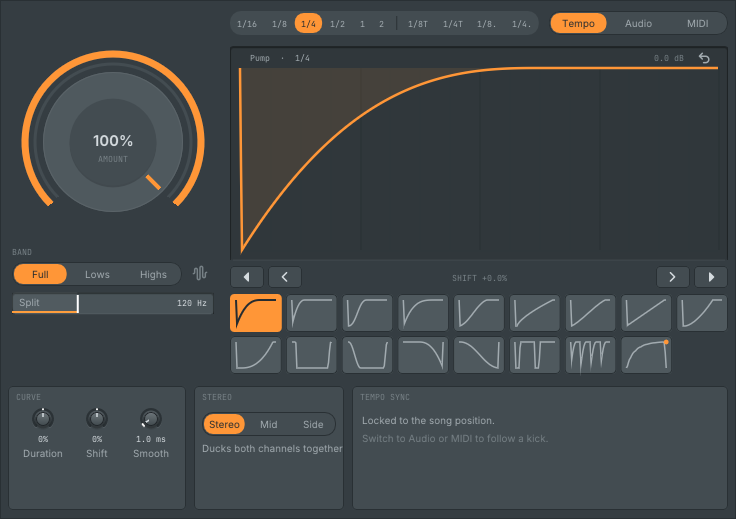

**Engine:** Effect: a tempo-synced volume shaper, triggered by the beat, another track, notes or MIDI.  
**Good for:** pumping and ducking without routing a sidechain.

More: [Tideline's manual](plugins/tideline.md).

### Chater

Plugin type `gl.chater`.

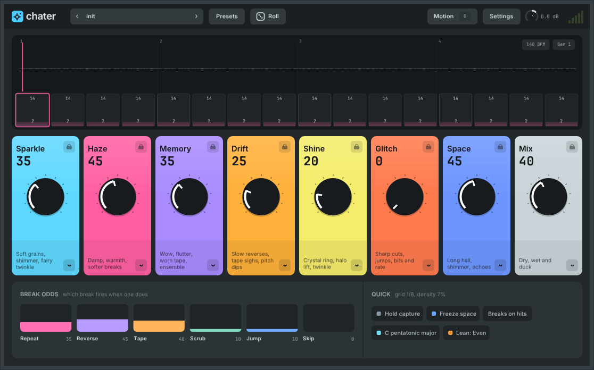

**Engine:** Effect: soft glitch breaks, glitter grains, tape haze and a long shimmering hall.  
**Good for:** dreamy textures, stutters and spacey tails.

More: [Chater's manual](plugins/chater.md).

### Loupe

Plugin type `gl.edison`.

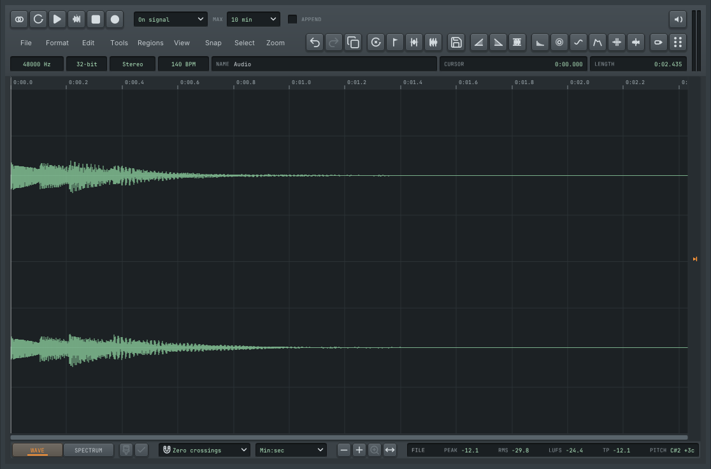

**Engine:** Effect: an audio editor in a mixer slot that records, cuts, fades and cleans up audio.  
**Good for:** editing recordings and samples inside the project.

### Terrace

Plugin type `gl.terrace`.

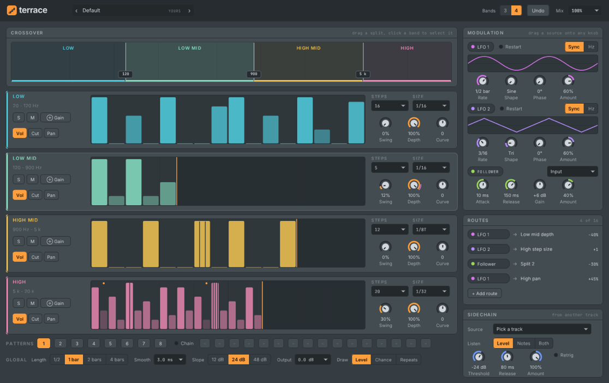

**Engine:** Effect: a multiband rhythmic gate with volume, filter and pan steps per band, LFOs and a sidechain.  
**Good for:** chopped pads, rolling grooves and moving mixes.

More: [Terrace's manual](plugins/terrace.md).

## Subtractive and virtual analog

More: [Loupe's manual](plugins/loupe.md).

### Tercet

Plugin type `gl.synth`.

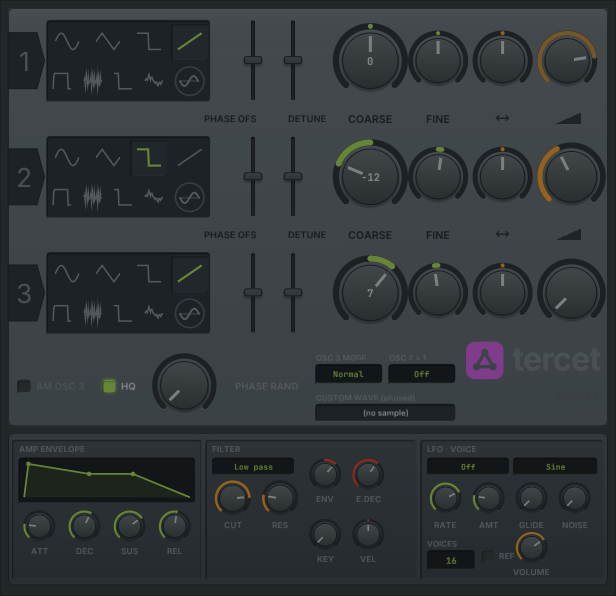

**Engine:** Three oscillators and noise into a filter.  
**Good for:** quick basses, leads and plucks.

### Analog Synth

Plugin type `gl.analog`.

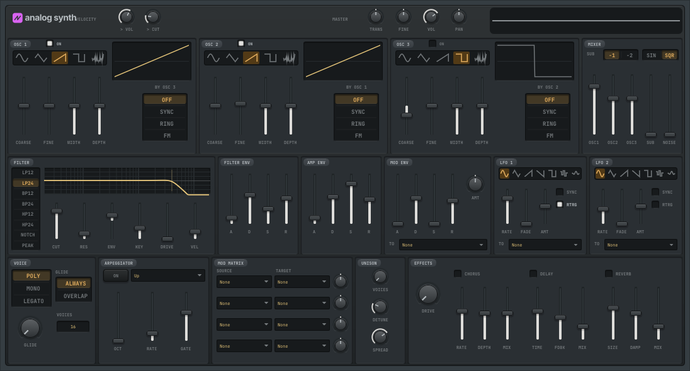

**Engine:** Virtual analog: three oscillators with unison, sync, ring and FM, a multimode filter, arpeggiator and effects.  
**Good for:** classic pads, basses, brass and arpeggios.

More: [Analog Synth in the synths notes](plugins/synths.md#analog-synth-glanalog).

### Twin VA

Plugin type `gl.twinva`.

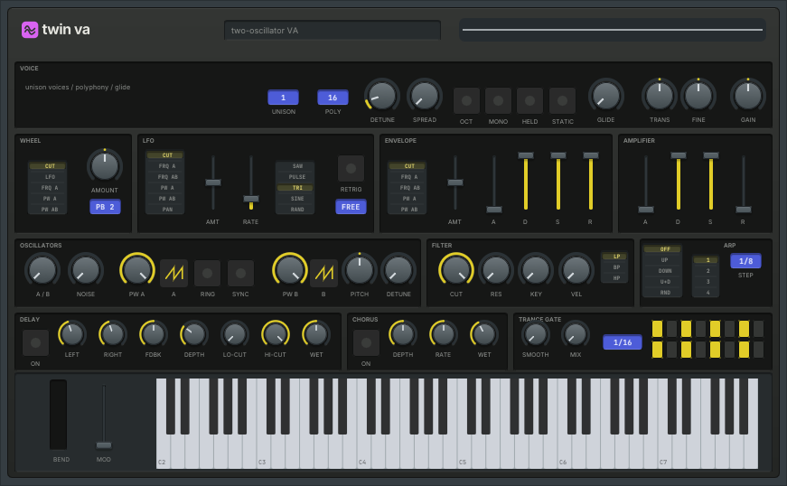

**Engine:** Two oscillators with unison stacks, hard sync and ring modulation into a resonant filter.  
**Good for:** supersaw leads, plucks and stacked chords.

### Saw Swarm

Plugin type `gl.sawswarm`.

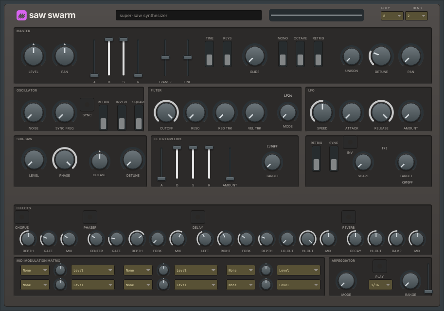

**Engine:** Stacks of detuned saws with hard sync and a sub saw.  
**Good for:** huge detuned leads and chords.

### DCO Synth

Plugin type `gl.dcosynth`.

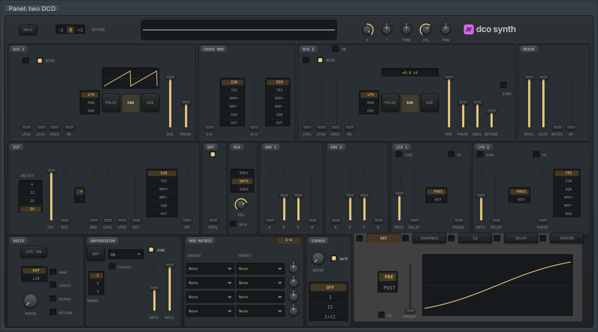

**Engine:** Two digitally controlled oscillators with pulse width, sub and cross modulation, a filter and chorus.  
**Good for:** warm polyphonic pads, strings and keys.

### Warm Trio

Plugin type `gl.warmsynth`.

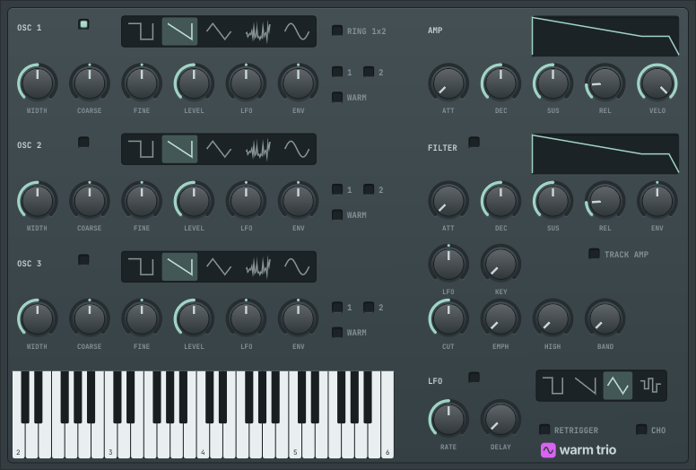

**Engine:** Three single-cycle oscillators into a warm resonant filter.  
**Good for:** simple, warm basses and leads.

### Pocket Synth

Plugin type `gl.pocketsynth`.

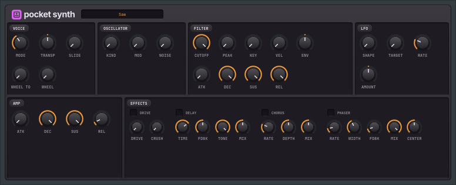

**Engine:** A small wavetable voice with stacked or detuned copies, slide and a filter.  
**Good for:** fast mono leads and slides.

### Hex Synth

Plugin type `gl.hexsynth`.

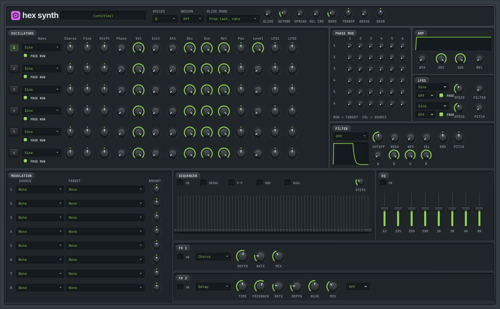

**Engine:** Two oscillators over a drawn wave set, a filter, drive, effects and a plate reverb.  
**Good for:** retro digital pads and bright keys.

### Acid Bass

Plugin type `gl.acid`.

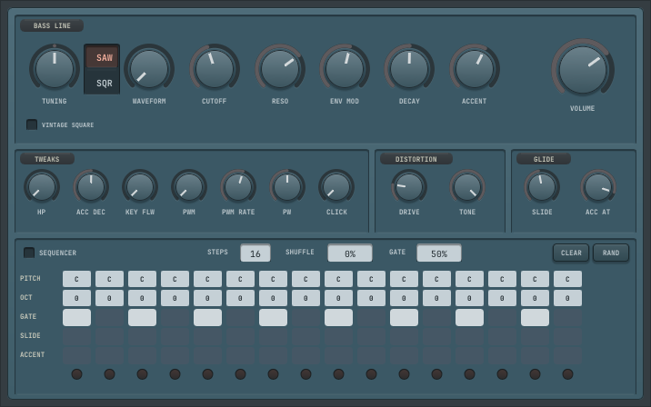

**Engine:** Monophonic saw or square bass with a resonant low pass, accent, slide and a step sequencer.  
**Good for:** squelchy acid lines.

### Step Bass

Plugin type `gl.stepbass`.

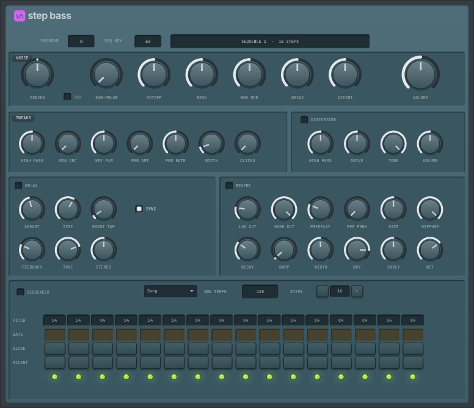

**Engine:** Monophonic bass voice with a 24 dB ladder low pass, accents, distortion, delay and reverb.  
**Good for:** driving sequenced bass lines.

## Wavetable and hybrid

### Isoline

Plugin type `gl.wavetable`.

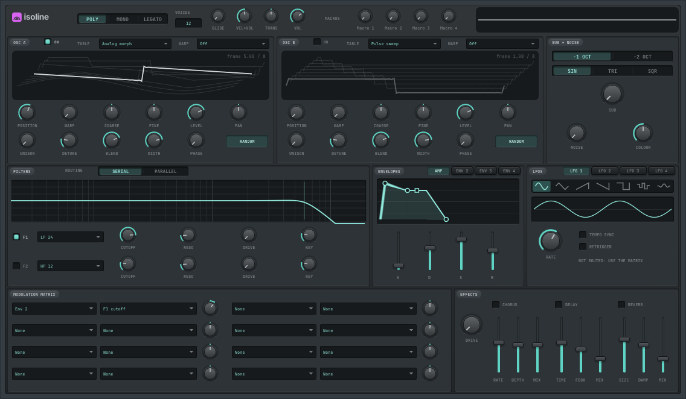

**Engine:** Two wavetable oscillators with warp, unison, two filters and a modulation matrix.  
**Good for:** growls, morphing pads and modern basses.

More: [Isoline in the synths notes](plugins/synths.md#isoline-glwavetable).

### Hybrid Synth

Plugin type `gl.gms`.

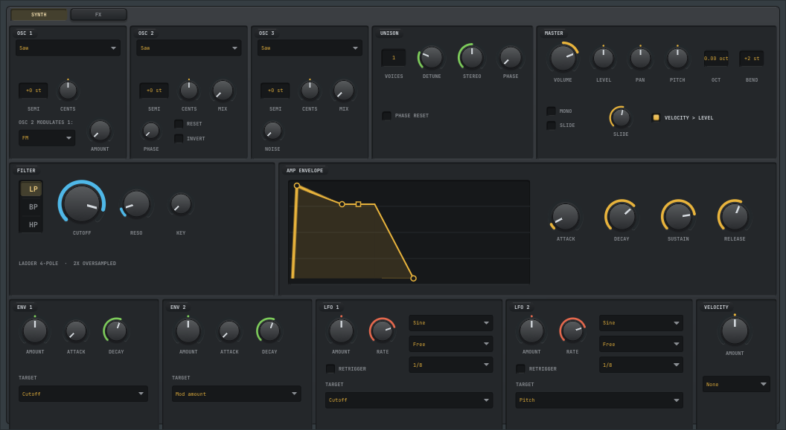

**Engine:** Band-limited wave oscillators from built-in or your own single-cycle files, with filters and modulation.  
**Good for:** layered digital pads and leads.

## FM

### Lattice

Plugin type `gl.matrixfm`.

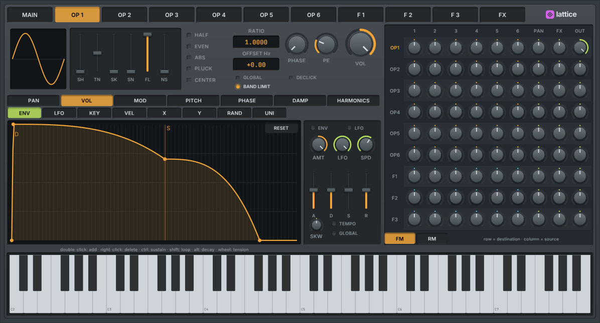

**Engine:** Six operators and three filters wired by a modulation matrix, with drawn envelopes.  
**Good for:** bells, electric pianos, metallic basses and evolving tones.

### FM Synth

Plugin type `gl.fm`.

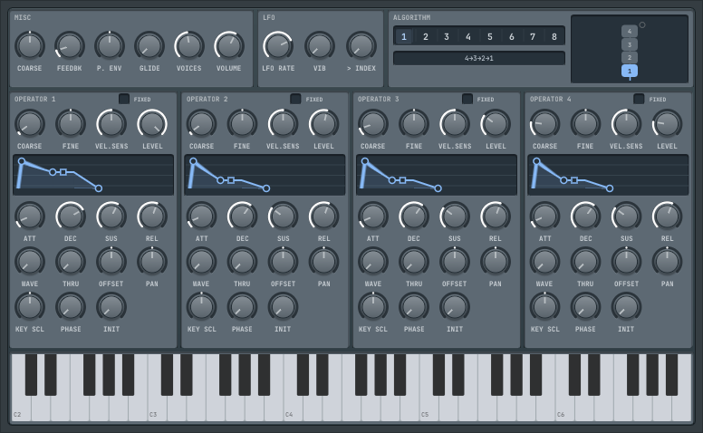

**Engine:** Four-operator FM with eight algorithms.  
**Good for:** electric pianos, bells and punchy basses.

### FM Duo

Plugin type `gl.fmduo`.

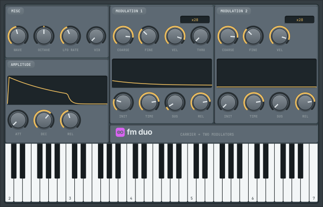

**Engine:** One sine carrier with two modulators.  
**Good for:** simple bells, basses and keys.

## Additive, resynthesis and pictures

### Facet

Plugin type `gl.additive`.

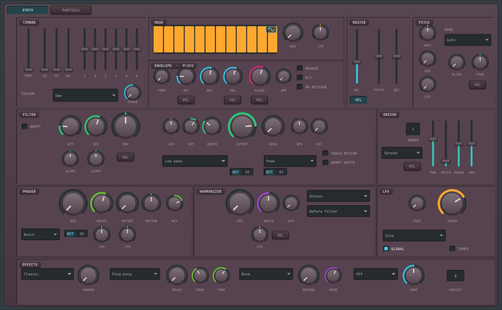

**Engine:** Additive: up to 256 sine partials shaped by a harmonic filter, a phaser, pluck and a harmonizer.  
**Good for:** organs, glassy pads, bells and filter sweeps made of partials.

### Halftone

Plugin type `gl.harmor`.

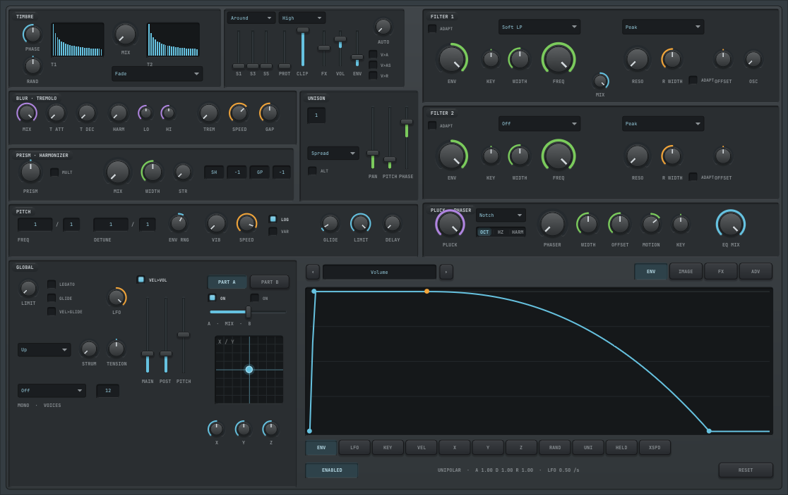

**Engine:** Resynthesis: plays a sample or a picture as sine partials in two parts and reshapes them.  
**Good for:** resynthesized samples, vocal textures and spectral morphs.

### Spectra Morph

Plugin type `gl.spectramorph`.

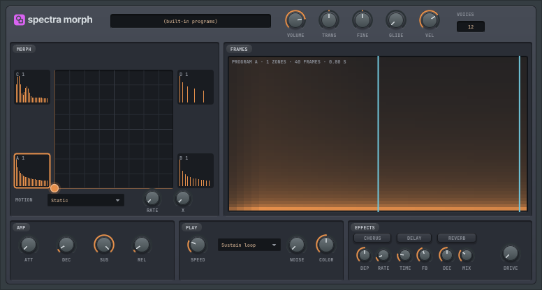

**Engine:** Resynthesized harmonic frames from four corners, blended on an X / Y pad.  
**Good for:** morphing tones and moving pads.

### Alloy

Plugin type `gl.alloy`.

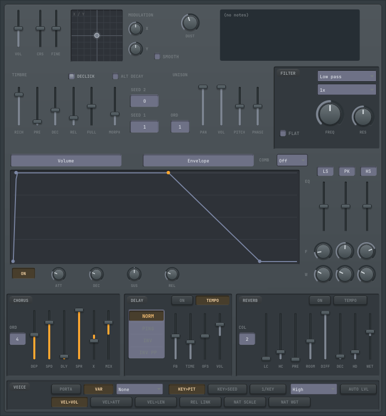

**Engine:** Harmonic spectra from two seeded random timbres, morphed and tilted.  
**Good for:** bells, gongs, metallic hits and drones.

### Image Synth

Plugin type `gl.imagesynth`.

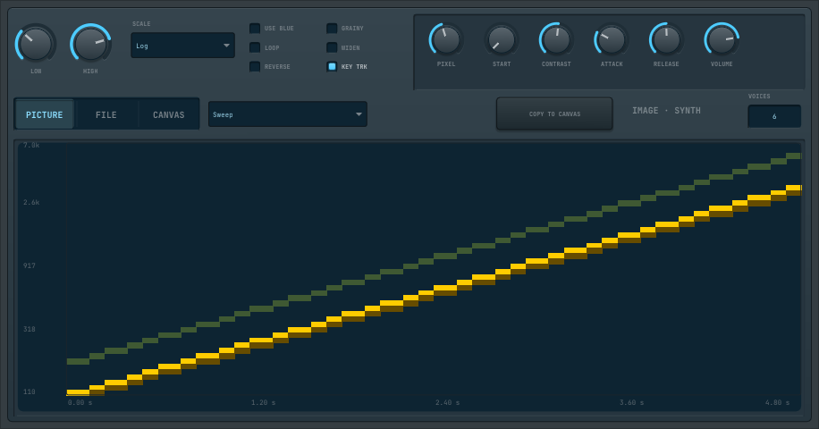

**Engine:** Reads a picture as a spectrogram: each row a sine, each column a moment.  
**Good for:** turning images into sound.

### Pixel Tone

Plugin type `gl.pixeltone`.

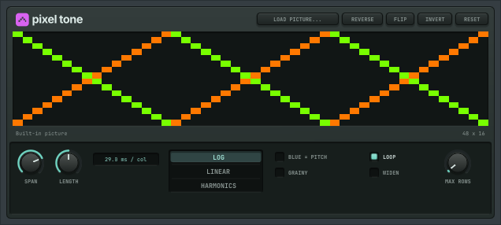

**Engine:** Plays your own pictures column by column as waves.  
**Good for:** lo-fi tones and textures from images.

## Physical models

### String Model

Plugin type `gl.string`.

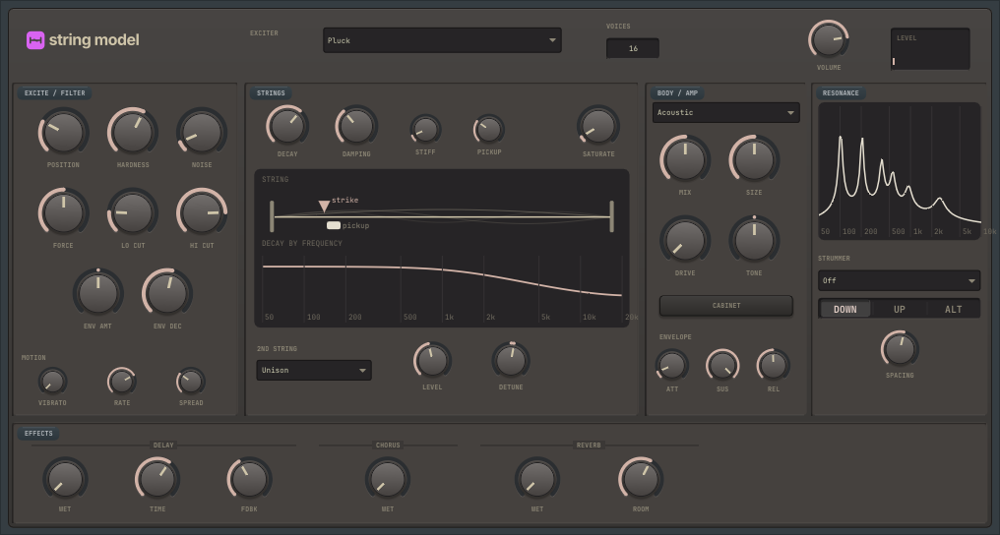

**Engine:** Two coupled waveguide strings, plucked, picked, hammered or bowed, with a body and an amp.  
**Good for:** guitars, harps, bowed strings and strums.

### Twin String

Plugin type `gl.twinstring`.

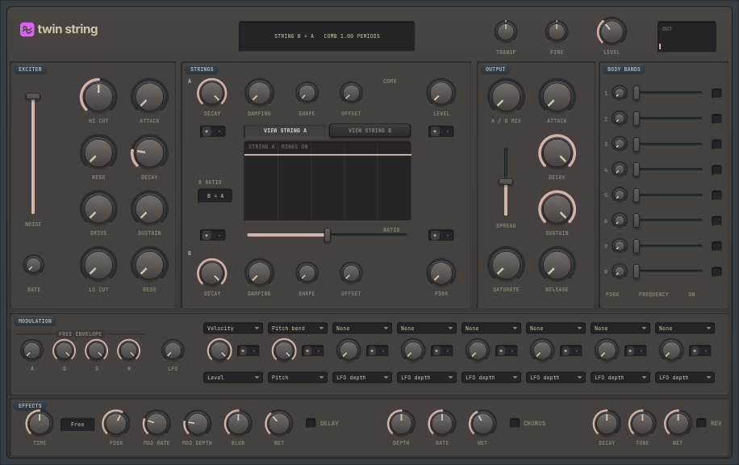

**Engine:** An overdriven exciter into two tuned waveguide strings and a comb.  
**Good for:** plucked, reedy and metallic tones.

### Pluck Model

Plugin type `gl.plucker`.

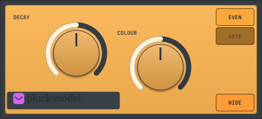

**Engine:** A lean plucked string (a tuned noise loop).  
**Good for:** plucks, harps and quick arpeggios.

### Pluck

Plugin type `gl.pluck`.

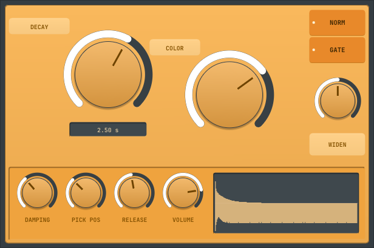

**Engine:** Karplus-Strong string, two detuned strings for stereo.  
**Good for:** simple plucks.

### Finger Bass

Plugin type `gl.fingerbass`.

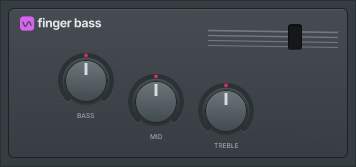

**Engine:** A plucked bass-guitar waveguide with a three-band tone stack.  
**Good for:** fingered bass lines.

### Keys

Plugin type `gl.keys`.

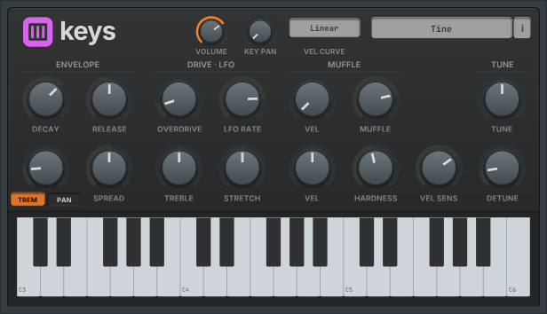

**Engine:** An electric piano model with hardness, tremolo and overdrive.  
**Good for:** electric piano chords and keys.

### Sample Keys

Plugin type `gl.samplekeys`.

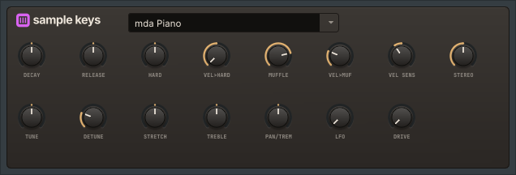

**Engine:** Sampled keyboards with key groups, velocity layers and tuning (needs sound sets on this computer).  
**Good for:** pianos and keys from your own sound sets.

## Samplers

### Sampler

Plugin type `gl.sampler`.

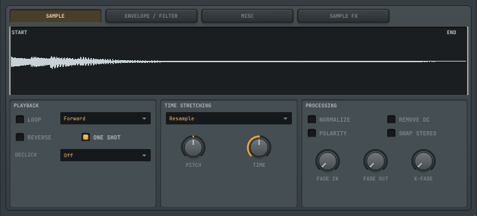

**Engine:** Plays one sample across the keyboard, with loop points, filter and envelopes.  
**Good for:** one-shots, loops and pitched samples.

### Multisampler

Plugin type `gl.multisampler`.

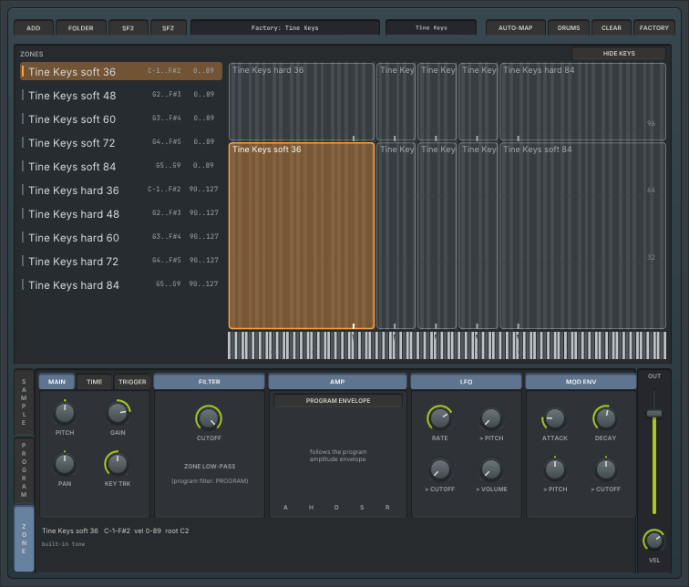

**Engine:** Zones of samples across keys and velocities; opens SFZ and SoundFont files.  
**Good for:** sampled instruments and SoundFonts.

### Patch Player

Plugin type `gl.patchplayer`.

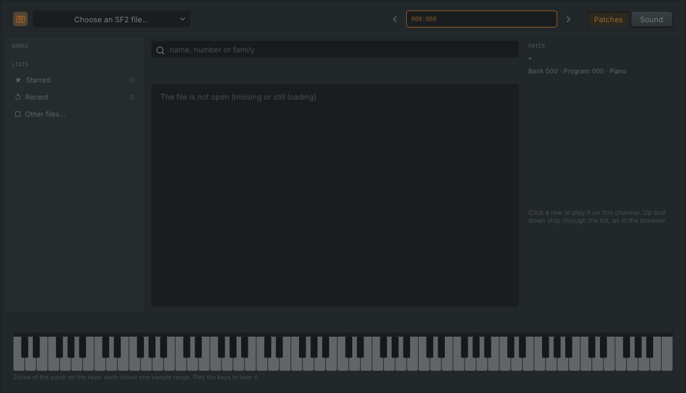

**Engine:** Plays one patch of a SoundFont file as the file describes it, with its envelopes, modulators and sends.  
**Good for:** General MIDI songs and SoundFont instruments.

### Folio

Plugin type `gl.waveprogram`.

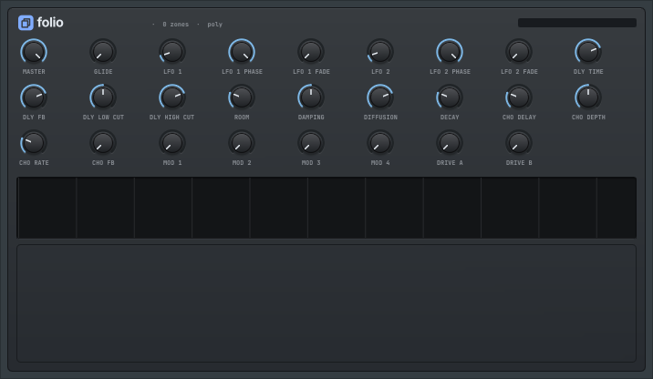

**Engine:** Sample programs: zones, a modulation matrix, filters, insert effects and buses.  
**Good for:** layered sample instruments.

### Kerf

Plugin type `gl.slicer`.

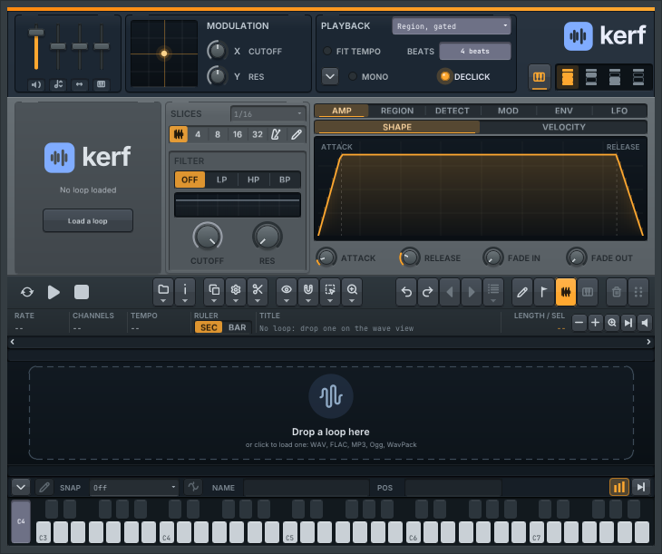

**Engine:** Region slicer that cuts a sample on the beat grid and plays the slices from keys.  
**Good for:** chopping loops into playable slices.

**Fit to tempo** plays the loop at the song's tempo. **Keep the pitch when fitting** in Kerf's options menu
is on for a new Kerf, so a fitted loop keeps its pitch through Gridline's stretch; turn it off for a
tape style fit, where the pitch follows the tempo. Projects saved before the setting existed open
with it off and sound as they did.

### Granular

Plugin type `gl.granular`.

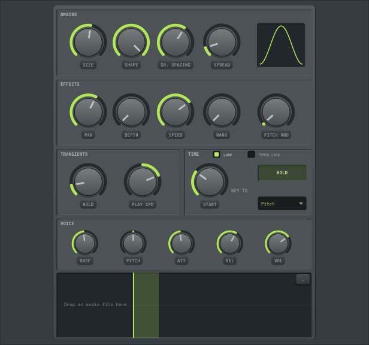

**Engine:** Grains read from the channel's sample.  
**Good for:** clouds, stretched textures and pads.

### Grain Scanner

Plugin type `gl.grainscan`.

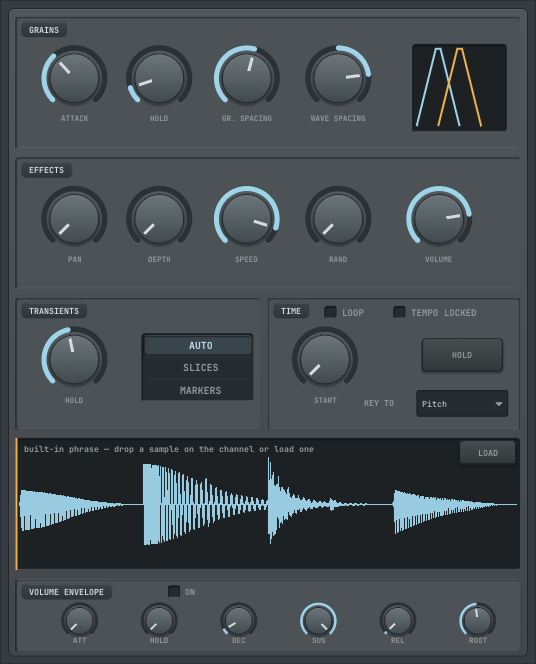

**Engine:** Grains that scan through the channel's sample at their own speed.  
**Good for:** time stretched, frozen and scanned sounds.

### Scratch Sampler

Plugin type `gl.scratch`.

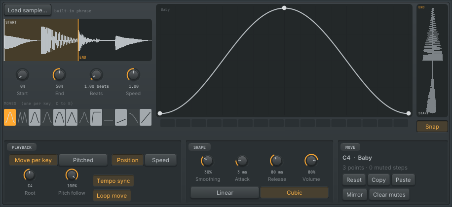

**Engine:** A sample played back and forth by drawn scratch moves.  
**Good for:** scratches and rewinds from any sample.

### Spline Scratch

Plugin type `gl.splinescratch`.

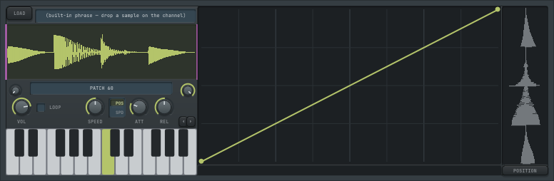

**Engine:** Each key plays its own drawn position and volume curves over the sample.  
**Good for:** tempo-synced scratch patterns.

### Tracker Sampler

Plugin type `gl.tracker`.

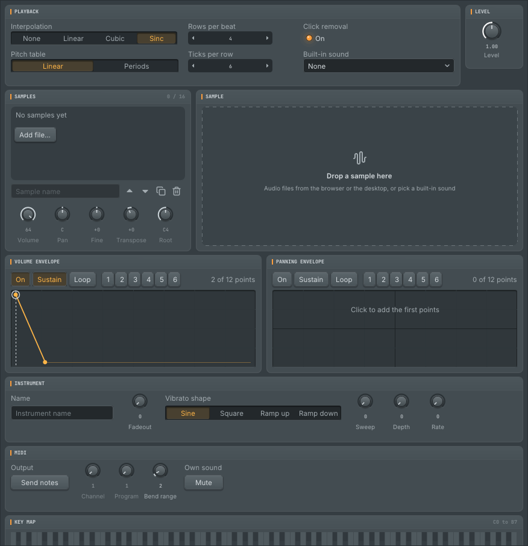

**Engine:** The Tracker's sample instrument: samples, loops and envelopes as a tracker keeps them.  
**Good for:** module-style songs and chip sounds.

## Drums

### Abacus

Plugin type `gl.pads`.

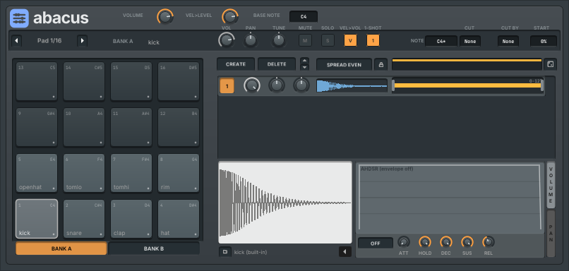

**Engine:** 32 sample pads with velocity layers, choke groups and envelopes.  
**Good for:** drum kits from your own samples.

### Drum Model

Plugin type `gl.drumkit`.

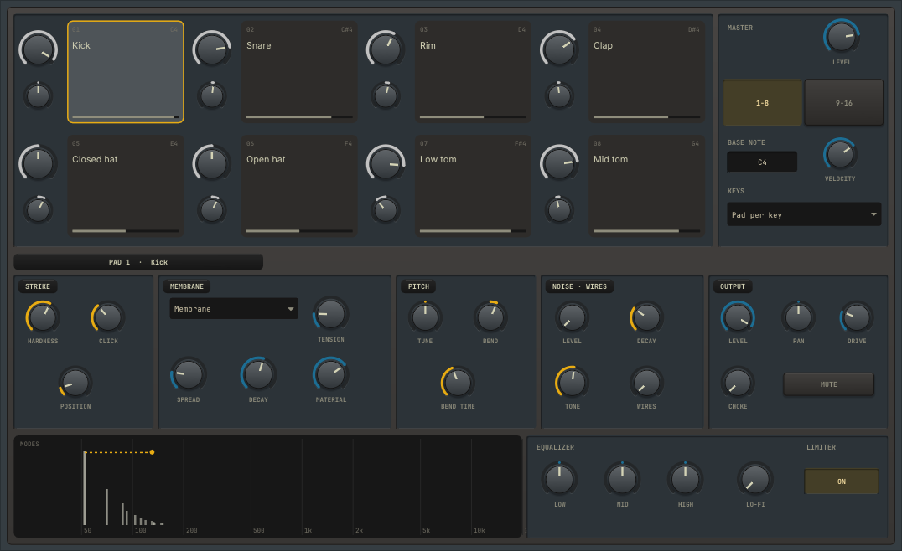

**Engine:** 16 pads of modal drums struck by a mallet, with a noise layer.  
**Good for:** synthesized acoustic and electronic kits.

### Membrane Pad

Plugin type `gl.membranepad`.

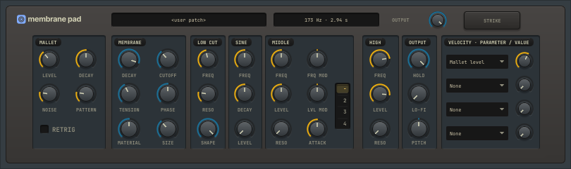

**Engine:** One keyboard-pitched membrane drum.  
**Good for:** tuned toms, hand drums and percussion.

### Membrane Kit

Plugin type `gl.membranekit`.

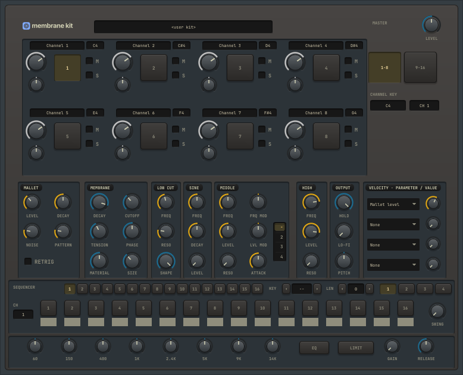

**Engine:** 16 membrane drums with a step sequencer, an EQ and a limiter.  
**Good for:** whole synthesized kits and grooves.

### Kick Sculptor

Plugin type `gl.kicksculpt`.

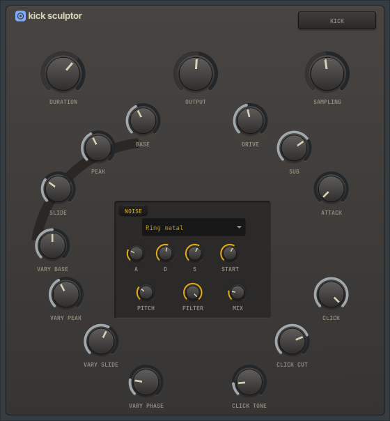

**Engine:** A pitch-swept sine kick with click, drive and noise layers.  
**Good for:** shaping a kick from scratch.

### Sweep Kick

Plugin type `gl.sweepkick`.

**Engine:** A sine sweeping down with click and distortion.  
**Good for:** quick electronic kicks.

### Kick

Plugin type `gl.kick`.

**Engine:** A synthesized kick drum.  
**Good for:** simple kicks.

### Snare

Plugin type `gl.snare`.

**Engine:** A synthesized snare: tone and noise.  
**Good for:** simple snares.

### Hi-hat

Plugin type `gl.hat`.

**Engine:** Synthesized hi-hats.  
**Good for:** simple hats.

### Clap

Plugin type `gl.clap`.

**Engine:** A synthesized hand clap.  
**Good for:** simple claps.

## Patching, MIDI and control

### Junction

Plugin type `gl.patcher`.

**Engine:** A patch of instruments and effects joined with cables, with eight macros.  
**Good for:** layering, splitting and building your own instruments.

### MIDI Out

Plugin type `gl.midiout`.

**Engine:** Sends the channel's notes and controllers to a MIDI device or to other channels.  
**Good for:** playing hardware synths and other channels.

### Envelope Mod

Plugin type `gl.envctl`.

**Engine:** Turns notes into an envelope that can move any knob.  
**Good for:** rhythmic modulation of other plugins.

### Keyboard Mod

Plugin type `gl.keyctl`.

**Engine:** Turns the notes played into control values.  
**Good for:** key-tracked modulation of other plugins.

### Voltage Out

Plugin type `gl.cvctl`.

**Engine:** Turns notes into pitch and gate voltages on an audio interface.  
**Good for:** playing modular synths.

### Voltage In

Plugin type `gl.cvin`.

**Engine:** Reads voltages from an audio interface and turns them into notes.  
**Good for:** playing Gridline from modular gear.

### Preset Stand-in

Plugin type `gl.flex`.

**Engine:** A stand-in for a preset player: one of Gridline's engines, chosen by the preset's kind of sound, with its macros.  
**Good for:** playing imported projects that used a preset player.
