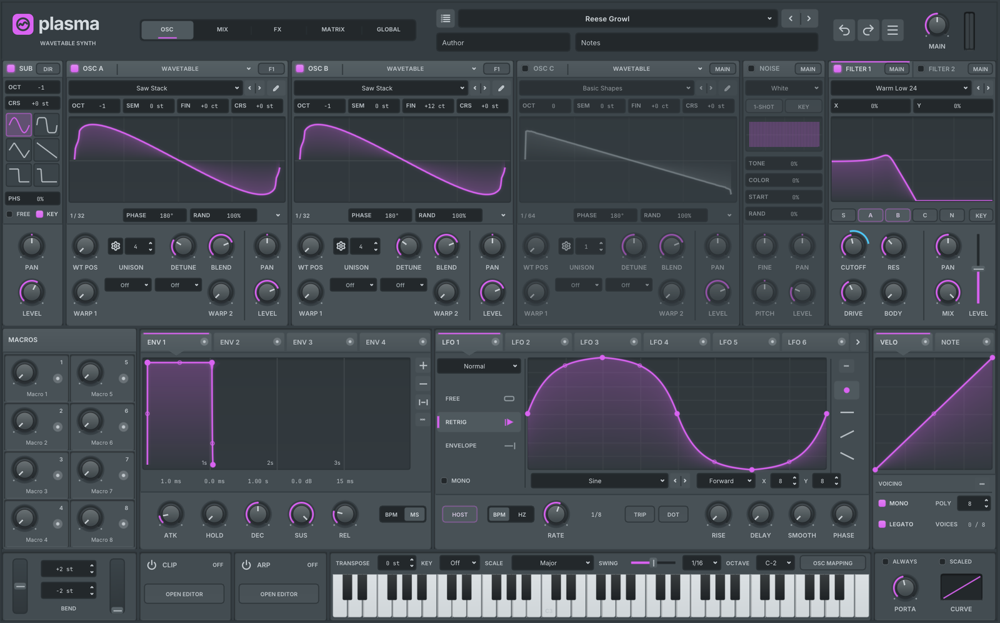
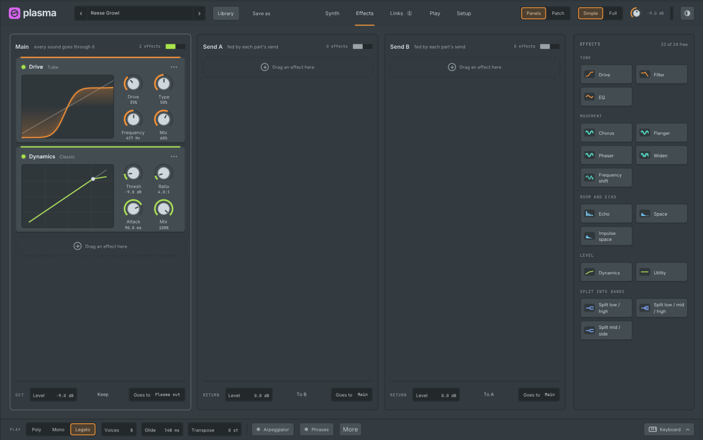
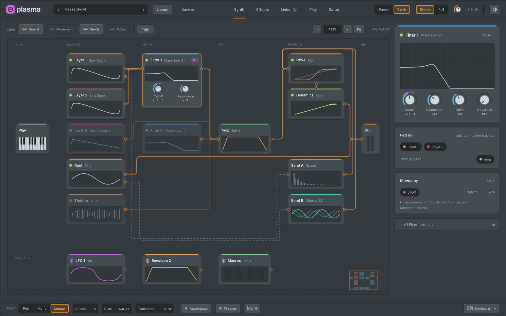

# Plasma (`gl.plasma`)

Plasma is a wavetable-centred hybrid synthesizer: three layers that each play a wavetable, a
multisample, a sample, a granular cloud or a spectral resynthesis, plus a Root (a plain wave under
the layers) and a Texture (noise or a sampled sound), two filters, 64 links, three effect lanes, an
arpeggiator and a phrase player. It can also read presets made for Serum 2 (and Serum 1 `.fxp`
files) from your own folders and set up a Plasma sound from their settings, and it plays projects whose
Serum or Serum 2 is not installed (see "Stand-in for a missing Serum" below).

Plasma is in the plugin picker under Synths. Its code, factory wavetables, presets and artwork
are original. Opening a Serum preset reads your own preset and content files; nothing from
another product ships with Gridline. Plasma is an independent synth with its own engine: an
opened preset is Plasma playing the settings it read, not a reproduction of the other synth's
sound. Gridline is not affiliated with or endorsed by Xfer Records; "Serum" is a trademark of
Xfer Records and is named only to describe the preset files Plasma can read.

## Layout

The editor has five tabs: **Synth**, **Effects**, **Links**, **Play** and **Setup**. Every setting
has one home in one of them, and the sound reads from left to right in the order it is made. On
Synth and Effects a switch shows the same sound as **Panels** (blocks) or **Patch** (boxes and
wires); Tab flips between them. **Simple | Full** sets how much each block shows: Simple keeps the
main controls and folds the rest behind the block's menu (Show every setting here), Full shows
every control in place. The choice is remembered, and the Editor card in Setup sets it too.

### Top bar

From left to right: Plasma's name with the sound's name, its < > arrows and its sound list (click
the name for Init, the factory sounds, Open file and the Library), **Library**, **Save as**, the
five tabs (Links shows how many links are in use), Panels | Patch, Simple | Full, the output level
with its meter and the dark or light switch. A sound that came from another format shows a short
note with an info mark beside its name. The plugin window's own header above keeps only its menu,
A / B and copy. Undo and redo are Gridline's own (Ctrl+Z / Ctrl+Shift+Z, the same history as the
rest of the project): every gesture is one step.

### Synth

The sound as blocks in three sections:

- **Sources**: Layer 1 to 3, Root and Texture.
- **Shape**: Filter 1 and 2, then the Amp (Envelope 1). The section's title row says in a few
  words where the sources go ("Layers 1 and 2 to Filter 1") and has a **Routing** button.
- **Movement**: the LFOs with their shapes at a readable size, Envelopes 2 to 4, the Macros
  (right-click a knob to rename it), Key and touch, and Chance. The row pages with the dots at its
  right and counts the links in use (64 at most).

Each block has a title bar with its on light (or, for a movement source, its link dot), its name,
what it plays (a layer's table, a filter's type) and its menu (the dots at the right); a folded
block shows its picture in the title bar. The menu opens the advanced panel (or double-click the
block), turns it on or off (or Shift-click its name), resets it, copies and pastes its settings to
another block of the same kind (Ctrl+C / Ctrl+V with the pointer over the block), loads and saves a
layer's wavetable, shows every setting in place, folds it, shows it in the Patch view, says what it
does and removes it from its section (Delete). Drag a block's name to move it within its row: the
order on screen is the editor's own and never changes the sound.

A family with room shows its next slot as a quiet outline ("Layer 3: click to add it, or drag one
here"). Each layer's table display is edited in place: drag across it to move through the table,
switch 2D / 3D and read the morphs and their amounts on it.

**Parts sidebar** (right on Synth and Effects; fold it, or drag its edge to resize it): **Parts**
lists each kind of block by section with how many are in use (Layer 2 of 3, LFO 1 of 10): drag one
into its section, or click it, to add the next free one; a full family is greyed out. Removing a
block switches its slot off and returns its settings to the start, as one undo step. Under it the
**Library** lists the factory tables, shapes and sounds, with a search: drag a table onto a layer to
load it (or onto empty space for a new layer), a shape onto an LFO, click a sound to load it.

**Advanced panels** grow from a block over the Synth tab, with Back at the top left and the other
members of its family at the top right:

- **Layer** (the table editor): Edit frame or 3D view, the frame with the whole table beside it,
  Copy, Paste and Add frame, the harmonics under it (levels or phases, 32 to 256 partials; drag a
  bar to change one), the frame strip, and cards for the **Table** (Load, Import, Export), **Draw**
  (freehand, lines and shapes, with snap across and up and down), **Change frames** (this frame,
  every frame, or a blend between two frames; Formula and shifting tools fold out under it) and
  **Voice** (unison, detune, spread, warp and its style). In a formula, `x` runs -1..1 across the
  cycle, `y` 0..1 across the table and `in` is the current sample.
- **LFO**: the shape across the whole width with quick shapes, More shapes, a grid and Points or
  Steps, then the **Speed**, **Each note** (keeps going, restarts or plays once), **Feel** and
  **Moves** (its links) cards.
- **Envelope**: quick shapes, Time or Beats, the graph, then the **Times**, **Levels**, **Curves**
  and **Moves** cards.
- **Routing**: one row per source and filter (level, pan, Goes to: Filters, Out, Direct or Off, the
  Filter 1 / 2 balance, both send levels, and whether Envelope 1 shapes it), then Send A and Send B
  (level, where each goes), Send chaining and Out (output, direct out and the meter).

**Advanced**, under the cards, opens the less used settings.

### Effects

Three lanes side by side: **Main** (every sound goes through it), **Send A** and **Send B** (fed by
each part's send). Each effect is a block with its live picture, its main dials and its menu
(every control with Show every setting here, or Full). Drag an effect by its name to reorder it or
move it to another lane; drag one in from the sidebar, which lists the effect types by group (Tone,
Movement, Room and echo, Level, Split into bands) and how many of the 24 slots are free. Under each
lane are its level and where it goes (a send returns to the main lane or feeds the other send);
**Keep** on the main lane keeps the effects when another sound loads.

### Links

Every link, **By source**, **By target** or **By slot**, with a search and **New link**. Select a
link to edit it on the right: its two ends, the response curve (drag the points, or pick Straight,
Ease in, Ease out, S curve or Steps), how far it moves, Centred on the knob, Scaled by another
source, rise and fall, trim, Turn off and Remove link. **Ready to link** lists the movement sources
that have no links yet.

### Play

An overview of **Voices** (Poly, Mono or Legato, the notes at once and their variation),
**Glide**, **Wheels** (bend up and down, transpose, fine), the **Arpeggiator**, **Phrases** and
**Key zones**, with a page for each under the tab: Voices, Key and touch, Arpeggiator, Phrases and
Key zones.

### Setup

Sound quality, Tuning (concert pitch and `.tun` scales), About this sound (name, author, notes),
Timing (every envelope time or LFO rate scaled at once), Send notes out, the Editor (value bubbles,
live motion, Simple or Full) and Compatibility (settings that make sounds brought in from other
files play the way they were made; new sounds leave them as they are).

### Play bar and keyboard

The play bar at the bottom holds Poly / Mono / Legato and the notes at once, glide, transpose, the
Arpeggiator and Phrases switches, More and Keyboard. The keyboard drawer (Alt+K) slides up over the
bottom of any tab, and the small bar at its top closes it again. It holds:

- the bend and mod wheels: drag them up or down. The bend wheel springs back to the centre when you
  let go; the mod wheel stays where you leave it. Double-click resets a wheel, right-click gives the
  usual control menu (links, automation, MIDI link);
- Bend up, Bend down and Trigger octave: drag up or down on a field, turn the mouse wheel over it,
  or click its minus and plus;
- a keyboard to play the sound: click a key, or hold the button and slide across the keys to play
  each in turn (the one you leave stops as the next starts). Letting go, Escape, closing the drawer
  or the window, or switching to another application stops the key.
  Lower on a key plays louder. Keys light up as they sound, from the mouse, MIDI or the song; a
  layer that plays only part of the keyboard shows its key zone as a coloured line above the keys,
  and while the arpeggiator or the phrases are on, a bracket marks the trigger octave.

While the pointer is over the drawer, nothing under it reacts.

### Patch

The Patch view draws the sound as boxes on a calm canvas. By default they read left to right in
the order the sound flows: the sources, the filters (Shape), the amp, the effects of the main
chain and **Out**, with the two sends under the amp. Every movement source in use (LFOs,
envelopes, macros, velocity and the rest) is a small tile below the sound, grouped by family.
Nothing else is written on the canvas: hints show in the hint bar and in tooltips.

- **At rest** the lines are quiet: thin orange **sound lines** for where each part's sound goes
  (a source feeding both filters shows two lines whose thickness is the balance). Every line leaves
  a box at a dot on its right edge and arrives at its own ring on the left edge of the next box, so
  each one can be followed from end to end; it takes the shortest way round the other boxes and
  never runs through one. A part that also feeds a send shows a branch from the same dot to the
  send (as thick as its send level), and the send's line goes on into the effects or Out. A box shows how many links move it, with one dot per link in the source's family
  colour; a tile shows how many controls it moves. In **Full**, a box also names the controls
  that are moved.
- **Point at a tile** to see what it moves: one curve runs from the dot at the top of the tile to
  the bottom edge of each box it moves (one curve per box, however many of its controls move), and
  each box shows the control and the amount (for example "Cutoff +40%"); everything else fades.
  **Point at a box** to see what moves it, the same way. Click a tile to keep its paths on view:
  drag an amount up or down to change it, Alt+click it to remove the link, or drag a path's end off
  its box onto empty canvas to unlink it.
- **Link** by dragging the dot at the top of a tile onto a box: a short list of that box's main
  controls (and the ones already moved) opens; pick one. A new link starts at 25 %; picking a
  control that is already linked selects that link so you can change how far it goes. **All controls** shows the rest with a
  search. Drop the dot on empty canvas to search every control.
- **Route** a part's sound by dragging from the right edge of a source or filter onto another box.
  Only the places the sound can go light up; anything else is refused with the reason. Drop on
  empty space for a search menu (where it can go, or an effect to add). Alt+click a line to take
  it away.
- **Move** any box or tile by dragging it. It snaps to the grid and lines up with its neighbours'
  edges and middles. A box let go on another slides to the nearest free place. The effects of the
  main chain run in the order they stand from left to right, so moving an effect past another
  changes the chain to match (in the same undo step) and the lines always read forward. Where you put the boxes is saved with the sound (in presets and projects), and each move
  is one undo step. A part you add later lands in a free spot next to what it connects to.
- **Clean up** at the top left sorts every box into the flow again (sources, shape, amp, effects,
  out from left to right, the sends under the amp, the movement tiles under the sound by
  family) evenly on the grid, with no box over another and no line through a box. It keeps your
  order within a column where that reads well, and the boxes glide into place in one undo step.
  **Fit** (F) frames the whole patch; the wheel zooms and dragging the background looks around.
  The link count (64 at most) is at the top right.
- The dashed **add tiles** turn on a hidden layer, root, texture or filter, add an effect to the
  main chain or a send, or show another movement source.
- Click a box to edit it in the **inspector** on the right (it shows only while something is
  selected): its picture and main controls, what feeds it and where it goes, the links that move
  it and all its settings. Double-click a box, or right-click it, to open it in the panels;
  right-click also turns it on or off and removes an effect. Delete removes the selected effect or
  link, or turns a box off; Esc clears the selection.

Both views edit the same sound, one undo step per gesture, so switch back and forth at any time.

### Linking

Every control takes modulation, three ways: drag a movement source's dot onto a control; click a
source's dot to turn on Link mode, then drag on any control to set the link's depth directly
(click the dot again or press Esc to stop); or right-click a control and choose Link from. A
linked control shows a ring in the source's family colour; Alt-drag changes the newest link's
depth. The same menu lists the control's links (depth, bypass, remove) and offers automation and
MIDI links. The Links tab lists all 64 links with their curves.

## Sources

- **Wavetable**: 22 factory tables (each up to 256 frames, band-limited mip levels), your own
  `.wav` tables (single cycles or tables with a stated cycle length) and tables drawn in the
  editor. Position, two morph slots with 103 modes (sync, bend, PWM, asym, flip, mirror, remap
  curves 1-4, quantize, odd/even, filters, fourteen distortions, FM / PD / AM / RM from another
  layer, the Root, the Texture or a filter, and spectral warps for the spectral engine), unison up
  to 16 voices with detune, blend, width, stack, table / morph spread and its detune curve, phase
  and random phase, octave / semitone / fine / coarse, pan and level.
- **Multisample**: plays an `.sfz` instrument (zones by key and velocity).
- **Sample**: start, end, loop modes and crossfade, slices, position and scan.
- **Grains**: density (free, tempo or grain count), length (free, tempo or percent), reverse
  probability, window shape and skew, randomness for offset, direction, pitch, length, pan, gain,
  window and morphs, up to 64 grains, and how unison voices start their grains.
- **Spectral**: resynthesis of a sample (or the wavetable) with the spectral warp modes.
- **Root**: six shapes, octave, coarse, phase, free-running or key-triggered, pan and level.
- **Texture**: 19 built-in noises or your own file, one-shot / keytrack, colour, start, random
  start, pitch, fine, pan and level.
- **Filters**: two filters with 106 types in groups (low-, high-, band-pass and notch slopes,
  ladder and analog models, combs, flangers, phasers, formant and vowel filters, multi-mode
  morphing and more), cutoff, resonance, drive, a type-dependent fourth knob (the X / Y pad for
  morphing types), key tracking, pan, mix and level. Each source goes to the filters (with a
  Filter 1 / 2 balance), straight out, or directly past the amp envelope and the main effects
  (Goes to, in Routing).

## Effects, links and voices

- **Effects**: up to 24 effects across the three lanes: drive (18 modes with an editable shaper),
  filter (all filter types), EQ, chorus, flanger, phaser, widen, frequency shift, echo, space
  (several reverb models), impulse space (with your own impulse responses), dynamics (single and
  multiband), utility, and splits (low / high, low / mid / high, mid / side) that hold effects per
  band.
- **Links**: 64 links: source, response curve (editable, with rise and fall), amount, centred on
  the knob or one-sided, destination, live output, a second source that scales it with its own
  curve and invert, trim and bypass.
- **Key and touch** (a page under Play): velocity and key response curves, the wheels, per-note
  expression (MPE), voice variation (random pan, detune, cutoff and times, and per-voice sequences
  of pan, detune, cutoff, envelope times and two movement values) and the sources that restart a
  part.

## Arpeggiator and phrases

- **Arpeggiator**: 12 patterns with a switch-on grid and Edit every pattern; per slot: shape (up, down, as
  played, chords, random and more, or a drawn pattern of steps with velocity and accents), rate
  in tempo divisions or Hz with triplet and dotted, transpose (shift, range, direction and cycles
  per step), latch and thru, offset, repeats, gate and chance, retrigger (on launch, by rate, on a
  new note, on the first note) and velocity (decay towards a target). The keys of the trigger
  octave pick slots while you play.
- **Phrases**: 12 phrases, each with a piano roll, a velocity lane and automation lanes for any
  parameter, length, keyboard span (off, mono, poly, offset), transpose, play modes (forward,
  reverse, pendulum, random variants, one shot, static), rate with BPM / triplet / dotted, launch
  quantize, restart, velocity start and note gate. Record takes the notes you play into the
  phrase (Layer keeps what is there, Extend lets the phrase grow, the grid button quantizes), Fold
  shows only the keys in use and the headphones button auditions notes as you place them.
- **Send notes out** (Setup) sends the phrase player's (or the phrase and arpeggiator's) notes on
  to the channel's MIDI output.

## Presets

There is one way to open a preset, whatever made it: Plasma presets, Serum 2 presets
(`.SerumPreset`) and Serum 1 presets (`.fxp`) are recognised by their content and open the same
way from every place:

- **Open preset...** in the preset menu (the file dialog lists every supported type at once);
- the Library (double-click, Enter, or Up / Down to step through and audition);
- dragging a file (from the browser panel or the desktop) onto Plasma's window, or onto the
  channel rack for a new Plasma channel; double-clicking one in the browser panel;
- the plugin header's preset menu and anything else that loads a preset for Plasma.

The Library (in the top bar) is a full page of **Tables**, **Shapes** and **Sounds** with a search,
filters and a preview of the chosen item. Tables and shapes show as cards with their pictures,
grouped as Factory, your own folders and the installed library, with Load into a chosen layer or
LFO; Import copies a WAV into your table folder. Sounds lists the factory sounds, your Gridline
preset library for Plasma (Save as stores the current sound there) and the **imported folders**: the Serum 2 and Serum preset folders found on this computer (macOS, Windows, and Wine
prefixes on Linux), grouped by folder and bank, plus folders you add with Add a folder. Each folder found reads "Presets 1", "Presets 2" and so
on; right-click one to rename it or to show it in the file manager. The library
is indexed in the background and kept in a cache, so it lists at once and refreshes when files
change (Read again rescans now). Typing in the search field while a Serum folder is selected searches
the whole library.

Opening a Serum preset reads the preset's settings and maps oscillators, warps, unison, filters, envelopes, LFOs (including drawn
shapes), macros, the matrix, the effect racks, the arpeggiator and clips onto Plasma. Wavetables,
samples and impulse responses that a preset references are looked up in your Serum content
folders and the folders you added. When something is approximated or a file was not found, a
short notice says so; the full report stays with the sound: hover the small info mark next to the
preset name.

Serum 1 presets go through the same mapping: their 299 parameters, modulation matrix, effect
order, LFO shapes, wavetable and noise names and macro names are read from the preset. Serum 1's
Chaos sources, the Sync Window and Mirror warps and LFO trigger modes have no exact counterpart and
are listed in the report.

## Stand-in for a missing Serum

Installed plugins are always hosted as themselves: Plasma never replaces an installed Serum.
When a project (a Gridline project or an FL Studio project) uses Serum or Serum 2 and the plugin
is not installed, Plasma plays it instead:

- the plugin's saved state is read (Serum 2's VST3 or Audio Unit state, Serum 1's VST2 chunk) and
  mapped onto Plasma as when you open the preset;
- automation clips, pattern automation and controller links of the plugin's parameters move to the
  matching Plasma parameters, with their values converted. Parameters without a counterpart keep
  their automation aside;
- the original plugin and its saved state are kept in the project untouched. When the plugin is
  installed again, the project opens with it, its state and its automation as before. Exporting
  to FL Studio writes the original plugin;
- the plugin window shows a short note ("Serum 2 is not installed: opens as Plasma") with
  what is approximated on hover, and **Replace with Plasma** keeps Plasma for good (the missing
  plugin and its saved settings are then removed from the project).

## FL Studio export

FL Studio has no Plasma of its own. Unless you choose **Rendered to audio** in **Settings, Project,
FL Studio export**, a Plasma channel goes into an FL Studio project as Plasma from the Gridline
Suite with all its settings, and FL Studio opens it live and editable where the Gridline Suite is
installed. With the default choice a muted copy of the channel plays it rendered to audio, for
computers without the Suite; with **Gridline Suite plugins only** there is no copy. **Rendered to
audio** renders the channel to samples. Automation of Plasma's parameters is kept in every case
where the plugin is written. (A Plasma that stands in for a missing Serum is exported as that
plugin, as described above.)

## Performance

Plasma renders control changes on a fixed grid, so the sound does not depend on the buffer size.
Sound quality in Setup sets the voice oversampling: Normal (none), High (2x, the default) or
Best (4x).

Parts that are not in use cost nothing: a layer, Root, Texture or Filter 2 that is off is
skipped, an LFO, envelope, macro, chance or key source with no link only keeps its clock running
(so it is in step the moment you link it), empty effect slots and unused sends are skipped, and
unison and oversampling cost only when they are used. A one-layer sound uses a fraction of the
processing time of a sound with everything on, and switching a part on is click-free.
