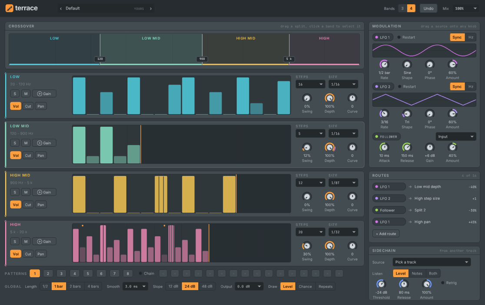

# Terrace (`gl.terrace`)

Terrace is a multiband rhythmic gate. It splits the sound into three or four bands and gives every
band its own steps for volume, filter cutoff and pan, so the lows can pump on the quarters while the
highs chop in sixteenths and the mids drift from side to side. Two LFOs, an envelope follower and a
sidechain from another track move any setting through a list of routes. It is in the plugin picker
under Dynamics (search for "gate", "multiband" or "terrace").

Terrace adds no latency and runs per sample, so the result does not depend on the buffer size.
Every level change is smoothed, so it does not click.

## The crossover

The panel at the top shows the sound's spectrum with the bands over it.

- **Drag a split** (the white lines with their frequency) to move it. The splits keep at least a
  third of an octave between them.
- **Click a band** to select it (its row gets a brighter frame; **+ Add route** routes onto it).
- **Bands** (top right, 3 or 4) sets how many bands there are. With 3 bands the third split is not
  used.
- **Slope** (bottom row: 12, 24 or 48 dB) sets how steeply the bands part.

The crossover is a Linkwitz-Riley type: with every step at rest the bands add back up to the input
at every frequency, with no dip or bump at the splits. It was chosen over a linear-phase crossover
because it adds no latency and does not smear a sharp gate with pre-ringing. The low bands pass
filters that match the phase of the splits above them, and the dry signal passes the same filters,
so **Mix** blends wet and dry without any comb filtering.

## The band rows

Each band has a row under the crossover:

- **S** solos the band (several can be soloed), **M** mutes it, and **Gain** sets its level from
  -24 to +12 dB (drag it up or down).
- **Vol**, **Cut** and **Pan** pick the lane the row shows. All three lanes play at once.
- **The steps.** Drag across the lane to draw. Volume steps go from silence (bottom) to full
  (top); cutoff steps from the band's low edge (bottom) to fully open (top); pan steps from left
  (bottom) through the centre line to right (top). Steps past the lane's length are greyed out.
- **Steps** sets the lane's length, 1 to 64 steps. Each lane has its own length, so lanes of
  different lengths drift against each other.
- **Size** sets each step's length, from 1/32 to 1 bar, triplets included (the list says how many
  steps of each size fill a bar). **Auto** fits 16 steps into the pattern's length.
- **The ruler** along the top of the lane numbers the bars and marks the beats, and its right end
  says how long the lane plays before it loops ("16 steps = 1 bar", "3 steps = 1 bar", "5/16").
  The beat lines run through the steps too, so you can see a triplet step cross a beat. A lane
  shorter than a bar shows one bar of its step size: 3 steps of 1/2T fill the whole lane.
- **Swing** delays every other step.
- **Depth** sets how far the lane moves the sound: at 0 the lane does nothing, at 100 % it goes all
  the way to its steps.
- **Curve** bends the line between steps: at 0 each step holds until the next one, to the right
  the line glides late, to the left early. The line as played is drawn over the steps.

**Draw** in the bottom row sets what drawing edits:

- **Level**, the step values.
- **Chance**, how likely each step is to play (0 to 100 %). A skipped step plays silence on the
  volume lane, the open filter on the cutoff lane and the centre on the pan lane. The dice are set
  by the step's place in the song, so a project plays the same every time and an export matches
  what you heard.
- **Repeats**, 1 to 4 hits within a step (a volume step of 2 hits plays twice, with a gap).

**Right-click a step** for the step menu, or **right-drag across steps** to pick several and
release for the menu. It splits the steps into 1 to 4 hits, sets their chance (100, 75, 50 or
25 %) and their level (full, half or off; on the cutoff lane open, half or closed; on the pan lane
left, centre or right), resets them, and under **Lane grid** gives the lane a ready grid that fills
a bar. Each choice is one undo step.

### Splitting a step into repeats

A step can play as 2, 3 or 4 quick hits instead of one (a ratchet or a stutter):

1. Right-click the step (or right-drag across a few).
2. Under **Split into**, click **2**, **3** or **4**.

Or hold **Alt** and roll the mouse wheel over a step to step its repeats from 1 to 4. A split step
is drawn as that many short blocks with gaps between them. Each hit plays the step's level for the
first half of its share of the step and rests for the second half. This works on all three lanes
and in every pattern.

### Triplets and odd grids

The steps follow **Size**, so a triplet grid is a lane whose size is a triplet:

| You want | Steps | Size |
|---|---|---|
| straight sixteenths | 16 | 1/16 |
| straight eighths | 8 | 1/8 |
| triplet eighths (a bar of shuffle) | 12 | 1/8T |
| triplet sixteenths | 24 | 1/16T |
| triplet quarters | 6 | 1/4T |
| one bar split in three | 3 | 1/2T |

The quickest way is the step menu: right-click any step, **Lane grid**, then the grid. For odd
groupings that run against the bar, keep a straight size and pick an odd number of steps: 3, 5 or
7 steps of 1/16 loop every 3, 5 or 7 sixteenths and land on a different beat each time round
(the ruler shows where the loop ends). Each lane (Vol, Cut, Pan) of each band has its own Steps
and Size, so one band can play triplets while another plays straight.

## Modulation

The column on the right holds the sources:

- **LFO 1** and **LFO 2**: **Sync** runs them in note values (1/32 to 8 bars), **Hz** in cycles a
  second. **Rate**, **Shape** (sine, triangle, saw up, saw down, square, random, smooth random),
  **Phase** and **Amount**. **Restart** starts the LFO again at each pattern start and with each
  note that restarts the lanes.
- **Follower** follows the level of the input or of one band (**Attack**, **Release**, **Gain**,
  **Amount**).

### Routes

The route list holds up to 16 routes, each a source, a target and an amount. Add a route with
**+ Add route**, or **drag a source** (an LFO's chip, the Follower's chip or the Sidechain title)
**onto a control**: a band's Swing, Depth, Size or Gain, a split in the crossover, Mix or Output. A
route shows as a coloured ring around its knob. Click a route's source to change it or remove the
route, its target for the list of targets, and drag its amount.

| Target | What it does |
|---|---|
| Volume, cutoff and pan depth | adds to the lane's Depth |
| Step size | moves the size up or down the list (an amount of 25 % is one size) |
| Swing | adds to the lane's swing |
| Gain | up to +-24 dB on the band |
| Cutoff, Pan | moves the band's filter or pan directly |
| Split 1 to 3 | up to two octaves either way |
| Mix, Output | the wet and dry blend, up to +-24 dB of output |

## Sidechain

Terrace can listen to another track:

- **Source** lists the mixer tracks and the channels. Picking a track routes it into Terrace's
  track as a sidechain (the route is not heard on its own); picking a channel uses its notes, its
  level or both, by **Listen**. The notes can also come from any MIDI Out port or the MIDI input.
- **Listen**: **Level** follows the track's loudness above **Threshold**, **Notes** jumps to full
  with each note and falls with **Release**, **Both** takes the larger.
- **Amount** scales the sidechain source for its routes.
- **Retrig**: each note restarts the lanes from their first step.
- In the Source list, **Notes pick patterns** lets notes from the first pattern note up (8 notes)
  pick the pattern, until the next note.

Linking a source is one undo step.

## Patterns

Terrace has 8 patterns of steps. Patterns share the lane settings (length, size, swing, depth,
curve); only the steps, their chance and their repeats differ.

- Click **1** to **8** to show and play a pattern (the Pattern parameter, so it can be automated).
  Right-click one to copy, paste or clear it.
- **Chain** plays the 16 chain slots in turn, one **Length** each (1/2 bar to 4 bars). Click a slot
  for the next pattern, right-click to empty it, or roll the wheel over it. Empty slots play the
  pattern picked with the buttons.
- **Length** also sets how long Auto steps are and when an LFO set to Restart starts again.

## Global

- **Smooth** (0.5 to 50 ms) smooths every lane: short for hard chops, long for soft swells.
- **Output** (-24 to +12 dB) and **Mix** (top right; click it for a list of values).
- The preset box at the top steps through the factory presets with the arrows; click the name for
  the full list and to save your own.

## Factory presets

Click the preset name at the top for the list, in these groups. Every preset is level matched:
over drums, a bass line, a pad and the three mixed it plays within about 1 dB of the sound without
it (the ducking ones cut only when a sidechain is linked). Loading a preset keeps the note source
channel of the project.

| Group | Preset | What it does |
|---|---|---|
| | Clean slate | Every step at rest: the sound passes through untouched. |
| Chops and stutters | Four floors | Each band at its own length (16, 5, 12 triplets, 20 thirty-seconds) with chance and repeats. |
| | Sixteenth chop | A sixteenth gate on the whole sound, the lows kept half open. |
| | Bar end stutter | Plays straight, then the last beat of every second bar stutters faster and faster. |
| | Ratchet highs | The highs in eighths with ratchets of 2, 3 and 4 hits. |
| | Broken sixteenths | A sixteenth gate where some steps only sometimes play. |
| Pumping and ducking | Low pump | The lows pump on the beat (3 bands). |
| | Breathing quarters | Every band breathes on the beat, the lows deepest. |
| | Room for the kick | A short dip in the lows at each beat. |
| | Ducked lows | Another track's level ducks the lows (pick it under Sidechain), the highs chop. |
| | Duck from notes | A channel's notes duck the lows and low mids (pick the channel under Sidechain). |
| Triplets and odd grids | Triplet tops | Triplet gates on the highs, the high mids bouncing left and right. |
| | Three across the bar | Three long steps across each bar (Steps 3, Size 1/2T) on the mids. |
| | Shuffle triplets | Eighth note triplets, long, short, medium: a straight loop takes a shuffle. |
| | Three against four | Loops of 3 and 4 sixteenths walk across the bar. |
| | Fives and sevens | Loops of 5 and 7 sixteenths that meet again every 35 steps. |
| | Dotted eighths | A hit every three sixteenths on the upper bands. |
| Pan and width | Ping pong highs | The highs jump left and right in eighths, the high mids answer. |
| | Slow orbit | Slow LFOs turn the upper bands around in opposite directions. |
| | Left centre right | Triplets walk the upper bands left, centre and right. |
| Filter rhythms | Rolling mids | The low mids' filter rolls open and shut, the highs ratchet. |
| | Muffled offbeats | The upper bands close their filters on the offbeats. |
| | Talking mids | The mids' filters open and close in a gliding sixteenth line. |
| Slow textures | Slow swells | Over four bars each band swells and settles at its own time. |
| | Drifting air | Slow random drifts in the highs' level and place. |
| | Soft breathing | The mids rise and fall every half bar. |
| | Slow filter sweep | The upper bands' filters close over one bar and open over the next. |
| Fills and chains | Fourth bar fill | Three bars of a light groove, then pattern 2 breaks up the fourth (Chain on). |
| | Question and answer | One bar the lows lead, the next the tops (Chain on). |
| Mix glue | Gentle groove | Small sixteenth accents with a little swing on every band. |
| | Offbeat air | The highs lift a little on the offbeats. |
| | Tight lows | The lows sit back a little after each beat. |
