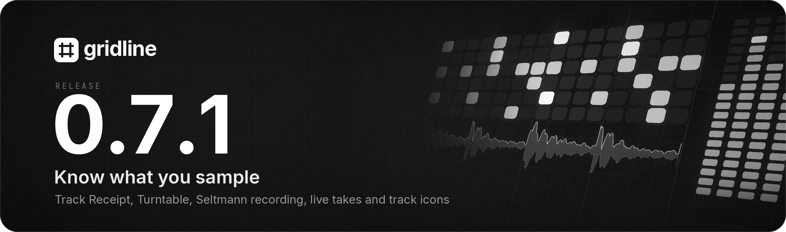
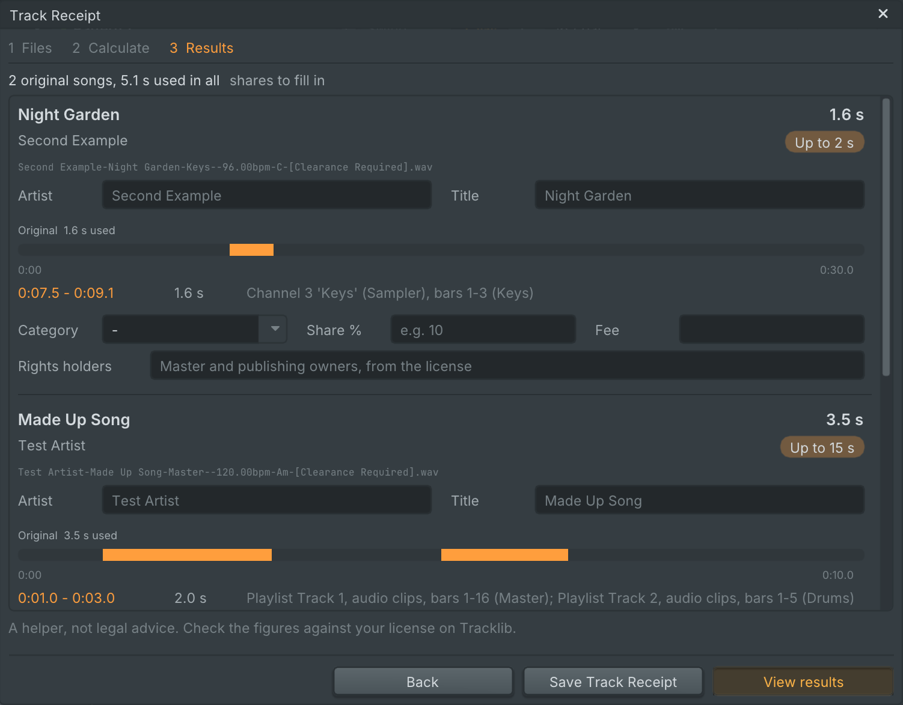
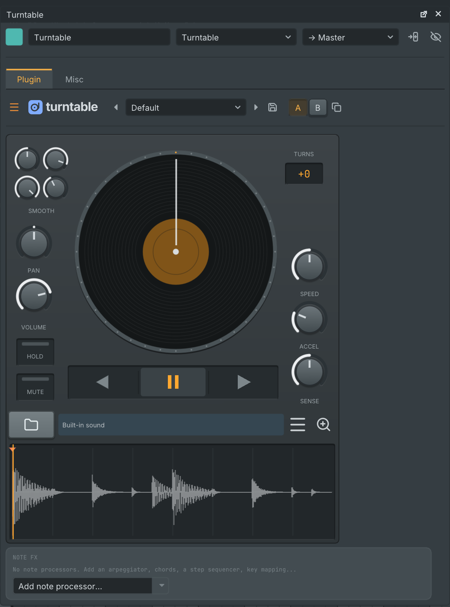
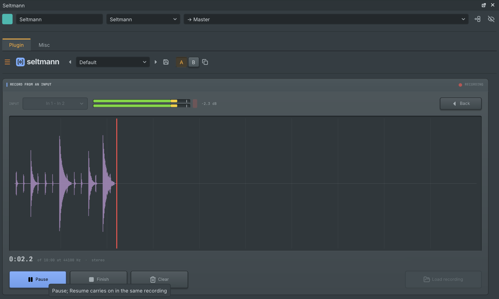

  

Gridline 0.7.1 is a point release on top of 0.7.0. **Track Receipt** measures which parts of which original recordings a project plays, for filling in sample licenses. **Turntable** is a new instrument for scratching a sample on a platter, **Seltmann** records from an input and gives every step of its sequence its own length and pitch, recording into the playlist draws each take live, and tracks and channels take icons. Plasma reads and maps many more settings of imported Serum 2 presets, Loupe has a redrawn interface, and a set of fixes comes along. Projects from 0.7.0 open as they are. Gridline's update check offers 0.7.1 to everyone on 0.7.0, on a 0.7.0 beta and on 0.6.x.

## Highlights

### Track Receipt: what your project samples, measured

**Help, Track Receipt...** is a helper for filling in sample licenses, for example on Tracklib. It lists every audio file the project uses, grouped by original song, and ticks the files named like Tracklib downloads. **Calculate** plays the project through offline and measures which parts of each original are actually heard, in the playlist and in every built-in sampler:

- **Counted once.** Loops and repeats count once, the same part heard from several stems counts once, and chopped parts add up.
- **Per song.** The results show the seconds used per song, the length tier, each part used with its timestamps and where it comes from. Muted parts are listed but not counted, and a song over 60 s is flagged.
- **Traced back.** Files Gridline makes from others (edits, stems, stretched clips, slices, renders) remember where they came from, so their uses map back to the original. Files inside third-party plugins count as the whole file until you type the parts used.
- **Ready to send.** **Save Track Receipt** writes a spreadsheet (Licenses, Usage, Release, Splits), and **View results** saves a PDF and opens it. What you type (category, share, fee, release details, writers) is saved in the project. On the command line: `gridline track-receipt <project> --out <folder>`.

Track Receipt is a helper, not legal advice. Check the figures against your license.

  

### Turntable, a new scratch instrument

Load a sample and scratch it on a platter. Drag the platter up and down or the waveform sideways to scratch (Ctrl for fine moves), with the platter's speed, acceleration, sensitivity and hold, four smoothing controls, whole extra turns and the motor (reverse, pause, forward). A new Turntable plays its own built-in sound until you load a sample or drop one anywhere on the editor. Notes can start the motor or jump to a cue point, key tracking sets the speed, and a large view gives the waveform more room. Five factory presets.

FL Studio projects with its scratch plugin open with Turntable: every setting, the sample, automation clips and recorded movements come along, and saving to FL Studio writes it back. The previous scratch effect stays as Turntable FX, so projects that use it sound as before. Turntable is part of the Gridline Suite too, so it also runs in other DAWs.

  

### Seltmann records, and its steps get their own length

- **Record from an input.** **Record**, next to Load on Seltmann's start screen, opens a recorder with an input picker, a live level meter, Record, Pause and Resume, Finish, Clear and a running time, with the take drawn as it records. **Load recording** saves the take in the project's Recorded folder and chops it like any file.
- **Steps with their own length.** Drag the right edge of a block in the sequence to change how long that step lasts without changing its region: a shorter step is cut, a longer one plays its region out and then rests. Once a step has its own length, the sequence lasts whole bars, so the loop stays in time. **Reset length** gives a step its default length back.
- **Steps with their own pitch.** Turn the mouse wheel over a block to pitch that step by a semitone per notch (Shift for tenths); the region's other steps keep theirs. Each block shows the pitch it plays at.

  

### Recording you can watch

Audio recorded into the playlist now appears while you record: each take is a growing clip on the track it will land on, with its waveform filling in as the audio arrives and a red outline and record head while it is live. Loop passes stack on the tracks below, and several armed tracks record side by side. When recording stops, the finished clip takes its place without a jump.

### Track icons

139 icons in 16 categories, with a search field and a category list in the icon menu. Mixer tracks, playlist tracks and channels all take them, and the mixer's icon sits in its own corner of the name plate at every strip width. FL Studio projects open with their icons, and saving to FL Studio writes them back.

### Plasma reads more of Serum 2 presets

Plasma now reads and maps many more settings of imported Serum 2 presets: the delay, compressor, reverb models, distortion, convolution, chorus, phaser, flanger, frequency shifter and multiband compressor, driven filters, LFO point modulation and synced divisions, the waveshaper warps, the spectral oscillator's level across the keys, the arpeggiator's rates and launched clips, and a noise that follows the keys, the pitch wheel and the tuning.

### And more

- **Loupe**'s interface is redrawn on one grid: one size per row of buttons, captions inside the info boxes, a wave and spectrum switch, readable slider values in the tool dialogs, and an editor that fits the window at 150 and 200 % interface scale.
- **Stop** clicked while stopped, or double-clicked, goes back to the beginning.
- The playlist's pattern list has a **"+"** under the last pattern for a new pattern.
- **Drop an instrument on a playlist track** to make it an instrument track playing it; an effect dropped on a track goes into its mixer track.
- **Replacing an instrument** renames an automatically named channel after the new one and resets the preset selector; undo brings both back.

## Fixed

- "Make unique" in a playlist clip's menu no longer closes Gridline when the pattern has piano roll notes.
- Sampler notes in the Stretch and Rubber Band time modes no longer play silence when the sample start (or, in reverse, the end) falls between two samples of the file, live and in exports.
- Control changes recorded into FL Studio patterns, such as scratching recorded on Fruity Scratcher, land on their exact sample, and the control keeps its value until the first change of each pass.
- Gridline started with command-line options no longer saves its window layout over yours.
- "Browser only" in Import from URL adds the file to a collaborative project's shared audio, so collaborators receive it.
- Plasma's noise gets a key range with Fold, and imported presets keep the noise's key range and pitch.

The complete list is in [CHANGELOG.md](https://github.com/lolitemaultes/Gridline/blob/v0.7.1/CHANGELOG.md).

## Upgrading from 0.7.0

- Projects open as they are.
- Plasma: the new mappings switch on only when a preset is imported, so Plasma's own sounds keep their sound. A Serum 2 preset imported in 0.7.0 and saved in a project picks up part of the changes by itself; open the original preset again to get all of them.
- Seltmann sequences you already have sound as before; whole-bar loops start only once a step has its own length.
- Installing 0.7.1 replaces the Gridline Suite copies in your plug-in folders at the first start, so they match this version (Turntable joins the suite).
- Collaborative projects: everyone in a session updates to 0.7.1.

## Install

| System | File |
| --- | --- |
| macOS 11 or later (Apple Silicon and Intel) | `Gridline-0.7.1-macos-universal.dmg` |
| Windows 10 / 11, x64 | `Gridline-0.7.1-windows-x64-setup.exe` or `-windows-x64.zip` |
| Windows 10 / 11, ARM64 | `Gridline-0.7.1-windows-arm64-setup.exe` or `-windows-arm64.zip` |
| Linux x86_64 | `.AppImage`, `-linux-amd64.deb`, `-linux-x86_64.rpm` or `-linux-x86_64.tar.gz` |
| Linux aarch64 | `.AppImage`, `-linux-arm64.deb`, `-linux-aarch64.rpm` or `-linux-aarch64.tar.gz` |
| FreeBSD, OpenBSD, NetBSD (x86_64) | `-freebsd-x86_64.tar.gz`, `-openbsd-x86_64.tar.gz`, `-netbsd-x86_64.tar.gz` |

- **macOS:** open the `.dmg` and drag Gridline to Applications. The first time, open it with right-click, then Open.
- **Windows:** run the `-setup.exe`. If SmartScreen appears, choose "More info", then "Run anyway".
- **Linux:** use the `.AppImage`, `.deb`, `.rpm` or `.tar.gz`.
- **BSDs:** use the `.tar.gz` for your system.

The `Gridline-0.7.1-media-tools-<system>.zip` files hold FFmpeg for Import from URL. You do not need to download them: the packages already carry it, and a Gridline built from source fetches the one for its system the first time Import from URL is used, checked against the checksums below.

## Checksums

Every file's SHA-256 checksum is in `Gridline-0.7.1-SHA256SUMS`. Check a download with `sha256sum -c Gridline-0.7.1-SHA256SUMS --ignore-missing` (Linux, BSD), `shasum -a 256 -c Gridline-0.7.1-SHA256SUMS --ignore-missing` (macOS) or `Get-FileHash <file>` (Windows PowerShell). Gridline's update popup checks the checksum of what it downloads by itself.

## Licence

Gridline is free software under the GNU General Public License v3.0. The bundled libraries and the programs shipped beside it keep their own licences, listed in [third_party/NOTICE.md](https://github.com/lolitemaultes/Gridline/blob/v0.7.1/third_party/NOTICE.md).
