

  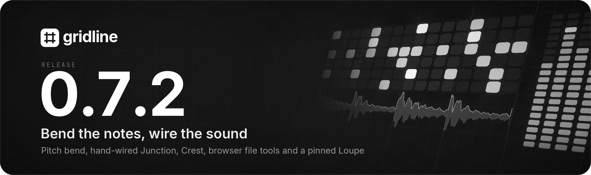

Gridline 0.7.2 is a point release on top of 0.7.1. **Notes bend** in the piano roll with a new Pitch bend tool, **Junction** becomes a map of modules and cables you wire by hand, **Crest** gets its full round, and the browser can **rename, move and trash files** with every reference following along. Loupe can be pinned into the main layout and drags audio out to the playlist, playlist tracks get a "+" menu, plugins can be favourites, and Windows gets ASIO. Projects from 0.7.1 open as they are, with one exception for Plasma, listed under Upgrading. Gridline's update check offers 0.7.2 to everyone on an earlier version.

## Highlights

### Pitch bend on piano roll notes

A Pitch bend tool sits beside the pencil (key N) and shows a line on every note. Drag anywhere on a note or its line to bend it like an automation line, with the value and the note it reaches shown beside the point.

- **Snap.** Points follow the piano roll's snap and whole semitones. Alt frees them, or with Snap off snaps them to the grid in view.
- **Curves.** Right-click a point for the glide into it: straight, smooth, ease in, ease out or step (hold, then jump), with a curve amount. Drag the small ring half way along a glide to bend it. The line shows the curve exactly as it plays.
- **Double-clicks.** Double-click a point to remove just that point, a glide or its ring to make it a straight ramp again, the note itself to reset its whole line. Each is one undo step.
- **Chords.** With several notes selected, a chord bends as one. Back on the pencil the lines stay visible, dimmed.
- **Everywhere.** Bends play per note on Gridline's instruments and on hosted plugins with per-note tuning, and as channel pitch bend on other plugins and MIDI Out. They travel with moves, copies, splits, chops and glue, are written to and read from MIDI files, and export to FL Studio as slide notes.

  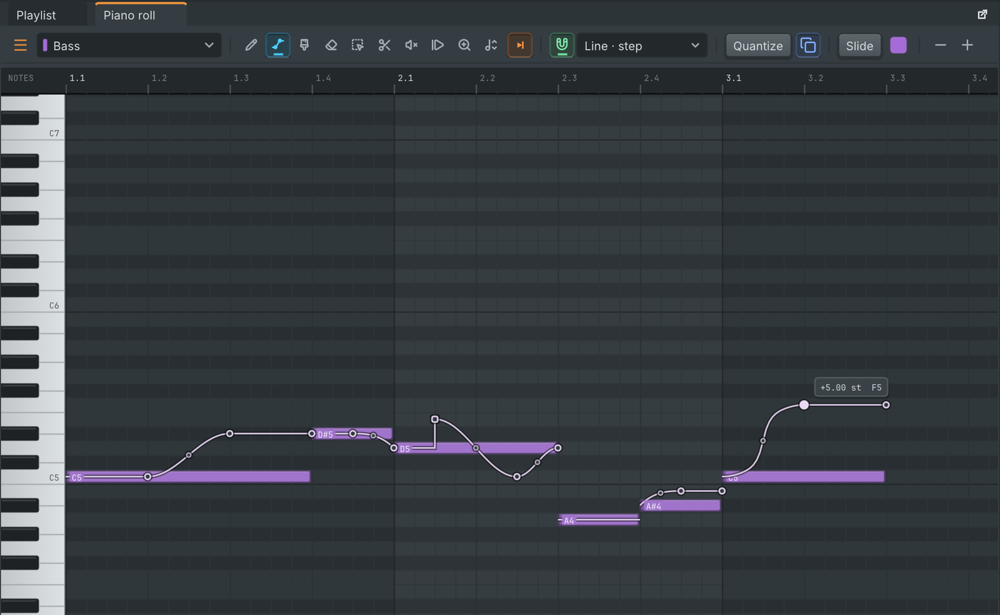

### Junction, wired by hand

Junction and Junction FX now open on a map of modules and cables. Drag from any port to wire audio, notes or parameters, in parallel, across sidechains and to several outputs.

- **Cables.** Each cable has its own level, and a right click inserts an effect into it. A cable that closes a loop becomes a feedback cable, drawn dashed, that arrives 256 samples later whatever the buffer size. Latency between parallel paths is compensated.
- **Modules.** Rename, colour, bypass, mute, duplicate and disconnect them. Note processors can sit before instruments, and installed plugins run inside with their own interface.
- **The map.** It zooms and pans smoothly, with box select, automatic arrange, a minimap and filters per cable kind.
- **The Panel page** holds the eight macros and any parameter put on it, with names, ranges and snapshots. Its knobs automate as before.

Six new patches show what it can do. Every edit is one undo step, and existing projects and presets keep their sound and data until you rewire them.

  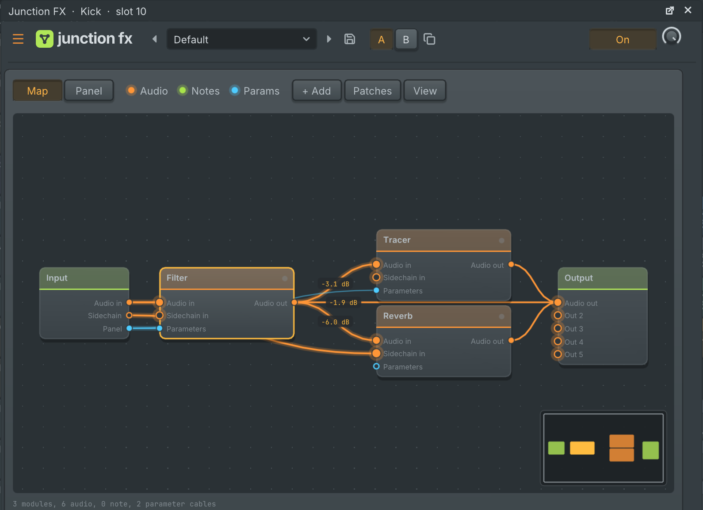

### Crest, full round

New instances of Crest run the engine that FL Studio import uses, with six new presets:

- Oversampling (2x, 4x, 8x), curves of up to 64 points and all 13 point shapes (right-click a point).
- A monitor with scrolling peaks, curve level and gain for one band or all four, pause and speed.
- A spectrum and heatmap with range, tilt and smoothing, and gain meters in the band tabs.
- dB, ms and Hz readouts on the knobs, and a linear-phase button with its quality menu.

Older projects and presets keep their engine and their sound.

  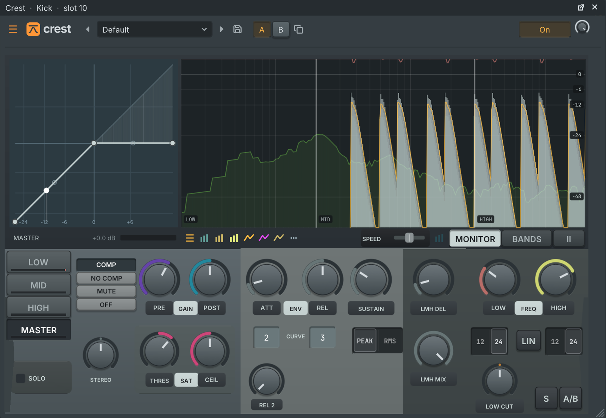

### Organise files in the browser

Right-click a file or folder to rename it in place, make a new folder or move it to the trash (asked first). Drag files and folders onto a folder to move them. Channels and clips that use a renamed or moved file follow it, in one undo step, and its sidecar files move along. Only your own folders and Gridline's folders can be changed; elsewhere the menu says why not.

The browser's PROJECT tab also lists every audio file the project uses, and the Edited audio folder now sits in that tab.

  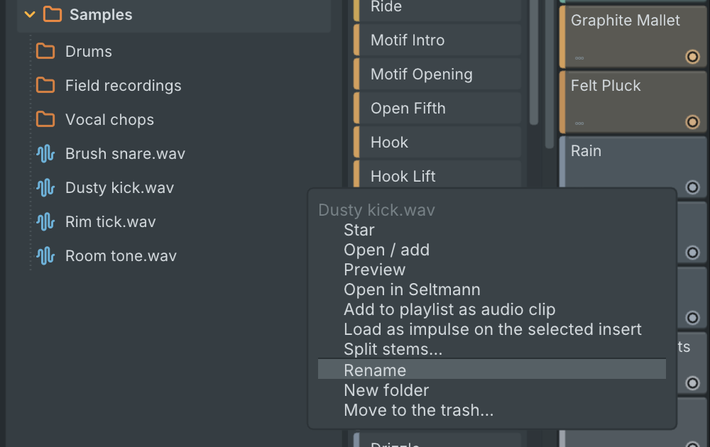

### Loupe, pinned and dragged out

Loupe's View menu pins it as a tab next to the playlist, below the playlist, on the left with the browser, on the right with the mixer, or as a floating panel, and its tab can be dragged to any other dock spot. While pinned, every sample or Loupe effect you open shows there.

The grip button in Loupe's toolbar drags the selection (or the whole file when nothing is selected) onto the playlist, where it lands as an audio clip at the drop position on the grid, or onto the channel rack and samplers. A dragged selection is saved as a new file in the project's Edited audio folder.

  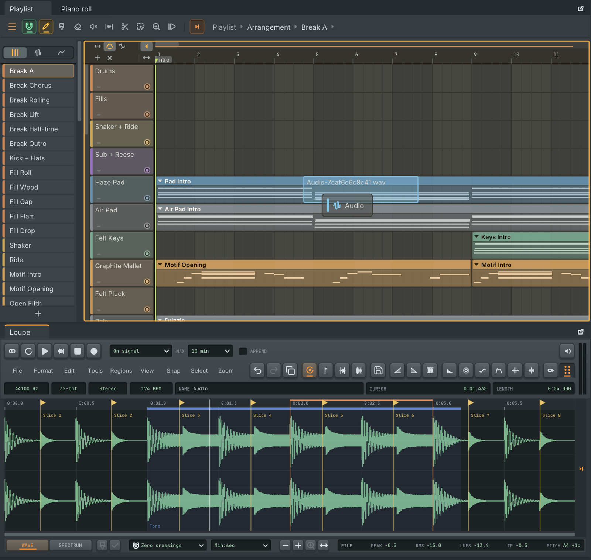

### A "+" on every playlist track

Hover a track header and a small "+" appears beside its mute switch. Its menu gives the track an instrument (your starred instruments are listed right there, then every instrument, or a channel already in the rack) and on an empty track starts a first pattern for it, named after the instrument and opened in the piano roll. On an instrument track it makes a new pattern at the song position (or the start of the view), changes the instrument or makes it an ordinary track again. Each action is one undo step. Turn it off in the playlist menu, View, Track + button.

Double-click a track's name to rename it. On a track that plays an instrument, double-clicking anywhere else on its header shows that instrument's window.

  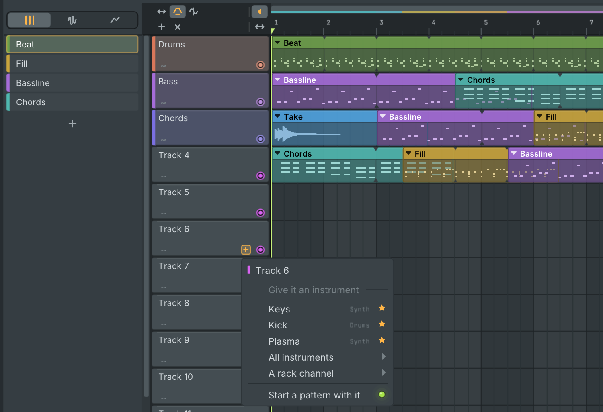

### Favourite plugins

A star on each plugin in the mixer slot list, the channel and instrument menus and the browser's plugin database marks it as a favourite. Favourites come first in those lists and have their own group in the browser, for built-in and installed plugins alike. The mixer slot list and the channel menus now also list installed plugins, not only built-in ones.

  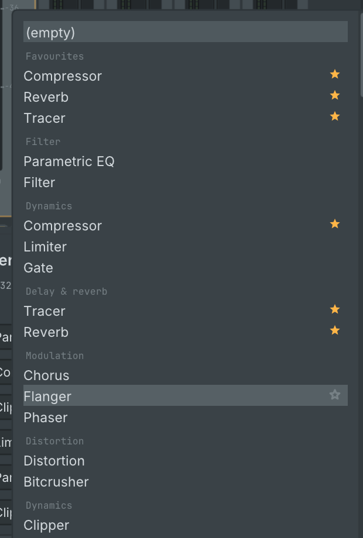

### ASIO on Windows

Settings, Audio has a driver type switch between the system audio (WASAPI, still the default) and ASIO. Pick any installed ASIO driver, its sample rate and buffer size from the sizes the driver allows, and open the driver's control panel. Device inputs feed the mixer's In 1 to In 16, the main output pair is selectable and other output pairs can each carry a mixer track. The driver's reported latency sets the recording offset, and resets the driver asks for reopen it on their own. An unplugged device falls back to the system audio. See [docs/asio.md](https://github.com/lolitemaultes/Gridline/blob/v0.7.2/docs/asio.md).

### Plugin folders per format

Settings, Plugins lists where VST3, VST2, CLAP, LV2 and AU plugins are searched. Add your own folders per format or for every format, switch folders or the default folders off, and rescan one folder or all. The Plugin Manager links to it. The `VST3_PATH` environment variable now adds VST3 search folders, as `VST_PATH`, `CLAP_PATH` and `LV2_PATH` already did.

  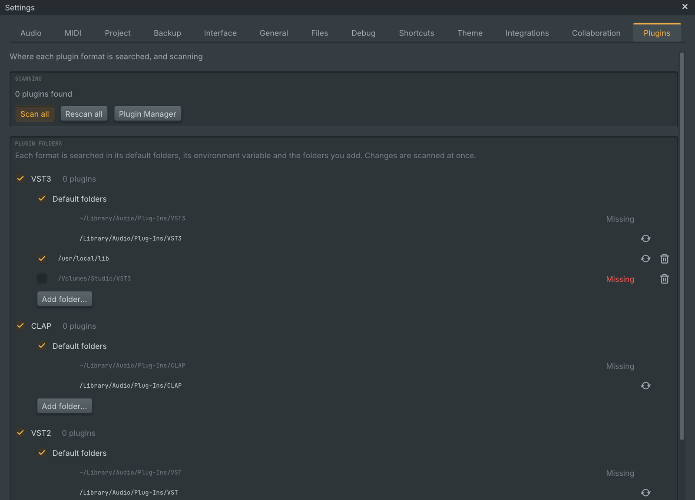

### Loop notches and overlapping clips

Looping clips show their loop points as small notches in the clip's top and bottom edges, with a faint line through the clip. The repeats are no longer dimmed, so a long loop reads calmer.

Where a clip lies over another on the same track, the notes, waveform or automation curve of the clip beneath stay visible through it, a little dimmed, while the top clip's own content and name stay clear. A click in the overlap still picks the top clip.

  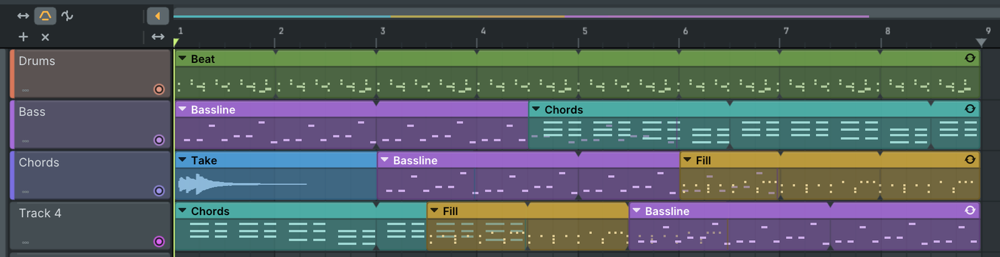

### Channel rack steps in the piano roll

Open a channel with steps in the piano roll and its steps are there as notes, with each step's key, velocity, pan, fine pitch, release, mod X and Y and shift. A small "Rack steps" tag says they still belong to the rack; looking changes nothing. Move, resize, delete or edit any of them and the channel's steps become piano roll notes in the same undo step, so one undo brings the rack row back exactly. The notes play exactly as the steps did, swing and step loops included, until one is given another length. "Steps to piano roll" in the rack menu makes the same notes, and "Piano roll to steps" turns them back.

  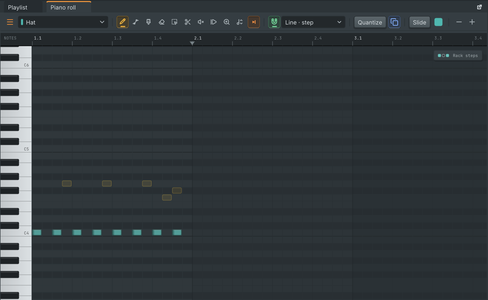

### Turntable is a mixer effect

Put Turntable on any mixer insert: the insert's audio passes through unchanged and the deck plays its sample on top, with the same platter, motor, hand and editor as before. The pickers offer this one Turntable. Projects from earlier versions open and sound as before: the 0.7.1 Turntable instrument shows as Turntable (old) and the earlier live-input effect as Turntable FX (old); neither is offered for new use. Platter stays a separate DJ deck instrument.

  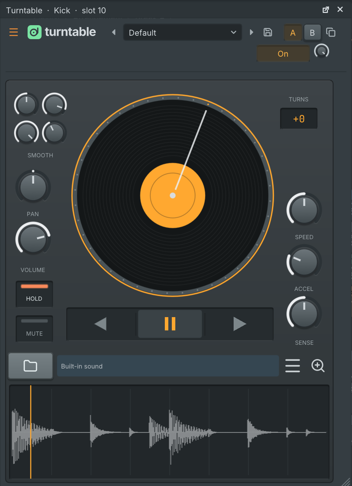

### And more

- **Plugin windows have their own size.** The menu of every built-in effect and instrument window has an Editor size submenu (Automatic, 100 % to 200 %), and the corner grip resizes the editor, keeping its proportions. Small editors open larger on large screens.
- **Shift+click draws a note and sets its length** in the piano roll: the drag that follows stretches it, in one undo step.
- **Stretch the playlist from its scroll bars**: drag either end of a scroll bar to zoom the time or the track height.
- **Alt+wheel zooms the playlist's track height around the pointer**, and the piano roll's row height the same way.
- **Auto scrolling can be turned off**, for the playlist and for the pattern editors on their own.
- **Channel rack play lights**: the green lamp at the end of each channel row lights while the channel plays and fades after.
- The Linux and BSD tarballs come with `install.sh`, which adds Gridline to the desktop menu with its icon.
- Plasma's distortion curves are rewritten. Most modes keep their level; see Known limits for the three that don't.

### FL Studio compatibility

- **Reverb.** Reverb settings from FL Studio projects and presets now load the way FL Studio itself loads them, including the oldest preset files without a version number, and the reverb's Full model sounds the same as FL Studio renders those settings. Its knobs show seconds, milliseconds, kHz and percentages instead of raw steps.
- **Automation.** Values that land halfway between two steps of a switch or a mode list now pick the same step FL Studio does. Automation of Multi Delay's unit controls and of Retro Phaser's and Bucket Chorus's switches now imports.
- **Slide colours.** A slide note now glides only the notes of its own colour, so FL Studio projects play their slides as they do in FL Studio.
- **Settings that now import or match:** the vocoder's band range, formant, invert, attack, release, hold and levels; Keyboard Mod from current FL Studio versions; Auto Pan's LFO speed; Enhance presets, which no longer import about 13 dB too quiet; Multi Delay's shortest step; oversampling and long curves on Crest.
- **Patches.** Import runs more patches as wired (note processors, installed plugins, sidechains, extra outputs and mixer track outputs) and reports exactly what it leaves out. Export writes hand-wired graphs back in FL Studio's patch format.
- **Pitch bends and steps.** Bends export as slide notes on the note's channel and colour, and steps shown in the piano roll export as step notes. Step notes in imported projects now keep the swing of steps.
- **Turntable.** FL Studio projects with its scratch plugin open with Turntable on the same mixer slot, with its settings, sample and automation, and export back the same way.

## Fixed

- The playlist could draw garbage on some Windows graphics drivers when a busy project was scrolled. Large windows now draw correctly whatever OpenGL version the driver provides.
- A bridged plugin whose other process dies no longer takes Gridline down: it shows as crashed and goes silent, other tracks play on and the project still saves. Reload it from its plugin window.
- Quitting no longer leaves an invisible process behind when a plugin never returns from closing: Gridline leaves after 20 seconds.
- Gridline as a plugin could crash the host as it quit or unloaded the plugin while the browser was still indexing files.
- Linux: Space and Gridline's other shortcuts typed into a plugin's interface no longer get lost.
- Recording armed when Play is pressed captures from the transport's first moment, also when the interface is slow to draw a frame.
- The app icon shows on every window, in the Windows taskbar at any display scale, and on Linux in the dock and task switcher.
- Dragging along the piano roll's keyboard plays and lights only the key under the pointer, and a lit key now lights the whole white key.
- Right-clicking the header of a folder added to the browser opens its menu again.

The complete list is in [CHANGELOG.md](https://github.com/lolitemaultes/Gridline/blob/v0.7.2/CHANGELOG.md).

## Known limits

- **Plugin windows in "Run in sandbox" mode on Linux.** The plugin's window doesn't open in this mode. The plugin itself runs.
- **FL Studio parameter audit.** We are still checking every built-in plugin's parameters for FL Studio projects, and some aren't matched exactly yet:
  - Retro Phaser, Bucket Chorus and Freq Shifter may not sound exactly as they do in FL Studio.
  - Sweep Kick has no envelope or LFO section yet.
  - FL Studio automation of Band Delay, Velocity Scale, Colour Router, Note Sequencer and part of Envelope Mod doesn't import yet. Key Remap and Note Script import theirs.
  - A few ranges on the EQ, the limiter and the vocoder don't reach as far as they do in FL Studio.
- **Pitch bend export to FL Studio.** A bend over another sounding note of the same colour is left out, since a slide would glide that note too. Curves are approximated by shorter slides. The export report counts what was converted, approximated and left out.
- **Junction and parallel paths.** Junction lines up parallel paths with latency compensation. Whether FL Studio's patching plugin does the same isn't confirmed, so imported patches with uneven parallel paths running in the new graph runtime may sum differently.
- **Plasma distortion.** Linear Fold, Sine Fold and Sine Shaper sound different at high drive in this version.
- **Windows plugins through yabridge need Wine 9.21 or older for the mouse.** Tested with yabridge 5.1.1 on Ubuntu 24.04, with synthetic input and Carla as a second host. On Wine 9.0 and 9.21 clicks land exactly. On 9.22, 10.20 and 11.21 they land offset by the window's position on the screen or reach nothing, in Gridline and in Carla alike. Typed text, Space, sound and saving work on all of them, and if the Wine side dies, the plugin shows as crashed, goes silent and the project still saves. Still open:
  - The first click after a plugin window's first move can be lost or misplaced on Wine 9.0 and 9.21: every time with no window manager, 4 of 36 runs under Openbox, none in Carla. This one looks like Gridline's and isn't solved yet.
  - Closing Dexed's interface doesn't return within 30 seconds, in Gridline or in Carla, and Gridline stops answering while it waits. Quitting with it open ends after 20 seconds.
  - Mouse and keyboard under XWayland couldn't be tested automatically, and with Gridline on the Wayland video driver a plugin's interface doesn't open.

  The full results are in [docs/plugin-window.md](https://github.com/lolitemaultes/Gridline/blob/v0.7.2/docs/plugin-window.md).

## Upgrading from 0.7.1

- Projects open as they are.
- Plasma: a project using the Linear Fold, Sine Fold or Sine Shaper distortion at high drive sounds different; see Known limits.
- Junction, Crest, the reverb, Auto Pan, Multi Delay and slide notes: projects saved with earlier versions keep their sound. Older reverbs show V1 in the Full model (switch in the corner of the room view), new reverbs and new imports use V2.
- A new compressor, flanger and several other effects open with the settings they get when an FL Studio project brings them in at their defaults. Projects and presets you already have are unchanged.
- Linux: the software centre id changed to `com.lolitemaultes.Gridline`; the metadata lists the old `org.gridline.Gridline` as replaced.
- Collaborative projects: everyone in a session updates to 0.7.2.

## Install

| System | File |
| --- | --- |
| macOS 11 or later (Apple Silicon and Intel) | `Gridline-0.7.2-macos-universal.dmg` |
| Windows 10 / 11, x64 | `Gridline-0.7.2-windows-x64-setup.exe` or `-windows-x64.zip` |
| Windows 10 / 11, ARM64 | `Gridline-0.7.2-windows-arm64-setup.exe` or `-windows-arm64.zip` |
| Linux x86_64 | `.AppImage`, `-linux-amd64.deb`, `-linux-x86_64.rpm` or `-linux-x86_64.tar.gz` |
| Linux aarch64 | `.AppImage`, `-linux-arm64.deb`, `-linux-aarch64.rpm` or `-linux-aarch64.tar.gz` |
| FreeBSD, OpenBSD, NetBSD (x86_64) | `-freebsd-x86_64.tar.gz`, `-openbsd-x86_64.tar.gz`, `-netbsd-x86_64.tar.gz` |
| Source | `Gridline-0.7.2-source.tar.gz` |

- **macOS:** open the `.dmg` and drag Gridline to Applications. The first time, open it with right-click, then Open.
- **Windows:** run the `-setup.exe`. If SmartScreen appears, choose "More info", then "Run anyway".
- **Linux:** use the `.AppImage`, `.deb`, `.rpm` or `.tar.gz`. The `.tar.gz` comes with `install.sh`, which adds Gridline to the desktop menu.
- **BSDs:** use the `.tar.gz` for your system.

The `Gridline-0.7.2-media-tools-<system>.zip` files hold FFmpeg for Import from URL. You do not need to download them: the packages already carry it, and a Gridline built from source fetches the one for its system the first time Import from URL is used, checked against the checksums below.

## Checksums

Every file's SHA-256 checksum is in `Gridline-0.7.2-SHA256SUMS`. Check a download with `sha256sum -c Gridline-0.7.2-SHA256SUMS --ignore-missing` (Linux, BSD), `shasum -a 256 -c Gridline-0.7.2-SHA256SUMS --ignore-missing` (macOS) or `Get-FileHash <file>` (Windows PowerShell). Gridline's update popup checks the checksum of what it downloads by itself.

## Licence

Gridline is free software under the GNU General Public License v3.0. The bundled libraries and the programs shipped beside it keep their own licences, listed in [third_party/NOTICE.md](https://github.com/lolitemaultes/Gridline/blob/v0.7.2/third_party/NOTICE.md).
