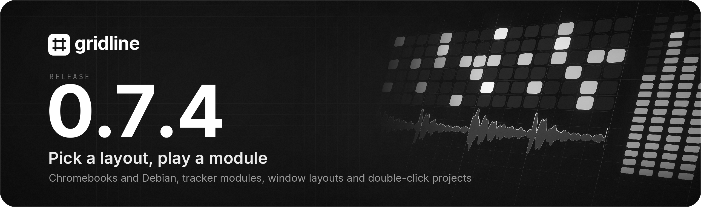
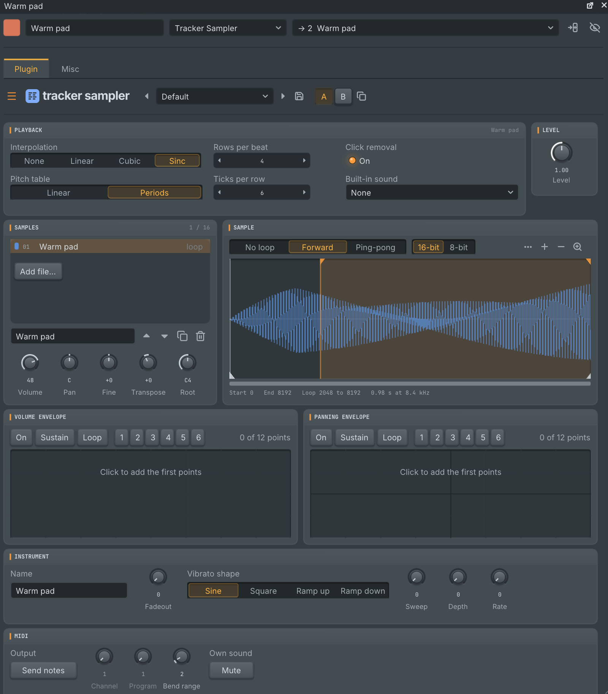
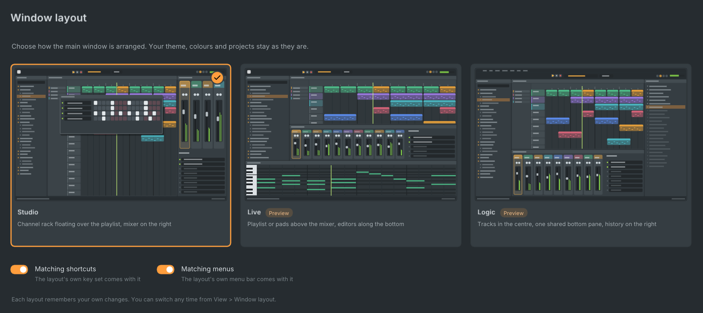
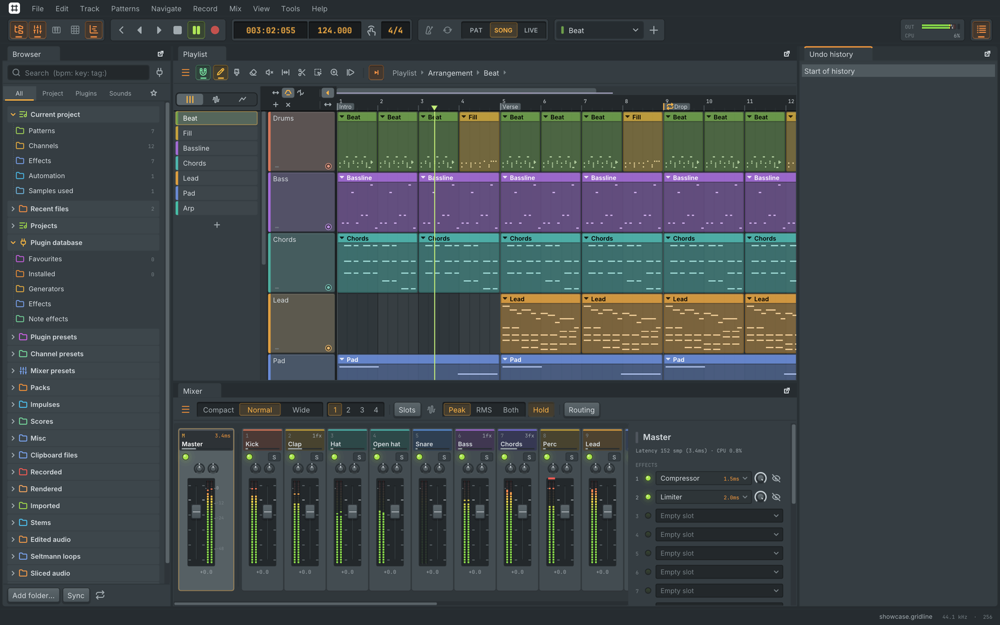
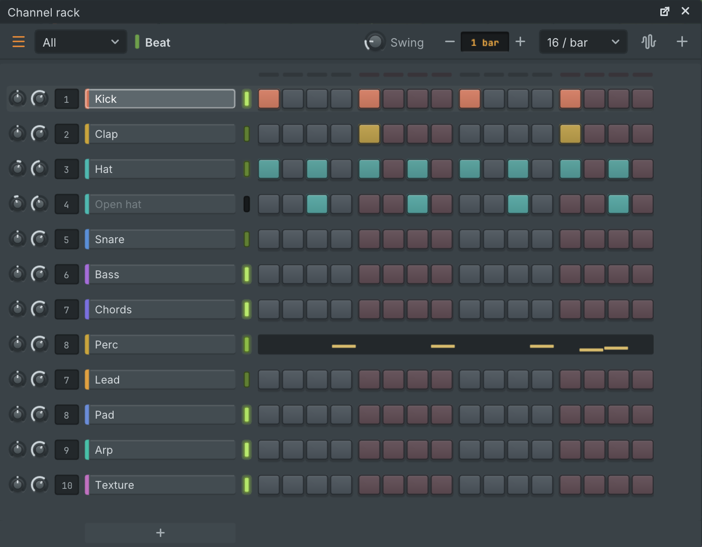
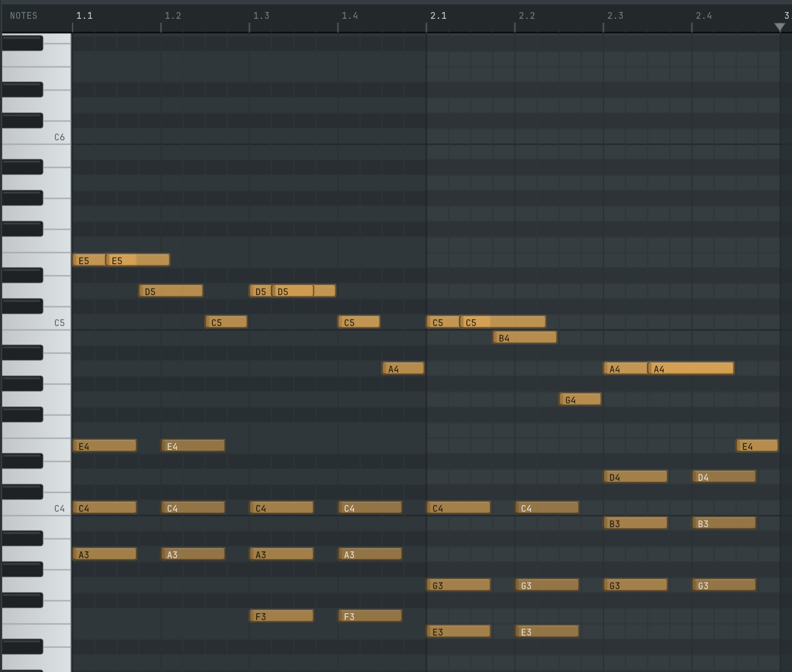
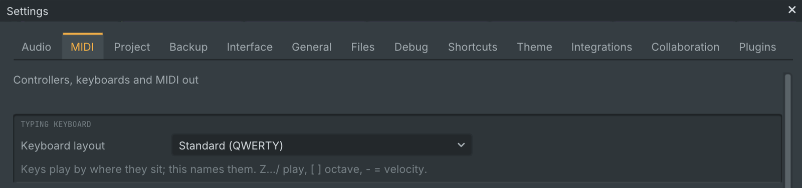
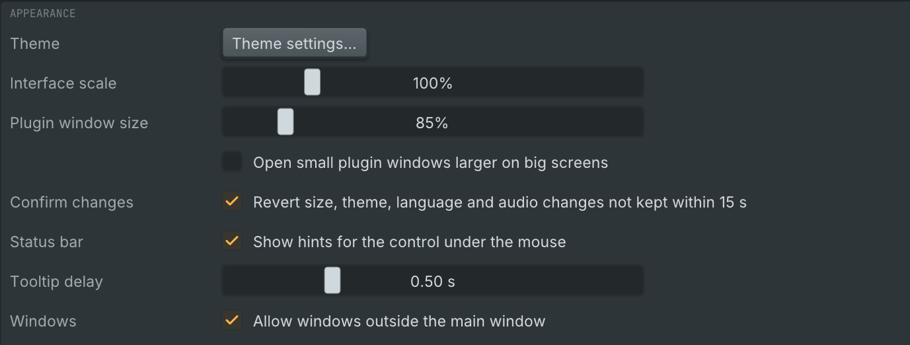

  

Gridline 0.7.4 is a point release on top of 0.7.3. **Gridline now installs on Chromebooks and on Debian 11, 12 and 13**, **tracker modules (.xm and .mod) open as projects**, played by the new **Tracker Sampler**, and the main window can take **one of three layouts**, chosen from a new layout chooser and always in your own theme. **Projects get file names of their own (.gridline and .gridlinez) and open with a double click**, **clips loop only when you ask**, **M4A and AAC samples load**, the typing keyboard has a **keyboard layout setting**, and built-in plugin windows have a **size setting** of their own. Projects from 0.7.3 open as they are and play as before. Gridline's update check offers 0.7.4 to everyone on an earlier version.

## Highlights

### Chromebooks and Debian

- **Chromebooks.** Gridline installs in ChromeOS's Linux development environment, with the Linux `.deb` for Intel and AMD Chromebooks and for ARM ones (MediaTek, Qualcomm). A new installation there starts at 48000 Hz with a 1024 frame buffer, which is what the Chromebook's Linux sound runs at. The file dialogs get a **Shared folders** button and explain how to share a folder with Linux, and the MIDI settings say how to give a USB MIDI device to Linux. See [docs/chromeos.md](https://github.com/lolitemaultes/Gridline/blob/v0.7.4/docs/chromeos.md).
- **Debian.** The `.deb`, the AppImage and the `.tar.gz` install and run on Debian 11, 12 and 13 and on Ubuntu 22.04 and later, on Intel, AMD and ARM computers. See [docs/debian.md](https://github.com/lolitemaultes/Gridline/blob/v0.7.4/docs/debian.md).
- **Tested before it ships.** Every release is now installed and started on each of these systems, Google's own Chromebook Linux images among them, before it is published.
- **The update popup picks the .deb** on Debian, Ubuntu and their relatives (Zorin OS, Linux Mint, Pop!_OS, elementary OS, Debian on a Chromebook), also when Gridline runs from the AppImage. The AppImage is offered only where no package fits.

### Tracker modules and the Tracker Sampler

Open an `.xm` or `.mod` file like any project, from File > Open, the browser, a drop on the window, the welcome screen or `gridline render`. Every instrument becomes a channel, every note a piano roll note, and the order list becomes playlist clips, so pattern breaks, jumps and loops play in order. Speed and tempo changes become tempo automation and a looping song gets a loop marker. Each note keeps the effect column of the rows it sounds through, so slides, vibrato, arpeggios, retriggers and note delays play as the module does. The converted project opens from the cache, the original file is never changed, and `gridline import-module` does the same from the command line.

The instruments play on the new **Tracker Sampler**, which is also an ordinary sampler for your own sounds:

- **Samples.** Up to 16 samples on a key map. Drop audio files on it or use Add file..., then name, reorder and copy them and set each one's volume, pan, fine tune, transpose and root key. Drag across the key map to give keys to a sample.
- **Waveform and editing.** Drag the start, end and loop points on the waveform, choose no loop, forward or ping-pong, and zoom in. Mark a range and cut, copy, paste, crop, silence, reverse, fade, normalise, resample, echo, mix in another sample or crossfade the loop. Every edit can be undone, and the edited audio travels with the project, its zip and collaboration.
- **Envelopes and vibrato.** Volume and panning envelopes you draw, with a sustain point and loop, six slots of your own for each, fadeout and auto vibrato.
- **Sound.** No, linear, cubic or sinc interpolation, linear or period-table pitch, 8 or 16 bit playback, and click removal.
- **Hear it.** Click a sample in the list to hear it once, and the key strip lights up every key that sounds and plays when you press it.
- **MIDI out.** A MIDI panel can send the notes the instrument plays to your MIDI output, on a channel and program of your choice.

A new Tracker Sampler stays silent until you drop a sample, pick one of its built-in sounds or choose one of its six presets. It is also in the Gridline Suite, so it plays in other DAWs too.

  

### Window layouts

Choose how the main window is arranged from Layout on the welcome screen, in Settings > Interface or in View > Window layout. **Studio** is the arrangement you know and stays the default. **Live** and **Logic** are previews: they arrange the windows and bring their own shortcuts and menus, and more of each follows in later updates.

- **Live** puts the browser on the left, the playlist and the live pads as one main view (Tab switches between them) with the mixer under it, and the editors and channel settings along the bottom.
- **Logic** puts the tracks in the centre, the browser on the left, one pane at the bottom that the mixer and the editors share, the undo history on the right, and a two-row top bar.
- **Your theme stays.** The slate look, or the colours, accent, control style and interface size you chose, stay the same in every layout.
- **Your own shortcuts and menus,** if you prefer: two switches in the chooser keep yours. Every menu command stays reachable in every layout, and Settings > Shortcuts shows which set is in use.
- **Each layout remembers your changes to it,** and switching back restores them. The layout is your own setting: projects never store it, so collaborators can each use their own.

The chooser is a page of large cards, each a true miniature of its layout in your colours. The arrow keys move between them, Enter picks one and the window switches at once.

  

  

### Projects open with a double click

- **New file names.** Projects now end in `.gridline` and zipped projects in `.gridlinez`. With an extension of their own, they open in Gridline by double click on every system. Projects with the earlier names (`.gridline.json`, `.gridline.zip`) still open everywhere, Save keeps their name, and Save as can still write the earlier names for someone on an earlier Gridline.
- **The file manager.** Projects, zipped projects and tracker modules open in Gridline from the file manager. The Linux packages and the Windows installer register them, and Gridline never takes over another program's file types: where a type already has a default program, choose Gridline once with Open with. See [docs/opening-files.md](https://github.com/lolitemaultes/Gridline/blob/v0.7.4/docs/opening-files.md).
- **One Gridline at a time** on Linux and Windows, as on macOS. A file opened while Gridline runs opens in that window, after asking about unsaved changes, and starting Gridline again brings the window forward. Set `GRIDLINE_SINGLE_INSTANCE=0` to run several side by side. On macOS a file that starts Gridline now opens as a project instead of being lost.

### Channel rack

- **One light per channel**, between its name and its steps. It is lit while the channel is on, dark while it is muted and glows while the channel plays. Click to mute, right-click (or Ctrl+click) to solo and again to bring every channel back, Shift+click to select.
- **New instruments open at once,** in front and ready to play, from every place you can add one. Installed plugins open their own window. Opening a project, undo and pasting open nothing.
- **Only as tall as its channels.** A floating channel rack grows when you add a channel and shrinks when you delete one, with the add button right under the last row. A long list still scrolls.
- **Esc takes you back to the playlist** from the piano roll, the channel rack, the mixer, a plugin window and the editors, once it has nothing else to close or cancel. Change the key under Back to the playlist in Settings > Shortcuts.

  

### Clips loop only when you ask

Dragging the right edge of a clip now simply makes it longer: a pattern clip is empty past its pattern, an audio clip shows more of its file and an automation clip holds its last value. Hold Ctrl (Cmd on macOS) while you drag to loop the clip instead, for pattern, audio and automation clips alike. Looping belongs to each clip, the clip menu has a Loop switch, and looped clips show a notch at each repeat. Projects made before, and FL Studio projects, play exactly as before.

### M4A and AAC samples

Files in `.m4a` (AAC, HE-AAC or Apple Lossless) and `.aac` now load everywhere samples do, from the browser and its preview to audio clips, collaborative projects and FL Studio projects that use them (they used to play as silence). macOS and Windows decode them with the system's own decoder, Linux and the BSDs with FFmpeg, the copy in the package or the one on the computer. A file that can't be decoded says why.

### See-through notes

Piano roll notes are slightly see-through. A note under or over another on the same key shows through it, and where two notes overlap the colour gets denser, so an accidental double note is easy to spot. Edges, names and marks stay sharp in both themes and with any accent.

  

### Keyboard layout for the typing keyboard

Settings > MIDI and the typing keyboard's menu let you pick Standard (QWERTY), QWERTZ, AZERTY, Dvorak, Colemak or Follow the computer. The keys are named after that layout and still play by where they sit.

  

### Plugin window size

Built-in instrument and effect windows now open at 85 %, closer to the size of the mixer and the channel rack, and no longer grow by themselves on large screens.

- **One setting for all of them.** Plugin window size in Settings > Interface goes from 75 % to 150 %; text, knobs and spacing change together and the window follows.
- **A size per plugin.** Editor size in a plugin window's menu, now from 75 % to 200 %, gives one plugin a size of its own and is remembered for that plugin.
- **Larger on big screens, if you like.** Open small plugin windows larger on big screens brings back the automatic growth. It is off by default.
- Plugins you install keep their own size.

  

### Projects open with whichever plugin format you have

A project made with one format of a plugin (Audio Unit, VST3, VST2 or CLAP) now opens on a computer that has only another, with that version and its settings. Gridline checks that it really is the same plugin by its ids, name, maker, kind, outputs and parameter names, moves the plugin's own state across where the plugin allows it, and otherwise sets every parameter of the same name. Automation follows. The open message lists what changed format, and when a match isn't certain nothing is swapped: the plugin's window lists the candidates for you to pick. FL Studio projects use the same matching.

### FL Studio projects

- **Tempo automation reaches stretched samplers.** A sampler channel stretched to a number of beats now keeps that length when the tempo changes: a stretch follows the tempo as it moves, and a resampling channel plays each note at the rate of the tempo where it starts.
- **Smooth pitch automation.** Automation on an imported channel's pitch knob moves in fine steps and replaces the knob instead of adding to it, on sampler and audio clip channels. Gridline's own projects keep their whole-semitone steps.
- **Automation of a missing plugin survives the export.** A plugin that isn't installed and plays through its built-in stand-in keeps its automation clips when the project goes back to FL Studio.

### Gridline plugins in FL Studio exports

When you export an FL Studio project, Gridline instruments and effects with no exact counterpart there (Seltmann, Plasma, Platter, Junction and the rest) can now be written as the matching Gridline Suite plugin with all their settings, and the samples they use travel inside those settings. With the Gridline Suite installed, they open live and editable in FL Studio. By default each instrument also gets a muted audio copy of its channel, for computers without the Suite. Choose in Settings > Project > FL Studio export, or for one export in File > Export > FL Studio project. Gridline reads these plugins back as its own.

### Sound and recovery

- **Idle Plasma instances rest.** A Plasma that isn't playing used to keep its whole effect rack running, so many complex sounds could load the processor with the transport stopped. It now rests once its notes and effect tails have died away, and wakes at once with the same sound.
- **Plugin scans never freeze the window,** however many plugins you have. A few are scanned at a time, so one that hangs no longer holds up the rest, and plugin files with hundreds of plugins finish. Large collections no longer slow the plugin manager, the browser or the picker.
- **No dropout when you add a Junction during playback.** The built-in modules inside it are prepared before they play.
- **After a graphics driver restart** the start screen, the crash report window and plugin interfaces come back, as the main window already did.
- **Work that stops moving is reported,** with its last step, so a stuck plugin or disk no longer looks like a frozen window.
- **Older graphics.** Where OpenGL 3.0 is refused, as on some virtual machines, Gridline falls back to an older OpenGL instead of failing to open.

## Other changes and fixes

- Menus are in one consistent order everywhere: open, create, edit, properties, arrange, and removals last. Options and Tools are split into sections, the two Recording options menus are one, and Plugin manager moved to Options. Every command and shortcut is unchanged.
- Menus no longer flicker near the window's edge or in windows moved out of the main one, and Gridline no longer makes some Linux desktops flash the whole screen.
- A clip or note slightly off the beat, dragged past the start, now lands exactly on the first beat.
- Exporting project bones over an earlier export can no longer damage it: the earlier files are replaced only once every new file is written.
- Track Receipt says when a calculation fails, and why.
- In a song with many tempo changes, a note exactly on a sample no longer slips one sample late.
- VST3 folders that link back to themselves are searched once. On Windows, 32-bit plugins and helper files in a plugin folder are skipped without loading, and a plugin that crashes while it is scanned shows no Windows error window.
- The Live pads window opens in front of the channel rack.
- Pitch Shifter's Music engine and the vocoder's output enhancer in imported projects sound closer to the projects they came from. Projects made before keep their sound.
- Bucket Chorus and Retro Phaser start their sweep at the start phase when playback starts.
- Instruments in a patch keep their notes when an effect in the patch changes its latency.
- Track reports count a channel or mixer track that its automation brings up from silence.
- Replacing a plugin shows the busy indicator instead of looking frozen.
- An idle Twin String holds about 14 MB instead of about 56 MB, with the same sound.
- In a collaborative project, Plasma loads a wavetable, sample, impulse or noise file as soon as it arrives.
- Settings > MIDI: the soft pedal's velocity slider no longer covers its caption and value.

The full list is in [CHANGELOG.md](https://github.com/lolitemaultes/Gridline/blob/v0.7.4/CHANGELOG.md).

## Known limits

- **Live and Logic are previews.** They arrange the windows and bring their shortcuts and menus; the rest of each style follows in later updates.
- **Windows, untested on a real computer:** the M4A and AAC decoder and the handoff that keeps one Gridline running have been checked only by our automated builds.
- **M4A and AAC on Linux and the BSDs.** Decoded through FFmpeg, an HE-AAC or `.aac` file can keep up to about a tenth of a second of silence at its end. This happens only on Linux and the BSDs; macOS and Windows use their own decoders.
- **FL Studio projects.** Plugin channels may still play louder than sampler channels, and some built-in plugins' parameters aren't matched exactly yet.
- **Memory on very large projects.** Instruments that aren't playing still hold their voice memory, so a project with hundreds of synth channels can use several GB.
- **Tracker modules** in other formats than .xm and .mod (such as .it and .s3m) don't open yet.

## Upgrading from 0.7.3

- Projects open as they are and play as before, looped clips included. Save keeps a project's earlier file name; new saves use `.gridline` and `.gridlinez`.
- FL Studio projects you imported before play as they did. Importing them again picks up the tempo and pitch fixes above.
- The channel rack's separate light at the start of each row is gone, so the knobs, the mixer track number and the name sit a little further left.
- Built-in plugin windows open a little smaller, at 85 %. Set Plugin window size to 100 % in Settings > Interface for the earlier size, and tick Open small plugin windows larger on big screens for the earlier automatic growth.
- On Linux and Windows, opening a file now goes to the running Gridline. Set `GRIDLINE_SINGLE_INSTANCE=0` to keep the old behaviour.
- If you are updating from a version before 0.7.0 on Debian, Ubuntu or a relative, install the `.deb` from the release page once: those versions download the AppImage.
- Collaborative projects: everyone in a session updates to 0.7.4.

## Install

| System | File |
| --- | --- |
| macOS 11 or later (Apple Silicon and Intel) | `Gridline-0.7.4-macos-universal.dmg` |
| Windows 10 / 11, x64 | `Gridline-0.7.4-windows-x64-setup.exe` or `-windows-x64.zip` |
| Windows 10 / 11, ARM64 | `Gridline-0.7.4-windows-arm64-setup.exe` or `-windows-arm64.zip` |
| Linux x86_64, Debian 11 to 13, Ubuntu 22.04 and later, Intel and AMD Chromebooks | `.AppImage`, `-linux-amd64.deb`, `-linux-x86_64.rpm` or `-linux-x86_64.tar.gz` |
| Linux aarch64, ARM Chromebooks | `.AppImage`, `-linux-arm64.deb`, `-linux-aarch64.rpm` or `-linux-aarch64.tar.gz` |
| FreeBSD, OpenBSD, NetBSD (x86_64) | `-freebsd-x86_64.tar.gz`, `-openbsd-x86_64.tar.gz`, `-netbsd-x86_64.tar.gz` |
| Source | `Gridline-0.7.4-source.tar.gz` |

- **macOS:** open the `.dmg` and drag Gridline to Applications. The first time, open it with right-click, then Open.
- **Windows:** run the `-setup.exe`. If SmartScreen appears, choose "More info", then "Run anyway".
- **Debian, Ubuntu and Chromebooks:** install the `.deb` with `sudo apt install ./Gridline-0.7.4-linux-amd64.deb` (or `-arm64.deb`). See [docs/debian.md](https://github.com/lolitemaultes/Gridline/blob/v0.7.4/docs/debian.md) and [docs/chromeos.md](https://github.com/lolitemaultes/Gridline/blob/v0.7.4/docs/chromeos.md).
- **Other Linux:** use the `.AppImage`, `.rpm` or `.tar.gz`. The `.tar.gz` comes with `install.sh`, which adds Gridline to the desktop menu.
- **BSDs:** use the `.tar.gz` for your system.

The `Gridline-0.7.4-media-tools-<system>.zip` files hold FFmpeg for Import from URL. You do not need to download them: the packages already carry it, and a Gridline built from source fetches the one for its system the first time Import from URL is used, checked against the release's checksums.

## Checksums

Every file's SHA-256 checksum is in `Gridline-0.7.4-SHA256SUMS`. Check a download with `sha256sum -c Gridline-0.7.4-SHA256SUMS --ignore-missing` (Linux, BSD), `shasum -a 256 -c Gridline-0.7.4-SHA256SUMS --ignore-missing` (macOS) or `Get-FileHash <file>` (Windows PowerShell). Gridline's update popup checks the checksum of what it downloads by itself.

## Licence

Gridline is free software under the GNU General Public License v3.0. The bundled libraries and the programs shipped beside it keep their own licences, listed in [third_party/NOTICE.md](https://github.com/lolitemaultes/Gridline/blob/v0.7.4/third_party/NOTICE.md).
