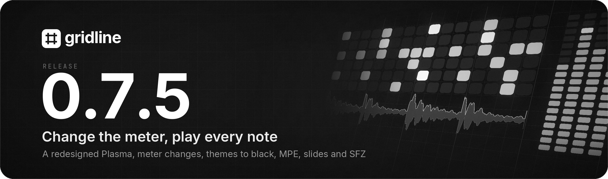
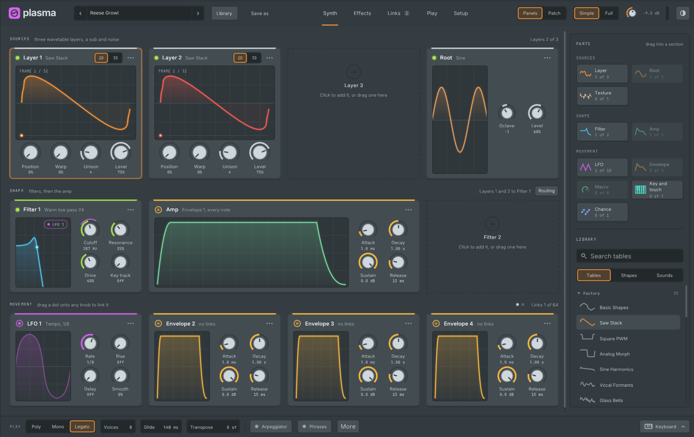
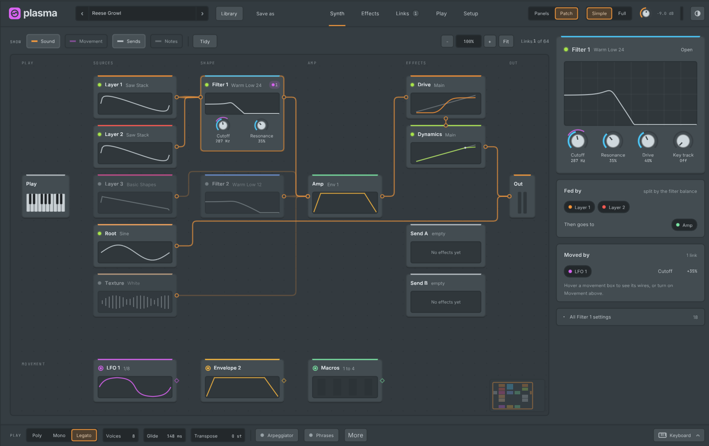
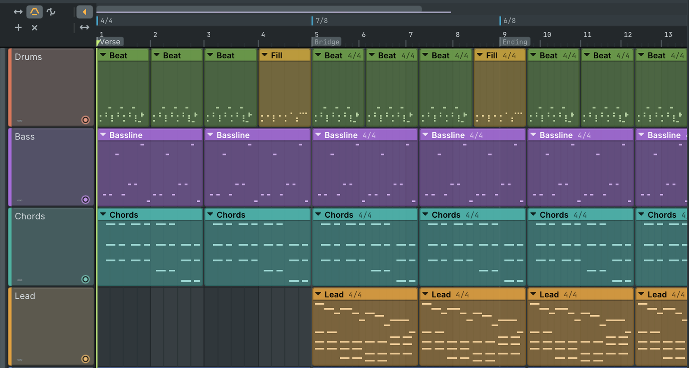
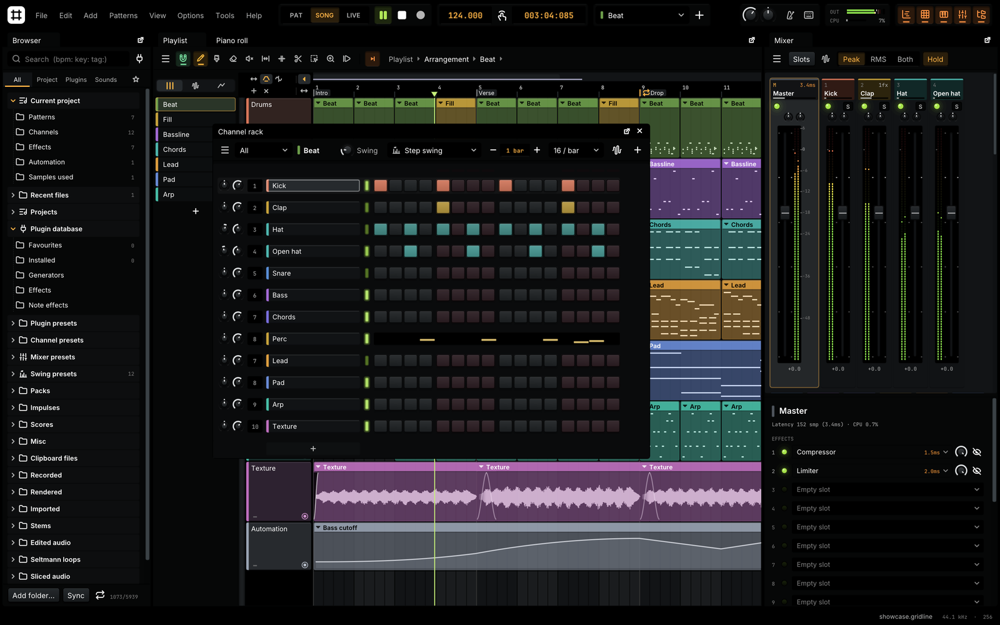
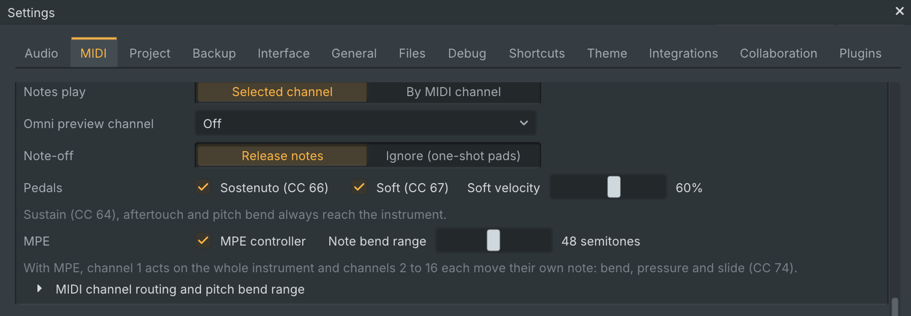
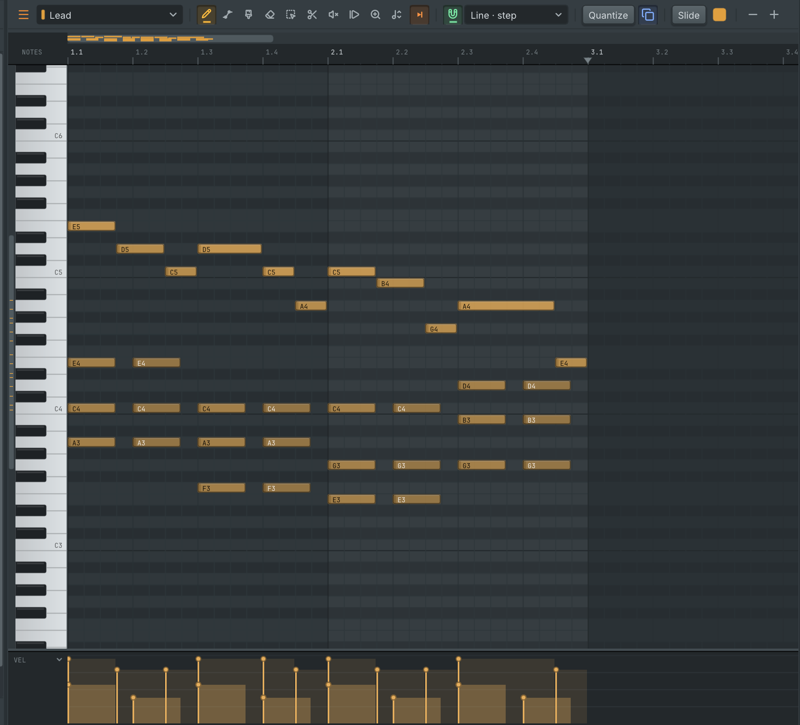
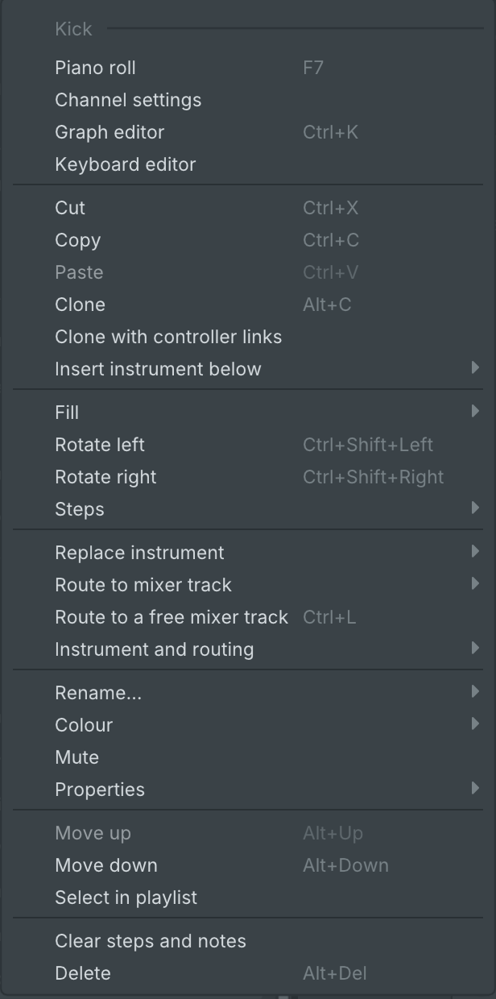
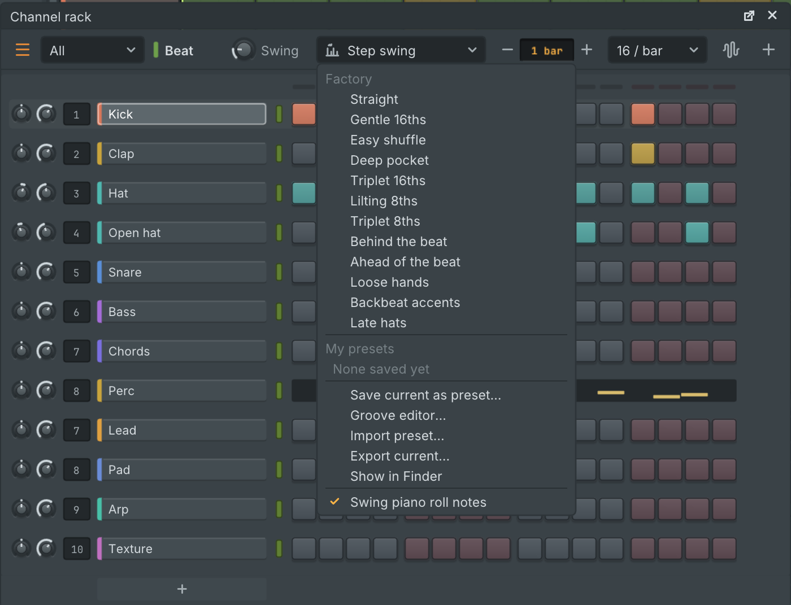

  

Gridline 0.7.5 is a point release on top of 0.7.4. **Plasma, Gridline's own synth, is redesigned**, with a new layout and a **Patch view** that draws the sound as boxes and wires. **A song can change its meter as it goes**, **themes go down to pitch black** with a **white text** option and the whole interface follows them, and **MPE keyboards play every built-in instrument note by note**. **Slides glide on every instrument**, the Multisampler plays **SFZ instruments**, channels can be **split and layered**, and the channel rack gets **swing presets and grooves**. Audio clips get **warp markers**, channels and mixer tracks can be **frozen or hibernated**, **drum kits** load onto Abacus, **Voltage In** brings control voltages into Gridline, and Gridline can run on **Wayland itself**. Projects from 0.7.4 open as they are and play as before. Gridline's update check offers 0.7.5 to everyone on an earlier version.

## Highlights

### Plasma, redesigned

Plasma has a new editor. Every setting has one home, the sound reads from left to right in the order it is made, and nothing is hidden behind a mode: a beginner sees the main controls, an expert reaches every detail from the same page.

- **Five tabs.** Synth, Effects, Links, Play and Setup.
- **The sound as blocks.** The Synth tab shows up to three layers, Root, Texture, two filters and the amp in signal order, with the modulation under them: LFOs with large shapes, envelopes, macros, key and touch, and chance. Each block has its live picture, an on light or link dot, More, fold and remove.
- **Simple or Full.** One switch folds or shows the secondary controls of every block.
- **Add what you need.** A parts sidebar lists what you can add (Layers 2 of 3, LFOs 1 of 10 and so on) and a library of tables, LFO shapes and sounds. Drag a part into the synth to add it, a table onto a layer, a shape onto an LFO.
- **Edit in place.** Each layer's table display is edited where it is: drag through the table in 2D or 3D and see the morphs live. Each block's menu opens its advanced panel, resets it, copies and pastes its settings to another block of its kind, and loads or saves a layer's wavetable.
- **Large editors.** The LFO and envelope editors are large panels with quick shapes and their links, and the LFO editor spans the whole window.
- **Effects** get a tab of their own, with lanes for the main chain and both sends.
- **The Library** in the top bar opens a full page of tables, LFO shapes and sounds with pictures, filters and previews.
- **The keyboard drawer** (Alt+K) slides up with new bend and mod wheels.
- **Lighter on the processor.** Parts that are not in use cost no processing time, so a one-layer sound takes a fraction of the time of a sound with everything on.

Sounds, projects, automation, MIDI links and collaboration work exactly as before, and every sound plays the same.

  

### The Patch view

Press Tab in Plasma to see the same sound as boxes and wires, left to right: what plays the notes, the sources, the two filters, the amp, the effects and both sends, and the output, with the motion sources in use in a row below. Thick wires carry the sound, dashed ones the sends, and dotted ones each modulation link with its depth on a label. Drag from a box's edge onto another box to route its sound (only the places it can go light up), drop on empty space for a search menu, drag a motion box's dot onto any control to link it, and Alt+click a wire to take it away. Both views edit the same sound, so switch back and forth at any time.

  

### Meter changes across the song

A song can now change its time signature as it goes, say a verse in 4/4, a bridge in 7/8 and an ending in 6/8.

- **Add a change** from the playlist ruler's menu, with Alt+Shift+T at the song position, or by double-clicking the meter lane above the ruler, which shows once a song has a change.
- **Edit it in place.** Click a change to set its meter, name and start bar, drag it to another bar line (hold Alt to place it freely), or right-click it for more.
- **Everything follows.** The playlist's grid, bar numbers, snapping, the position display, the metronome, the count-in and the bar position sent to plugins all follow the meter in force. Compound meters such as 6/8, 9/8 and 12/8 click every eighth with a lighter accent on each group of three. A change inside a bar leaves a short bar, drawn hatched, which keeps its number.
- **Notation only.** Clips and notes never move or change length, and the song sounds the same.
- **Patterns** follow the song's meter or have one of their own (**Meter** in the pattern menus), and new patterns made at a change take its meter, with steps that stay sixteenths.
- **Files.** Meter changes save with the project, go through FL Studio and MIDI files both ways, become cue points in WAV exports and reach everyone in a shared project. MIDI import can also split a file into one pattern per meter section. FL Studio and MIDI projects that already had time signature markers now show their bars in each marker's meter.

See [docs/meter-changes.md](https://github.com/lolitemaultes/Gridline/blob/v0.7.5/docs/meter-changes.md).

  

### Themes down to black

- **Brightness to pitch black.** Settings > Theme > Brightness now goes all the way down to black, in the dark and the light theme, and the text stays readable on the way.
- **White text and glyphs.** A new option draws text, browser folders and idle icons in pure white on dark panels.
- **The whole interface follows.** The top bar, browser folders and icons, audio waveforms, plugin window bars and the title bar the desktop draws above Gridline all follow the theme, so no light bar is left over a dark theme.

The default dark and light themes look as before. See [docs/themes.md](https://github.com/lolitemaultes/Gridline/blob/v0.7.5/docs/themes.md).

  

### Playing: MPE, slides, SFZ and layers

- **MPE on Gridline's own instruments.** Tick **MPE controller** in **Settings > MIDI** and an MPE keyboard or pad surface plays every built-in instrument note by note: sliding a finger bends just that note (48 semitones by default), pressing harder raises its level and sliding up and down brightens it. Each channel's settings have an **Expression** section to choose what pressure and timbre do, how much, and whether notes bend on their own. Notes can carry pressure and timbre lanes, saved with the project. Without MPE turned on nothing changes. See [docs/mpe.md](https://github.com/lolitemaultes/Gridline/blob/v0.7.5/docs/mpe.md).
- **Per-note pitch for plugins.** The **Processing** tab of a plugin's window has a **Per-note pitch** choice: Automatic (the plugin's own note tuning where it has one), MPE (each note on a channel of its own, with a bend range of 2 to 96 semitones), Channel pitch bend, or Off.
- **Slides on every instrument.** A slide note now glides the notes it meets on every built-in instrument, drums with a pitch included, and on plugins, over the slide's length; a slide never starts a note of its own. Shift+S turns slide mode on and off in the piano roll, a faint arrow shows which notes each slide moves, and MIDI export writes slides as pitch bends. See [docs/slide-notes.md](https://github.com/lolitemaultes/Gridline/blob/v0.7.5/docs/slide-notes.md).
- **SFZ instruments in the Multisampler.** `.sfz` instruments play as they are written: every opcode of SFZ v1 and v2 and the widely used extensions is read, with keyswitches, round robins, release regions, envelopes, LFOs, filters, EQ and the instrument's own effects. Anything Gridline has no counterpart for is listed in the editor and never stops the instrument from loading. The editor shows the region map, keyswitches and a knob for each named controller, and can convert the instrument to editable zones. The browser lists `.sfz` and `.sf2` files as instruments you can hear with a click. See [docs/sfz.md](https://github.com/lolitemaultes/Gridline/blob/v0.7.5/docs/sfz.md).
- **Split and layered instruments.** A layer channel gives each child a key zone and a velocity zone with crossfades, a transpose and a solo, and can share notes by **Cycle** (round robin) or **No repeat**. Its layer editor has a lane per child, zone bars to drag, **Split** and **Reset**, and eight macro knobs that each turn any controls of the children at once. Layers save as `.gllayer` presets, and four come built in. See [docs/layers.md](https://github.com/lolitemaultes/Gridline/blob/v0.7.5/docs/layers.md).

  

### Editing: scroll bars, shorter menus, the mixer and swing

- **Scroll bars in the piano roll.** A slim bar above the ruler shows every note of the pattern at a glance, with the playback position: drag it to move, click beside it to jump a page, drag either end to zoom and double-click it to fit the pattern. A second bar left of the keyboard scrolls the keys and marks each pitch in use. The automation clip editor has the same time bar. See [docs/piano-roll.md](https://github.com/lolitemaultes/Gridline/blob/v0.7.5/docs/piano-roll.md).
- **Shorter right-click menus.** The channel, mixer track, channel rack, playlist track and audio clip menus and the Tools menu no longer need scrolling: each section keeps its most used commands and the rest sit in a submenu named after the section. Every command is still there with the same shortcut, and commands that can never apply are left out instead of greyed. See [docs/context-menus.md](https://github.com/lolitemaultes/Gridline/blob/v0.7.5/docs/context-menus.md).
- **Many mixer tracks at once.** With the mixer focused, Ctrl+A (Cmd+A on macOS) selects every insert track. Double-clicking a fader or knob of a selected track, or choosing its **Reset**, resets that control on all of them as one undo step, and the track menu has **Reset selected tracks**. The mouse wheel over the empty part of a strip scrolls the mixer sideways.
- **Swing presets and grooves.** A preset menu sits beside the channel rack's Swing knob with eleven factory feels, from Gentle 16ths to Late hats. Save your own and share them as small files. A preset can swing 8ths, 16ths or 32nds and set its own timing and accent for each step of a repeating cycle; the new Groove editor draws both. Grooves can be taken from a pattern's notes, a MIDI file or an audio clip's transients, and the piano roll's quantize tool uses them.

  

  

  

### Working together across networks

Joining a collaborative project when both computers sit behind home routers used to work only if the reply code came back within about half a minute. Now the join window and the invite keep trying on their own for up to 15 minutes, so a reply code that takes a while to come back through a chat still connects.

- **Through firewalls and routers.** Gridline keeps the way through each router open while it waits, asks a second address server when the first does not answer, and works on computers without IPv6.
- **Plain answers.** Both windows show what is happening and what to do next, and a failed join says why: the invite expired, was used or cancelled, the other computer runs another version, a router or firewall blocks direct connections.
- **Codes that survive chat apps.** Line breaks, invisible spaces, typographic dashes, quoting and a capitalised start no longer break invite and reply codes, and a code pasted in the wrong place says where it belongs.
- **Still no Gridline server.** Connections go straight between the computers, through another collaborator, or through a TURN relay you set yourself in Settings > Collaboration.

See [docs/collaboration.md](https://github.com/lolitemaultes/Gridline/blob/v0.7.5/docs/collaboration.md).

### Sounds in, voltages in, plugins out of the way

- **Drum kits.** Packed `.h2drumkit` kits and unpacked kit folders load onto Abacus: each instrument becomes a named pad with its velocity layers, round robin, cut groups, level, pan, pitch and envelope. The browser shows a kit's instruments, each playing with a click. See [docs/drum-kits.md](https://github.com/lolitemaultes/Gridline/blob/v0.7.5/docs/drum-kits.md).
- **REX2 and Apple Loops.** Sliced `.rx2` loops and Apple Loops (`.caf`) open, and the browser shows a loop's tempo, key, slices and tags. A REX2 loop on the channel rack or the playlist becomes a Kerf channel cut at its slices, so it follows the song tempo without stretching. See [docs/loop-files.md](https://github.com/lolitemaultes/Gridline/blob/v0.7.5/docs/loop-files.md).
- **Voltage In.** A new controller reads pitch, gate, clock and four CV inputs from a DC-coupled audio interface. Pitch and gate play notes into any channel, timed to the sample; its eight outputs drive any parameter through **Link to controller**, and a clock input can set the tempo and start and stop the song. A **Calibrate** window checks the interface, fits the round trip and tunes an output with a tuner. Voltage Out gains new sources, trims and a direct mode. See [docs/cv-gate.md](https://github.com/lolitemaultes/Gridline/blob/v0.7.5/docs/cv-gate.md).
- **Freeze.** Right-click a channel, a mixer track or a linked playlist track and choose **Freeze**: its sound is rendered once and its plugins unload, while its volume, pan, sends and their automation stay live. **Unfreeze** brings the plugins back exactly as they were, and an edit the render depends on renders it again. See [docs/freeze.md](https://github.com/lolitemaultes/Gridline/blob/v0.7.5/docs/freeze.md).
- **Hibernate.** **Hibernate** unloads a channel's or track's plugins without a render. They load again by themselves when their editor opens, shortly before the song plays them, or when you play them. **Tools > Macros** hibernates every unused plugin at once.
- **Warp markers.** The playlist's Warp tool (W) pins points of an audio clip to the timeline: drag a marker and the audio on both sides stretches to fit, with its pitch kept. The clip menu can add markers at every transient and quantize the audio to the grid. See [docs/warp-markers.md](https://github.com/lolitemaultes/Gridline/blob/v0.7.5/docs/warp-markers.md).
- **Edit in Loupe from the browser** or from a sampler channel's settings. The file itself is never changed.
- **Browse samples with the keyboard.** The arrow keys walk through the browser and preview each sample as you land on it; Enter loads it. See [docs/browser-keys.md](https://github.com/lolitemaultes/Gridline/blob/v0.7.5/docs/browser-keys.md).

### Native Wayland

Settings > Interface > Window system can now run Gridline on Wayland itself instead of through XWayland, from the next start. Plugin interfaces then open in windows of their own, and the setting explains each choice. The default stays Automatic, which runs through XWayland on a Wayland desktop. Files dropped on Gridline on Wayland now land where you let go, a file opened from the file manager brings the running Gridline forward, and a session-wide scale setting no longer doubles the interface size. See [docs/wayland.md](https://github.com/lolitemaultes/Gridline/blob/v0.7.5/docs/wayland.md).

### Reliability

- **A stuck MIDI system no longer stops Gridline.** When the computer's MIDI service hangs or refuses to start, Gridline used to freeze at startup or quit. It now starts without MIDI devices, says so in **Settings > MIDI**, keeps trying on its own and opens your devices as soon as the service answers.
- **Plugin scans can no longer use up the computer's memory.** Each plugin's check has a memory limit, and a plugin that goes over it is listed with the failed plugins and skipped by later scans. Programs a plugin starts are always ended with it. Large LV2 bundles of hundreds of plugins now load in about the memory of one.
- **Changes in a plugin's own window stick.** A knob, slider, menu or switch in a VST3 plugin's interface could jump straight back to its earlier value, most often on Linux and Windows. It now stays, as one undo step.
- **Menus that add, move or remove things** (cloning, freezing, deleting or moving channels, mixer tracks, playlist tracks and patterns) no longer crash Gridline.
- **The typing keyboard keeps its octave** over a long session, and leaving Gridline lets go of every held key.
- **Pitched samples cost about a quarter of the processing time** they did, with exactly the same sound, in the Sampler and every other sample player.
- **Tiling window managers** (i3, sway, Hyprland, bspwm and others) now tile the main window.

## Other changes and fixes

- The channel rack draws a thin line between instrument rows and automation rows.
- The automation lane under the piano roll edits points like the automation clip editor, with select, move, erase, copy and paste, curves and **Simplify points...**; recorded controller moves take far fewer points.
- Loupe: grips to adjust each edge of a selection, a new selection heard at once while playing, Loop and scrubbing everywhere, not only in a mixer slot, a follow-the-playhead setting of its own, and recordings drawn while they record (Seltmann's recorder too).
- Holding Ctrl (Cmd on macOS) on the edge of a trimmed clip loops the part the clip showed.
- The main button of a window or dialog is raised and filled with the highlight colour, so it no longer looks pressed.
- A sampler's start and end handles now trim its audio clips too, and reversing a trimmed audio clip plays the same audio backwards.
- Cut groups, mono and the voice limit work on the Sampler for steps and for notes played live, and cut without a click.
- Knobs over whole numbers or choices follow every drag, slow and fine drags included.
- The song position's time format and Show played chords stay as chosen.
- Shared projects keep "Swing piano roll notes", and the channel rack's group menu no longer crashes.
- MIDI export of a later part of the song starts in the meter in force there.
- M4A samples have their exact length on Linux and the BSDs, without extra silence at the end.
- FL Studio projects with a moved sample start open their audio clips at the right place, and export back the same way.
- The loop badge by the pointer is larger, clearer and shows only where a drag really loops.

The full list is in [CHANGELOG.md](https://github.com/lolitemaultes/Gridline/blob/v0.7.5/CHANGELOG.md).

## Known limits

- **MPE pressure and timbre** act on the whole instrument, except in SFZ instruments that map them; per-note pressure and timbre come later. Pitch is per note everywhere.
- **Meter changes.** A few editing tools and the live launch grid still use the song's starting meter, and plugins see a meter change from the next audio block.
- **Voltage Out's direct mode** needs the ASIO driver on Windows for now.
- **Live and Logic layouts** are still previews.
- **FL Studio projects.** Plugin channels may still play louder than sampler channels, and some built-in plugins' parameters aren't all mapped yet.

## Upgrading from 0.7.4

- Projects open as they are and play as before.
- FL Studio and MIDI projects with time signature markers now show their bars in each marker's meter. Nothing in the song moves.
- A project with meter changes opened in an earlier Gridline keeps the changes as plain time signature markers.
- Channel, mixer and other right-click menus are shorter: less used commands moved into submenus. The command palette still finds every command.
- Collaborative projects: everyone in a session updates to 0.7.5. An older collaborator is told to update when joining.

## Install

| System | File |
| --- | --- |
| macOS 11 or later (Apple Silicon and Intel) | `Gridline-0.7.5-macos-universal.dmg` |
| Windows 10 / 11, x64 | `Gridline-0.7.5-windows-x64-setup.exe` or `-windows-x64.zip` |
| Windows 10 / 11, ARM64 | `Gridline-0.7.5-windows-arm64-setup.exe` or `-windows-arm64.zip` |
| Linux x86_64, Debian 11 to 13, Ubuntu 22.04 and later, Intel and AMD Chromebooks | `.AppImage`, `-linux-amd64.deb`, `-linux-x86_64.rpm` or `-linux-x86_64.tar.gz` |
| Linux aarch64, ARM Chromebooks | `.AppImage`, `-linux-arm64.deb`, `-linux-aarch64.rpm` or `-linux-aarch64.tar.gz` |
| FreeBSD, OpenBSD, NetBSD (x86_64) | `-freebsd-x86_64.tar.gz`, `-openbsd-x86_64.tar.gz`, `-netbsd-x86_64.tar.gz` |
| Source | `Gridline-0.7.5-source.tar.gz` |

- **macOS:** open the `.dmg` and drag Gridline to Applications. The first time, open it with right-click, then Open.
- **Windows:** run the `-setup.exe`. If SmartScreen appears, choose "More info", then "Run anyway".
- **Debian, Ubuntu and Chromebooks:** install the `.deb` with `sudo apt install ./Gridline-0.7.5-linux-amd64.deb` (or `-arm64.deb`). See [docs/debian.md](https://github.com/lolitemaultes/Gridline/blob/v0.7.5/docs/debian.md) and [docs/chromeos.md](https://github.com/lolitemaultes/Gridline/blob/v0.7.5/docs/chromeos.md).
- **Other Linux:** use the `.AppImage`, `.rpm` or `.tar.gz`. The `.tar.gz` comes with `install.sh`, which adds Gridline to the desktop menu.
- **BSDs:** use the `.tar.gz` for your system.

The `Gridline-0.7.5-media-tools-<system>.zip` files hold FFmpeg for Import from URL. You do not need to download them: the packages already carry it, and a Gridline built from source fetches the one for its system the first time Import from URL is used, checked against the release's checksums.

## Checksums

Every file's SHA-256 checksum is in `Gridline-0.7.5-SHA256SUMS`. Check a download with `sha256sum -c Gridline-0.7.5-SHA256SUMS --ignore-missing` (Linux, BSD), `shasum -a 256 -c Gridline-0.7.5-SHA256SUMS --ignore-missing` (macOS) or `Get-FileHash <file>` (Windows PowerShell). Gridline's update popup checks the checksum of what it downloads by itself.

## Licence

Gridline is free software under the GNU General Public License v3.0. The bundled libraries and the programs shipped beside it keep their own licences, listed in [third_party/NOTICE.md](https://github.com/lolitemaultes/Gridline/blob/v0.7.5/third_party/NOTICE.md).
