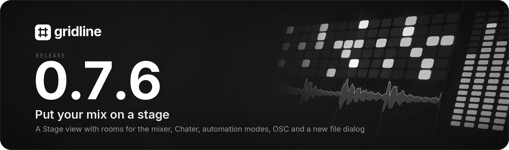
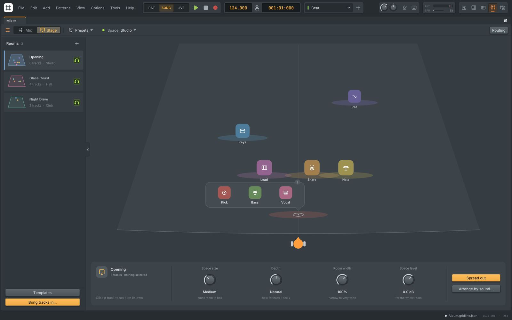
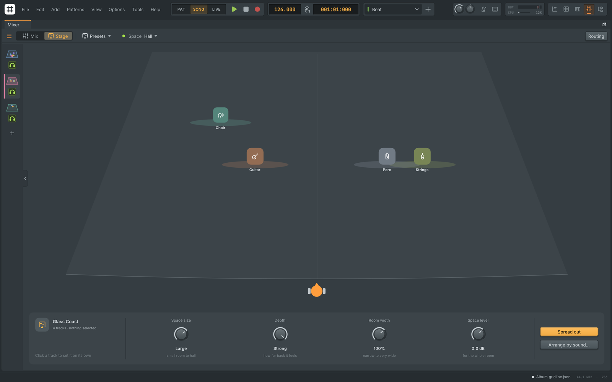
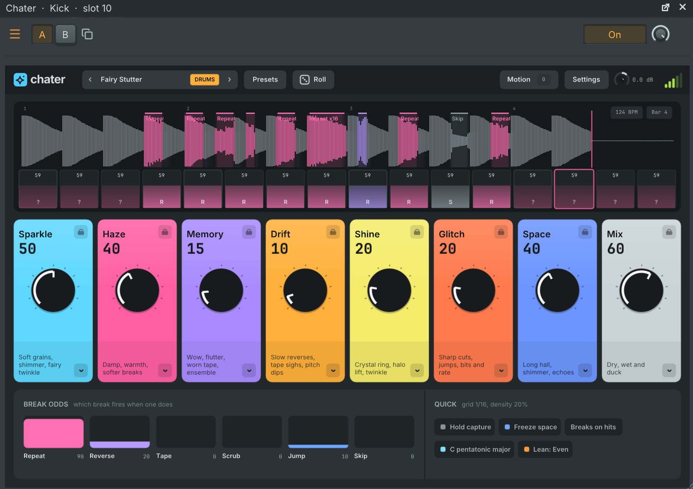
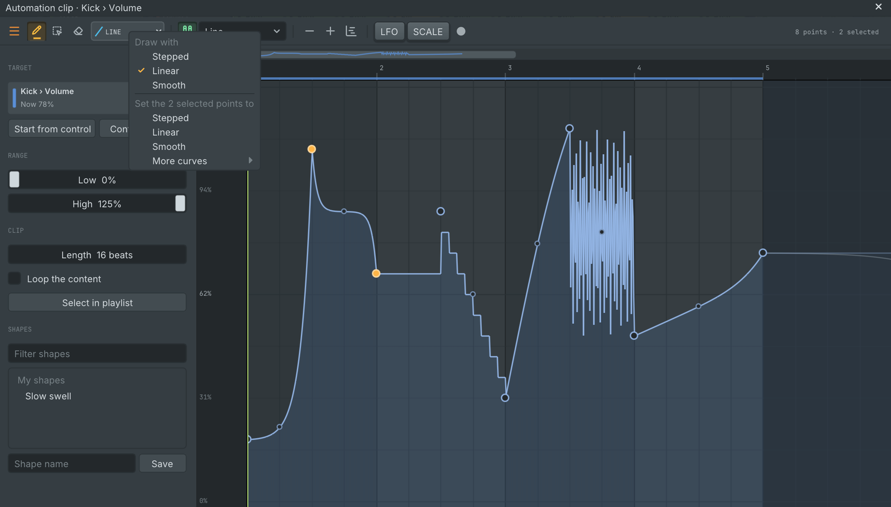
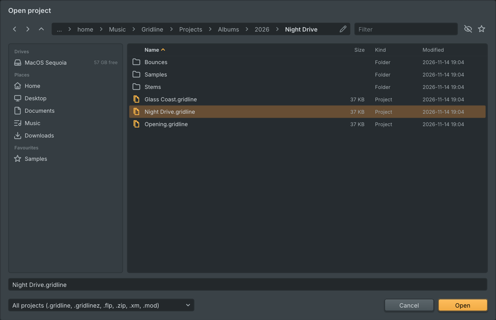
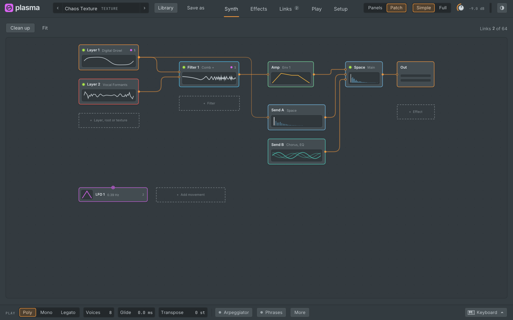

  

Gridline 0.7.6 is a point release on top of 0.7.5. **The mixer gets a Stage view**: your tracks stand on a stage, and where you put them sets their **pan, distance and width**. A big project can split its tracks into **rooms**, each with its own stage and space. **Chater** is a new glitch, glitter and sparkle effect, the automation clip editor draws **stepped, linear or smooth**, and Gridline takes **OSC control** from phones, tablets and other programs. A **new Open and Save dialog** has drives, places and a path bar, **Import from URL** copes with more sites and says clearly what went wrong, and **mixer and playlist tracks move by dragging**. Plasma's **Patch view is redone**, Plasma opens **at its full size with larger text**, and the release fixes **keyboard and window problems on Linux** and several **crashes**, among them the one when creating an automation clip. Projects from 0.7.5 open as they are and play as before. Gridline's update check offers 0.7.6 to everyone on an earlier version.

## Highlights

### The Stage view

**Mix | Stage** at the left of the mixer's toolbar shows your tracks standing on a stage, seen from where you sit.

- **Place a track, hear it there.** Left and right is the pan, near and far the distance: further back is quieter, duller, narrower and roomier. The oval under a track is its stereo width.
- **Drag to place.** Drop a track on another to share its spot; tracks that share a spot sit together in a tray you drag them out of again, so tracks never cover each other. A box dragged on the empty stage selects the tracks it reaches, with a count as you go.
- **Knobs with words.** The panel under the stage sets one track, several or the whole stage, and holds the space's size, depth, room width and level.
- **Spread out and Arrange by sound** show where every track would go before you apply it as one undo step. Arrange by sound looks at what plays on each track and marks a track it is unsure of.
- **Spaces and presets.** Projects start with No space, where distance is kept but not heard. Pick one of nine spaces from the **Space** button, from a small room to a church, a plate or open air, each tuned as a stage, or start from one of six stage presets. Focus and a pan law that keeps a stereo track whole at the side come with it.

Everything is automatable, undoable and shared with collaborators, and projects that never use the Stage sound exactly as before. See [docs/stage-view.md](https://github.com/lolitemaultes/Gridline/blob/v0.7.6/docs/stage-view.md).

  

### Rooms

A big project can group its mixer tracks into rooms, for example one for each song of an album, each with its own stage: its own space, back of the stage, room width and echoes.

- **The rooms column** runs down the left of the Stage in every project. A tab on its edge slides it out and back (or press \\), and dragging its edge sets the width, down to a **slim rail** of room floors.
- **Make and keep rooms.** Start a new room from the one you are on or from one of six templates, and right-click a room to rename, colour, reorder or delete it or save it as your own template. A room is deleted only once its tracks have moved elsewhere, after you confirm.
- **Move tracks between rooms.** Drag a selection onto a room, or use **Bring tracks in...** to pick them by arrangement, pattern, colour or name. Moved tracks keep their places, effects and routing and take on the new room's sound, in one undo step.
- **Headphones per room.** Click a room's headphones to hear it alone, click others to add them, or right-click to hear one room only.
- **The Mix view** gets a room colour line under each strip and a filter for the room shown.

Projects with one room are saved exactly as before. See [docs/stage-view.md](https://github.com/lolitemaultes/Gridline/blob/v0.7.6/docs/stage-view.md#rooms).

  

### Chater

Chater is a new effect for dreamy glitches, glitter and sparkle. It keeps the last bars of its track and breaks gently into them by chance on the tempo grid, on the input's own hits or both: soft stutters, reverse swells, tape stops, scrubs and skips that blur into the space or, with the Glitch tile up, cut sharp. Around the breaks it adds pitched grain sparkle, a shimmer tail, ringing crystal resonators and a lifted halo on the highs, wears the sound like an old tape (wow, flutter, hiss and crackle) and sends it into a long hall with shimmer and Freeze.

- **Eight macro tiles** drive it all, and the glitch tape shows each break over the audio it replaced.
- **Repeatable.** Breaks follow the seed and the song position, so renders match playback.
- **40 presets** in eight banks by source (pads, vocals, keys, plucks, drums, ambient, lo-fi and glitch), and dice with locks and history.

See [docs/plugins/chater.md](https://github.com/lolitemaultes/Gridline/blob/v0.7.6/docs/plugins/chater.md).

  

### Automation modes

The automation clip editor's toolbar now has the curve chooser of the piano roll's automation lane, and the two share it: pick **Stepped**, **Linear** or **Smooth** in either and new points and strokes in both use it. Gridline remembers the choice. With points selected, the chooser's menu also sets their curve in one step. See [docs/automation.md](https://github.com/lolitemaultes/Gridline/blob/v0.7.6/docs/automation.md#drawing-curves).

  

### OSC control

Gridline can receive Open Sound Control messages, so touch surfaces on a phone or tablet, other music software, modular and lighting tools can drive it: transport, tempo, position and loop; mixer volume, pan, mute, solo, sends and effect slots; channels; notes; any plugin parameter by number or name; patterns and markers. **Link to controller** learns an OSC address just like a MIDI control, and feedback can go back to the surface so its faders and buttons follow Gridline. Switch it on in **Settings > MIDI > OSC**: it is off by default and listens on this computer only until you allow the network. See [docs/osc.md](https://github.com/lolitemaultes/Gridline/blob/v0.7.6/docs/osc.md).

### A new Open and Save dialog

- **Places on the left:** this computer's drives and volumes (USB sticks, network drives and discs with their own icons and free space), Home, Desktop, Documents, Music and Downloads, the project's Recorded and Rendered folders, favourite folders you pin with the star, and recent folders.
- **A path bar:** click a part to jump there, or click into it and type a path, with Tab to complete.
- **A real list:** Name, Size, Kind and Modified columns that sort by any of them, icons for projects, sounds, MIDI files and presets, a filter box, a hidden files switch, and Back, Forward and Up. The keyboard works throughout.
- **Saving:** the name box holds the name alone, with the chosen type's extension shown beside it and added when the file is written.

The dialog remembers its size and the last folder of each kind of dialog. See [docs/opening-files.md](https://github.com/lolitemaultes/Gridline/blob/v0.7.6/docs/opening-files.md#the-open-and-save-dialog).

  

### Import from URL you can rely on

- **Retries** a download a site refuses for a moment, or a connection that breaks off, up to three times.
- **Stereo audio** from films with surround sound, and real titles for playlist items.
- **Works on macOS** again when Gridline.app has been dragged out of the disk image.
- **Plain errors** that say what went wrong and what to try, with **Copy details** for a bug report, and **Reinstall the tools** in Settings > File > Import from URL.

See [docs/import-url.md](https://github.com/lolitemaultes/Gridline/blob/v0.7.6/docs/import-url.md).

### Move tracks by dragging

Drag a mixer track by its name plate, or a playlist track by its header, to a new place; several selected tracks move together and Esc cancels. Routing follows the tracks, not their numbers: sends, sidechains, send automation and controller links keep pointing at the same tracks, so the project sounds exactly the same. **Alt+Left / Alt+Right** in the mixer and **Alt+Up / Alt+Down** in the playlist move the selected tracks one place. See [docs/mixer.md](https://github.com/lolitemaultes/Gridline/blob/v0.7.6/docs/mixer.md#moving-tracks).

### Plasma's Patch view, redone

The Patch view is now a calm canvas with no writing on it. The sound reads left to right, from the sources through the shape, the amp and the effects to the output, with the sends under the amp and every movement source in use as a tile below. Every line runs from a dot on one box's edge to its own port on the next by the shortest way round the others, never through a box and never backwards.

- **Point to see.** Point at a tile to see a path to each control it moves, with the amounts, or at a box to see what moves it; the rest fades.
- **Link and unlink by dragging.** Drag a tile's dot onto a box and pick one of its controls, drag a link's end off its box to unlink it, and drag an amount to change it.
- **Your own layout.** Boxes and tiles move freely and snap to the grid and to each other, and their places are saved with the sound. **Clean up** sorts everything back into a tidy flow and **Fit** frames it.

See [docs/plugins/plasma.md](https://github.com/lolitemaultes/Gridline/blob/v0.7.6/docs/plugins/plasma.md#patch).

  

### Plasma at full size

- **Full size, larger text.** On a 1920 x 1080 screen or larger, Plasma opens at 100 % so its text is shown as designed; on a smaller screen it is reduced just enough to fit. Every label, value and title is a step larger and stays readable when the editor is reduced.
- **A keyboard that glides.** The keyboard drawer (Alt+K) is redrawn with bend and mod wheels, clear bend range fields and a shaded keyboard: hold the button and slide across the keys to play each in turn. Clicks on the drawer never reach the controls under it.
- **Full coloured borders** round every block, heavier with a soft glow when selected.
- **Shorter instrument windows.** The menu and A/B buttons sit on the tab row when there is room, and a channel without note processors shows one slim row.

### Playing and editing

- **The chord stamp** has its own button beside the piano roll's menu button, with a compact picker of recent chords, chord types, scale chords and inversions.
- **MPE pressure and timbre act note by note** on nearly every built-in instrument: pressing harder on one key raises that note alone.
- **Everything follows the meter in force:** the live launch grid, Live mode's metronome and count-in, the playlist's editing tools, the automation clip editor's grid and the pattern tools. Plugins now see a meter change on its first sample and the right meter after a loop.
- **A click brings a window to the front** and gives it the keyboard, the first time and every time.
- **Search in the plugin pickers.** An effect slot or an add or replace menu starts with a search field.
- **Collapse all folders** in the browser with one button.

### Linux windows and keyboard

- **The keyboard works as soon as Gridline opens.** On some Linux desktops the keyboard did nothing for the first minute or two after starting.
- **The main window tiles on Hyprland** and other tiling window managers that decide once, because Gridline now starts in its main window and shows the loading screen inside it.
- **The main window opens the way you left it,** with its size, place and maximised state, fitted to the display if that has changed.
- **A plugin's window opens in front** on desktops that keep new windows from taking the focus, instead of seeming to flash and close.
- **Every built-in keyboard follows the mouse** one key at a time, with no key left sounding.

### Crash fixes

- **Creating an automation clip** from a channel rack knob's menu no longer closes Gridline, and edits of the whole project are faster on big projects.
- **More edits keep Gridline running:** routing a channel to a free mixer track, dropping a file or instrument on a rack row, dragging mixer tracks, moving or copying an effect to another track, adding a mixer track, moving automation clips to the playlist, layer children and the slicer's undo and redo.
- **Memory safety fixes** in the crash report window, the Hall reverb's classic editor and several key strips and canvases.

## Other changes and fixes

- The typing keyboard opens on if it was on when you closed Gridline, or as set under **Settings > MIDI > Typing keyboard**.
- **Link to controller** works on an installed plugin's parameters from its Parameters page.
- **Alt+L** and **Ctrl+Alt+L** in the mixer select the channels and tracks routed to the focused track.
- Built-in plugin windows keep their own controls at the interface size when the editor is shown smaller or larger.
- Controls along the bottom of a plugin editor shown smaller than its full size can be clicked again.
- Projects from FL Studio 10 or earlier open with their clips on the right playlist tracks.
- Project scripts read the meter at any position with `project.song.bar(tick)` and `project.song.beat(tick)`.
- Settings > Debug notes why each plugin window closed.

The full list is in [CHANGELOG.md](https://github.com/lolitemaultes/Gridline/blob/v0.7.6/CHANGELOG.md).

## Known limits

- **The Stage's sound.** The Stage shapes level, tone, width and the space from where each track stands. A fuller sound pass, with recorded rooms and a headphone mode, comes later.
- **Room solo is per computer.** Soloing rooms is for your computer only: it is never saved or shared with collaborators.
- **MPE pressure and timbre** still act on the whole instrument in drum kits, the decks and scratch players, the mono step bass, Plasma and instruments that play their own sequence.
- **Voltage Out's direct mode** needs the ASIO driver on Windows for now.
- **Live and Logic layouts** are still previews.
- **FL Studio projects.** Plugin channels may still play louder than sampler channels, and some built-in plugins' parameters aren't all mapped yet.

## Upgrading from 0.7.5

- Projects open as they are and play as before. Projects that never use the Stage are saved exactly as before.
- A project with two or more Stage rooms needs Gridline 0.7.6 or later to open.
- Collaborative projects: everyone in a session updates to 0.7.6. An older collaborator is told to update when joining.

## Install

| System | File |
| --- | --- |
| macOS 11 or later (Apple Silicon and Intel) | `Gridline-0.7.6-macos-universal.dmg` |
| Windows 10 / 11, x64 | `Gridline-0.7.6-windows-x64-setup.exe` or `-windows-x64.zip` |
| Windows 10 / 11, ARM64 | `Gridline-0.7.6-windows-arm64-setup.exe` or `-windows-arm64.zip` |
| Linux x86_64, Debian 11 to 13, Ubuntu 22.04 and later, Intel and AMD Chromebooks | `.AppImage`, `-linux-amd64.deb`, `-linux-x86_64.rpm` or `-linux-x86_64.tar.gz` |
| Linux aarch64, ARM Chromebooks | `.AppImage`, `-linux-arm64.deb`, `-linux-aarch64.rpm` or `-linux-aarch64.tar.gz` |
| FreeBSD, OpenBSD, NetBSD (x86_64) | `-freebsd-x86_64.tar.gz`, `-openbsd-x86_64.tar.gz`, `-netbsd-x86_64.tar.gz` |
| Source | `Gridline-0.7.6-source.tar.gz` |

- **macOS:** open the `.dmg` and drag Gridline to Applications. The first time, open it with right-click, then Open.
- **Windows:** run the `-setup.exe`. If SmartScreen appears, choose "More info", then "Run anyway".
- **Debian, Ubuntu and Chromebooks:** install the `.deb` with `sudo apt install ./Gridline-0.7.6-linux-amd64.deb` (or `-arm64.deb`). See [docs/debian.md](https://github.com/lolitemaultes/Gridline/blob/v0.7.6/docs/debian.md) and [docs/chromeos.md](https://github.com/lolitemaultes/Gridline/blob/v0.7.6/docs/chromeos.md).
- **Other Linux:** use the `.AppImage`, `.rpm` or `.tar.gz`. The `.tar.gz` comes with `install.sh`, which adds Gridline to the desktop menu.
- **BSDs:** use the `.tar.gz` for your system.

The `Gridline-0.7.6-media-tools-<system>.zip` files hold FFmpeg for Import from URL. You do not need to download them: the packages already carry it, and a Gridline built from source fetches the one for its system the first time Import from URL is used, checked against the release's checksums.

## Checksums

Every file's SHA-256 checksum is in `Gridline-0.7.6-SHA256SUMS`. Check a download with `sha256sum -c Gridline-0.7.6-SHA256SUMS --ignore-missing` (Linux, BSD), `shasum -a 256 -c Gridline-0.7.6-SHA256SUMS --ignore-missing` (macOS) or `Get-FileHash <file>` (Windows PowerShell). Gridline's update popup checks the checksum of what it downloads by itself.

## Licence

Gridline is free software under the GNU General Public License v3.0. The bundled libraries and the programs shipped beside it keep their own licences, listed in [third_party/NOTICE.md](https://github.com/lolitemaultes/Gridline/blob/v0.7.6/third_party/NOTICE.md).
