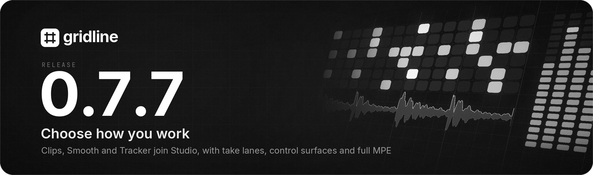
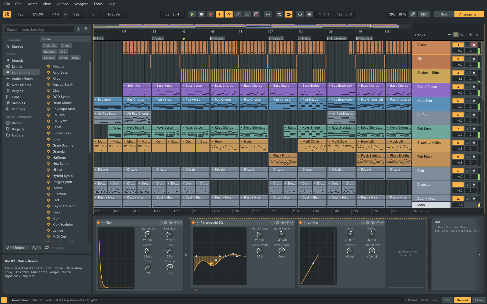
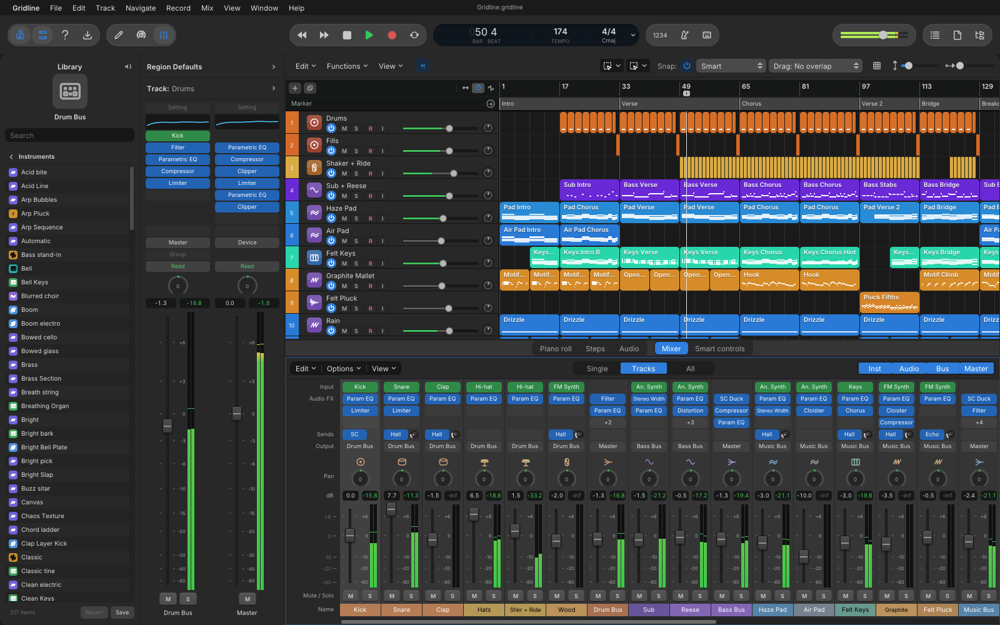
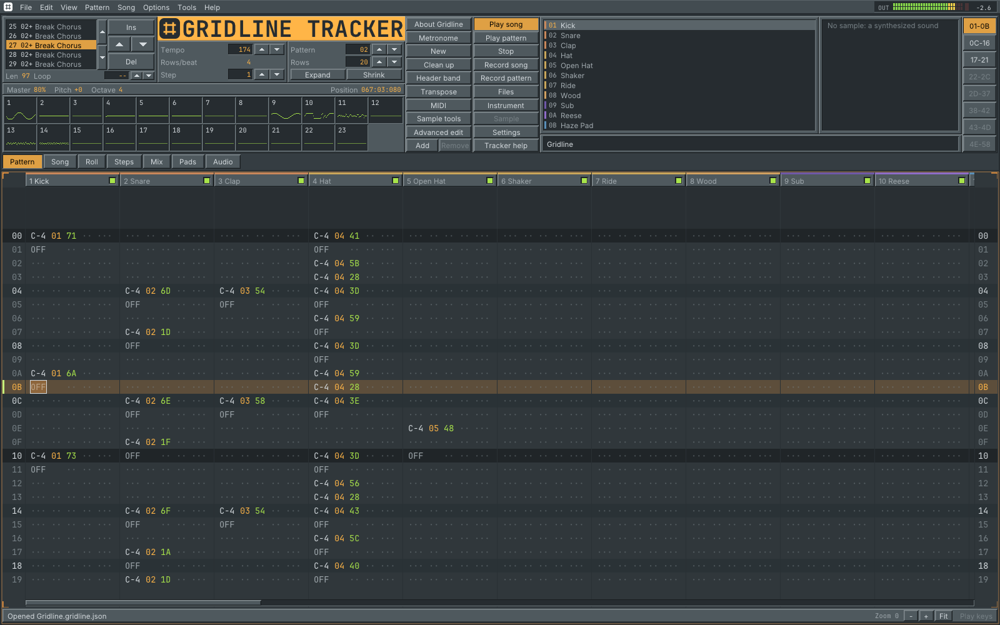
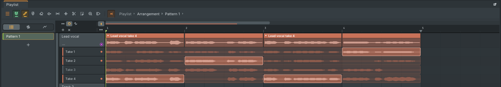
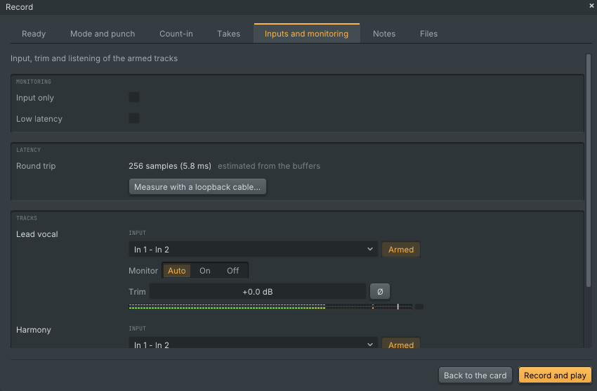
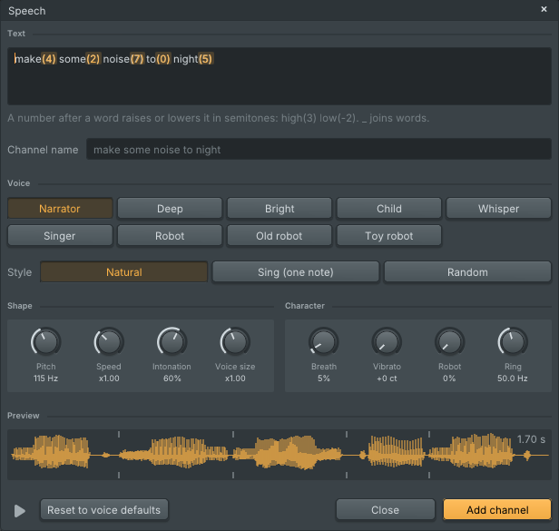

  

Gridline 0.7.7 is a point release on top of 0.7.6. **Clips, Smooth and Tracker are now complete layouts** beside Studio: three more ways to lay out the same project, each with its own panels, bars, menus and keys, and you can switch between all four at any time. **Recording is rebuilt**: loop passes become **take lanes** you comp by dragging, a **Recording card** and a **Record window** hold every setting, and quick punch, punch crossfades, input monitoring and pre-roll come with them. Gridline now drives **Mackie Control and HUI surfaces**, puts outboard gear in the mix with **Hardware Insert**, sends **MIDI Out to other channels** and records and edits **full MPE**. It also reads and writes **DAWproject** files, understands your **sound library**, turns typed text into a voice with **Speech**, takes a **typed value** on every plugin control and plays from a **game controller**. MIDI devices plugged in while Gridline runs are now picked up, and many fixes come with it. Projects from 0.7.6 open as they are and play as before. Gridline's update check offers 0.7.7 to everyone on an earlier version.

## Highlights

### Four layouts

**View > Window layout** (or **Layout** on the welcome screen) arranges the main window as **Studio**, **Clips**, **Smooth** or **Tracker**. They are four views of the same project: the same channels, patterns, clips, mixer and undo history, so you can start a song in one, switch, and go on in another, and collaborators can each work in the layout they like. Every layout keeps your theme and control style, and each can bring its own shortcut set and menus or keep yours.

#### Clips

Clips is built around the launch grid and the arrangement, with the mixer under the grid and the notes editor and a device band along the bottom.

- **Grid and Arrangement.** One switch at the top shows the launch grid (fixed-width columns, scenes, a stop button under each column and compact mixer strips for every track, return and Main) or the arrangement, with track headers on the right and the returns and Main at the foot. Clips move by dragging their body.
- **The device band** shows the selected track's instrument and effects side by side, each with a picture you drag to set it (the EQ curve, the filter, the compressor's curve, the reverb's decay, the delay's echoes) and its main knobs; a click opens the whole editor above the band. Installed plugins get Gridline's own sliders for the parameters you pick.
- **The notes editor** has a clip column with the clip's settings, Fold, the scale, envelopes drawn over the notes and MPE lanes, and pops out into its own window.
- **Capture, Session record and Draw mode** sit in the compact control bar, and the browser filters by tags with chips.

See [docs/plugin-window.md](https://github.com/lolitemaultes/Gridline/blob/v0.7.7/docs/plugin-window.md#in-the-clips-layout).

  

#### Smooth

Smooth keeps the tracks in the centre and everything else one click away.

- **The Library** on the left lists every sound and effect by kind. A click previews a patch with one note, a double-click or Enter puts it on the selected track. B shows or hides it.
- **The inspector** shows the selected track's channel strip and its output side by side, with its effects, sends and automation mode.
- **One shared lower pane** holds the piano roll, the steps, the audio editor, the mixer and **Smart Controls**, which learn a hardware control in place and stay with their plugin when effects are reordered.
- **Regions** loop by their edge, move across several tracks at once and onto spare tracks below the last one, and **Track > New tracks...** makes instrument, playlist or mixer tracks in one go.

  

#### Tracker

Tracker shows the song as rows of notes, one column per channel, typed from the computer keyboard.

- **The pattern editor** takes notes from the keyboard's two rows (F1 to F8 pick the octave), with an edit step, instrument, volume and effect columns, block selections and the classic keys for inserting and removing rows. Every edit is an ordinary edit of the project, so the piano roll and the other layouts see the same notes.
- **The header band** holds the order list, tempo, rows, step, live scopes for each channel, the instrument list and buttons for every tool.
- **Pages** for the Song arranger, the piano roll, the steps, the mixer, the pads and the audio editor, plus Files, Settings, Clean up, Advanced edit, Sample tools and an instrument editor, and its own About screen.

  

### Take lanes and comping

Loop recording now keeps every pass of a track on that track. The newest take plays, and lanes open under the track, one per take.

- **Comp by dragging.** Drag across a lane to play that take over the range, click a lane to pick it for the part under the pointer, or click a lane's header to play that take wherever it has audio. Each change is one undo step, and the track's row plays the result.
- **Rate, solo and audition.** A lane's header has three rating dots and an **S** that solos the take without changing the comp; right-click to audition a take from its start.
- **Flatten the comp** into one audio clip with short crossfades at the joins, **Remove unused takes**, or hide the lanes.
- **Shared and saved.** The takes, the comp and the lanes are saved with the song and shared in a collaboration session. **Takes > Move the takes into lanes** converts takes from older songs.

See [docs/recording.md](https://github.com/lolitemaultes/Gridline/blob/v0.7.7/docs/recording.md#loop-recording-and-take-lanes).

  

### The Recording card and the Record window

Clicking the record button on opens a small **Recording card**: before recording it lists the armed tracks with their input levels and the disk time left, with **Record and play**; while recording it shows the time, the mode and pass, the take and the levels, with **Stop** and **Discard take**. **H** folds it to a small REC pill.

**Full options** opens the **Record** window, with every recording setting on pages: Ready (a summary of the next take), Mode and punch, Count-in and start, Takes, Notes, Inputs and monitoring, and Files. The controls can also show as a slim strip under the top bar, or the Record window can stay open while you record. See [docs/recording.md](https://github.com/lolitemaultes/Gridline/blob/v0.7.7/docs/recording.md#the-recording-card).

  

### Punch, monitoring and the input

- **Quick punch.** The record key, the record button or the card's button punches in and out while the song plays; the pieces of one pass stay one take. Takes that start or end at a punch crossfade with the audio already there (5 to 50 ms).
- **Pre-roll and post-roll** around a punch range, shown as hatched areas on the ruler.
- **The input.** Each mixer track's input has a **Trim** and a polarity switch before the meter, which holds its peak and lights a clip lamp at 0 dBFS. Armed tracks in Auto monitoring hear their input tape style; **Input only** and **Low latency monitoring** are a click away. A track can be made **record safe**.
- **Never lose a take.** Armed tracks keep the last minute of what they hear while the transport plays, so **Recover the last pass** brings back a take played without Record, and **Recover what I just played** puts back the notes played in the last two minutes.
- **Start on the first note**, and a **loopback latency check** under Settings > Audio > Measure... that times the device's round trip to the sample.
- **Arm instruments** from the channel rack and the track headers of every layout, and choose which MIDI messages record.

See [docs/recording.md](https://github.com/lolitemaultes/Gridline/blob/v0.7.7/docs/recording.md#quick-punch).

### Hardware: control surfaces, Hardware Insert and MIDI Out

- **Mackie Control and HUI.** In **Settings > MIDI**, a device can be a Mackie Control main unit, an extender, a one-strip surface or a HUI. Faders move and follow the mixer inserts' volumes, the encoders pan, each strip has rec arm, solo, mute and select, bank and channel buttons move along the mixer, and the transport and jog wheel drive the song. The scribble strips show the inserts' names and the timecode display shows bars, beats and ticks. See [docs/midi-devices.md](https://github.com/lolitemaultes/Gridline/blob/v0.7.7/docs/midi-devices.md#control-surfaces-mackie-control-and-hui).
- **Hardware Insert** puts outboard gear in a mixer insert through extra outputs and inputs of the audio device. **PING** times the round trip, and plugin delay compensation lines the gear up with the rest of the mix. With the send set to None it is a compensated audio return for an external synth. On macOS and Linux, **Settings > Audio > Output channels** opens 4, 6 or 8 outputs. See [docs/midi-devices.md](https://github.com/lolitemaultes/Gridline/blob/v0.7.7/docs/midi-devices.md#hardware-insert).
- **MIDI Out plays other channels.** A MIDI Out channel's notes, knobs, program changes and bends now reach every channel listening on its port, on the same sample. See [docs/midi-devices.md](https://github.com/lolitemaultes/Gridline/blob/v0.7.7/docs/midi-devices.md#midi-out-to-other-channels).
- **Sustain holds notes** can be turned off for piano plugins that model their own pedal.
- **Plug in while it runs.** MIDI keyboards and controllers connected after Gridline started are now picked up, and unplugging one releases the notes it held.

### Full MPE

Recording from an MPE controller keeps each note's pitch, pressure and timbre. The piano roll paints **Note pressure** and **Note timbre** in the lane under the notes. Notes send them to plugins as CLAP note expressions, VST3 poly pressure and brightness, or MPE on each note's own channel; a MIDI Out channel can send MPE; and MIDI files keep it both ways. See [docs/mpe.md](https://github.com/lolitemaultes/Gridline/blob/v0.7.7/docs/mpe.md).

### Speech

**Speech...** in the channel rack's add menu turns typed text into a voice: nine voices (robots included), knobs for pitch, speed, intonation and voice size, breath, vibrato, a robot sound and ring modulation. A number in brackets after a word sets its pitch, and the Style can speak, sing every word on one note or pick a random pitch per word. The result is a sampler channel with a slice at every word, and **Chop** cuts its clip into one piece per word. See [docs/speech.md](https://github.com/lolitemaultes/Gridline/blob/v0.7.7/docs/speech.md).

  

### Your sound library and DAWproject

- **Sound libraries found and understood.** Gridline asks once before adding the usual loop and sample folders to the browser, and while it indexes it finds the tempo, key and sound kind (kick, snare, hat, bass, vocal and more) of files whose names say nothing. Filter by them with chips or with `sound:`, `scale:` and `beats:` in the search. See [docs/sound-library.md](https://github.com/lolitemaultes/Gridline/blob/v0.7.7/docs/sound-library.md).
- **DAWproject files.** **File > Export > DAWproject** and **File > Import > DAWproject file** carry tempo and meter, instruments, mixer tracks with effects, routing and sends, clips with their notes and expression, audio clips, automation and markers to and from other music programs, and Gridline lists what it could not carry exactly. See [docs/dawproject.md](https://github.com/lolitemaultes/Gridline/blob/v0.7.7/docs/dawproject.md).

### Playing and editing

- **The channel pitch knob is in cents** (-2400 to +2400) and works on every instrument: notes already sounding follow it, through each note's own tuning where the plugin has it and otherwise as pitch bend over the channel's new **Bend range**.
- **Type a value into any plugin control.** Right-click a knob in Gridline's plugin editors, in the app and in the Suite plugins, and choose **Type a value...**: `2.5k`, `-6 dB`, `250 ms`, `1/8 dotted`, `C4` and `4:1` all work. See [docs/plugin-window.md](https://github.com/lolitemaultes/Gridline/blob/v0.7.7/docs/plugin-window.md#typing-a-value).
- **Edit several channels' notes together** in a piano roll that edits more than its target channel.
- **Kerf** gets Mod X, Mod Y and velocity targets, a speed per slice, slides that glide into the next slice, four envelope sets, an LFO and two slice layers, and imported slice loops keep their modulation (GitHub #54).
- **Groove accents can be automated.**
- **Play Gridline with a game controller.** On a Steam Deck or with any controller, the buttons run the main commands, the D-pad moves through menus and windows, a command pad of large tiles works with the D-pad and a finger, and R1 plays notes of the scale. See [docs/game-controller.md](https://github.com/lolitemaultes/Gridline/blob/v0.7.7/docs/game-controller.md).
- **Assistants can propose.** The AI assistant window can let an assistant's change wait until you accept it.

### Lighter and faster

- **An idle project costs close to nothing.** Silent instruments rest until a note wakes them, with no change to the sound, playback spreads over threads only when it pays, and the interface draws about ten frames a second while nothing happens.
- **Track Receipt** calculates in seconds instead of minutes, with exactly the same results.
- **Volume and pan automation** no longer slows exports or changes how other tracks render.
- **The first switch into a layout** takes a few milliseconds on big projects.

### Fixes

- **Plugins scan on Windows** as they do in other hosts: the scanner prepares them as Windows hosts do, retries one that crashed or timed out, and logs every failed scan to `plugin-scan.log`. A plugin's own pop-up menus no longer close at once on Windows.
- **Exports no longer crash** on a plugin's saved text, and a new project's first export no longer clips.
- **A crash after edits while instruments rest** is fixed.
- **Collaboration between two homes that can't connect directly** now says within seconds what works instead, with backup address servers, a forwarded UDP port setting and a step-by-step TURN guide (GitHub #42).
- **Platter's scratches are sharp**: the record follows the hand within about 15 ms.
- **Plugin windows keep their place**, show the preset picked from their menu, and tidy their header.
- **Loupe keeps the selection** after every edit that moves the audio (GitHub #69), **step recording** goes back and grows held notes (GitHub #71), the **piano roll shows the play position in song mode** (GitHub #70), and **controllers drive the knobs of built-in plugins**, MIDI Out's included (GitHub #60).

## Other changes and fixes

- The pads window is now called Pads.
- Smooth moves regions across several tracks at once, and its top bar meter no longer flickers.
- The Clips arrangement moves clips by dragging their body; effects drop onto any mixer strip, Main and the returns included; double-clicked instruments go on the chosen track; and **View > Stage** opens the Stage.
- Channel rack names stay readable in a narrow rack.
- File > New from template lists Empty project once.
- Panel tabs fit the same on native Wayland.
- Voltage Out no longer says direct output needs a particular driver.

The full list is in [CHANGELOG.md](https://github.com/lolitemaultes/Gridline/blob/v0.7.7/CHANGELOG.md).

## Known limits

- **The Stage's sound.** The Stage shapes level, tone, width and the space from where each track stands. A fuller sound pass, with recorded rooms and a headphone mode, comes later.
- **MPE pressure and timbre** still act on the whole instrument in drum kits, the decks and scratch players, the mono step bass, Plasma and instruments that play their own sequence.
- **Hardware Insert** passes the sound on unchanged on a device without the pairs it names, and in exports.
- **Imported projects.** Plugin channels may still play louder than sampler channels in projects brought in from other programs, and some built-in plugins' parameters aren't all mapped yet.

## Upgrading from 0.7.6

- Projects open as they are and play as before. The channel pitch knob reads in cents, and older projects' whole semitones become cents, sounding the same.
- If you used the Clips or Smooth preview before, the layout opens in its new arrangement the first time; Studio and your other settings stay as they were.
- Collaborative projects: everyone in a session updates to 0.7.7. An older collaborator is told to update when joining.

## Install

| System | File |
| --- | --- |
| macOS 11 or later (Apple Silicon and Intel) | `Gridline-0.7.7-macos-universal.dmg` |
| Windows 10 / 11, x64 | `Gridline-0.7.7-windows-x64-setup.exe` or `-windows-x64.zip` |
| Windows 10 / 11, ARM64 | `Gridline-0.7.7-windows-arm64-setup.exe` or `-windows-arm64.zip` |
| Linux x86_64, Debian 11 to 13, Ubuntu 22.04 and later, Intel and AMD Chromebooks | `.AppImage`, `-linux-amd64.deb`, `-linux-x86_64.rpm` or `-linux-x86_64.tar.gz` |
| Linux aarch64, ARM Chromebooks | `.AppImage`, `-linux-arm64.deb`, `-linux-aarch64.rpm` or `-linux-aarch64.tar.gz` |
| FreeBSD, OpenBSD, NetBSD (x86_64) | `-freebsd-x86_64.tar.gz`, `-openbsd-x86_64.tar.gz`, `-netbsd-x86_64.tar.gz` |
| Source | `Gridline-0.7.7-source.tar.gz` |

- **macOS:** open the `.dmg` and drag Gridline to Applications. The first time, open it with right-click, then Open.
- **Windows:** run the `-setup.exe`. If SmartScreen appears, choose "More info", then "Run anyway".
- **Debian, Ubuntu and Chromebooks:** install the `.deb` with `sudo apt install ./Gridline-0.7.7-linux-amd64.deb` (or `-arm64.deb`). See [docs/debian.md](https://github.com/lolitemaultes/Gridline/blob/v0.7.7/docs/debian.md) and [docs/chromeos.md](https://github.com/lolitemaultes/Gridline/blob/v0.7.7/docs/chromeos.md).
- **Other Linux:** use the `.AppImage`, `.rpm` or `.tar.gz`. The `.tar.gz` comes with `install.sh`, which adds Gridline to the desktop menu.
- **BSDs:** use the `.tar.gz` for your system.

The `Gridline-0.7.7-media-tools-<system>.zip` files hold FFmpeg for Import from URL. You do not need to download them: the packages already carry it, and a Gridline built from source fetches the one for its system the first time Import from URL is used, checked against the release's checksums.

## Checksums

Every file's SHA-256 checksum is in `Gridline-0.7.7-SHA256SUMS`. Check a download with `sha256sum -c Gridline-0.7.7-SHA256SUMS --ignore-missing` (Linux, BSD), `shasum -a 256 -c Gridline-0.7.7-SHA256SUMS --ignore-missing` (macOS) or `Get-FileHash <file>` (Windows PowerShell). Gridline's update popup checks the checksum of what it downloads by itself.

## Licence

Gridline is free software under the GNU General Public License v3.0. The bundled libraries and the programs shipped beside it keep their own licences, listed in [third_party/NOTICE.md](https://github.com/lolitemaultes/Gridline/blob/v0.7.7/third_party/NOTICE.md).
