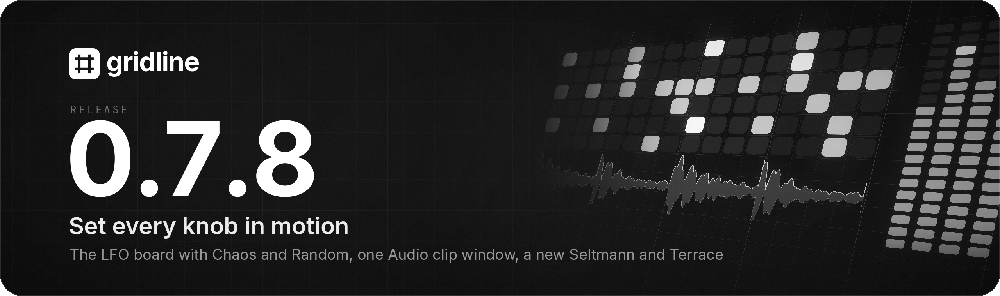
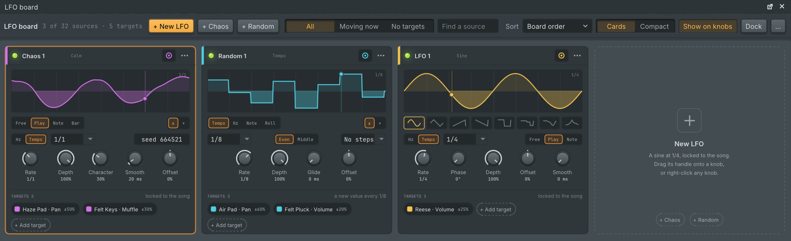
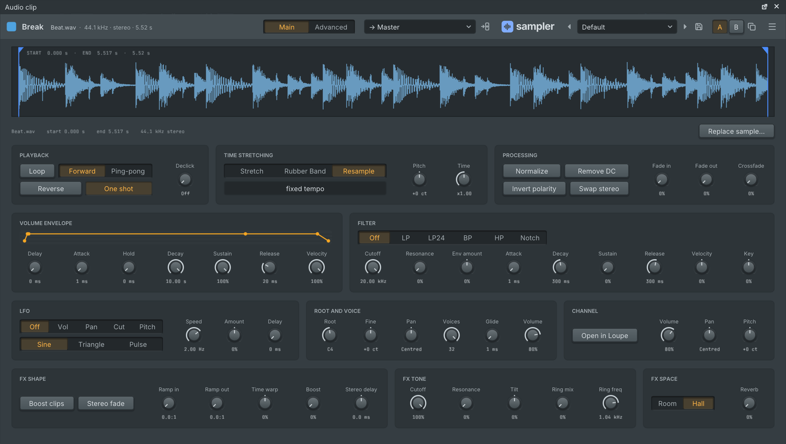
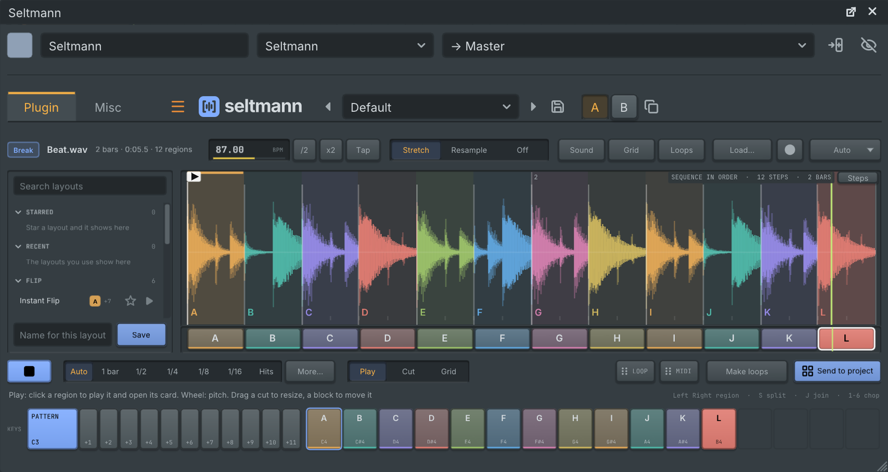
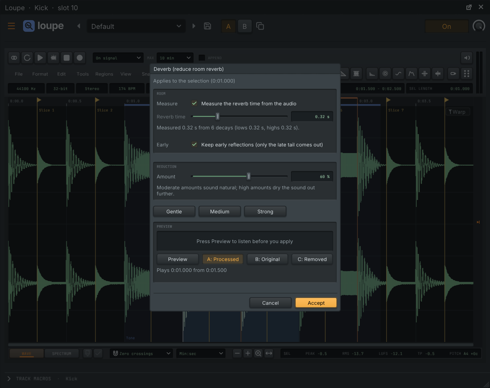
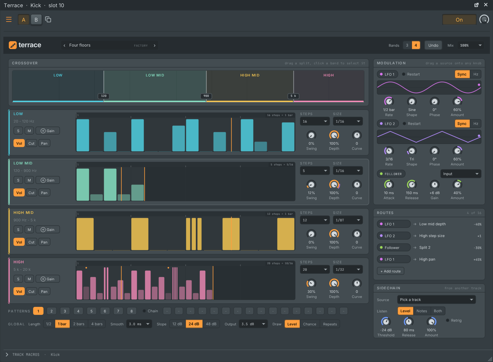
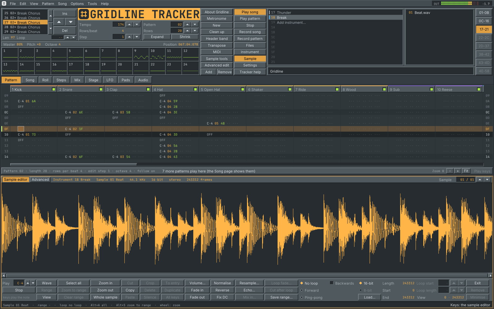

  

Gridline 0.7.8 is a point release on top of 0.7.7. **The LFO board** moves any knob with an LFO, and its two new sources, **Chaos** and **Random**, add movement that never repeats and stepped random values, the same on every export. **Macro knobs** sit in every plugin window. Audio clips get **one Audio clip window** with a calm Main page and an Advanced view, Loupe's **audio tools** right on the clip, and **render to audio** from anywhere. **Seltmann** has a new editor, **Terrace** is a new multiband rhythmic gate, the **Patch Player** plays SF2 files as their patches and **Loupe** adds Deverb, Declip and Drum loop stretch. Every layout gets a control bar you can customise, pinned commands and workspace cards; the Tracker gets a Stage page, a classic Sample editor and sample entries. Gridline now drives the **Novation Launchpad Pro [MK3]** and **Novation FLkey** keyboards, installed plugins work in **collaborative projects**, and an idle Gridline uses **far less of the processor**. Projects from 0.7.7 open as they are and play as before. Gridline's update check offers 0.7.8 to everyone on an earlier version.

## Highlights

### The LFO board, Chaos and Random

**Alt+F9** or **View > LFO board** opens a board of up to 32 sources per song: a tab beside the Mixer in Studio, in the mixer band in Clips, in the lower pane in Smooth and as the LFO page in the Tracker.

- **LFOs.** Eight shapes (including one you draw), a rate in Hz or note values, free, locked to the song or restarted on each note. Drag a card's handle onto any knob, or right-click a knob and choose **Modulate**. Each target has its own amount, direction, curve and smoothing, the knob shows the swing and a live dot, and Alt-drag sets the amount.
- **Chaos** is a smooth movement that never repeats, from calm (one slow bend) to wild (faster layers and sudden turns), with a rate, depth, smoothing, a seed and a restart that runs freely, follows the song, or starts again on every note or bar.
- **Random** holds a random value until the next trigger (a note value, a rate, every note of a channel, or the **Roll** button), with a glide, an even or centred spread and a snap to steps.
- **The same every time.** The same seed plays the same movement from the same place, so exports come out the same on every run and every computer, and in a shared session the sources, their seeds and every Roll reach everyone.
- **One Modulate menu** on every knob lists LFO, Chaos, Random, Macro and Controller plugin in the same order, with **Remove all modulation** and **Open the LFO board**.

See [docs/lfo-board.md](https://github.com/lolitemaultes/Gridline/blob/v0.7.8/docs/lfo-board.md).

  

### Macro knobs in every plugin window

Every channel has eight macro knobs on the Misc page of its window, and every mixer track has eight under each of its effects. Right-click any control of a plugin, built-in or installed, and choose **Link to macro**; one macro can move many controls, each with its own range and curve. **Map** links a control by moving it, also on a plugin's own interface. Macros can be renamed, automated and linked to MIDI controls and to each other. See [docs/plugin-window.md](https://github.com/lolitemaultes/Gridline/blob/v0.7.8/docs/plugin-window.md#macro-knobs).

### One Audio clip window

Double-click an audio clip, in any layout, and the clip and the sampler channel that plays it open in one **Audio clip** window.

- **Main** is one calm page under the sample with everything the sampler plays it with: playback, time stretching, processing, the volume envelope, filter, LFO, root and voice, the channel's level and the sample effects.
- **Advanced** shows the waveform editor, with handles to trim, slip, fade and set the volume, tools for warp markers, slicing and drawing, a sharp spectrum view, and tabs of modules for the clip, its sample and its channel, plus Edit audio and Analysis. Gridline remembers which view you used.
- **In each layout's own place.** A window in Studio, the band's own cards in Clips (with Launch and Follow for a clip of the clip grid), the inspector and the lower pane in Smooth, and the Sample editor in the Tracker.

See [docs/audio-clip-editor.md](https://github.com/lolitemaultes/Gridline/blob/v0.7.8/docs/audio-clip-editor.md).

  

### Editing audio

- **Audio tools on audio clips.** Right-click a clip and choose **Audio tools** for Clean up, Declick, Declip, Deverb, Noise gate, Equalize, Reverb, Blur, Normalize, Amplify, fades, Reverse and Drum loop stretch, with the same settings and Preview as in Loupe. The result is a new file: the original is never changed, and one undo brings it back. See [docs/playlist.md](https://github.com/lolitemaultes/Gridline/blob/v0.7.8/docs/playlist.md#audio-tools).
- **Render to audio from anywhere.** A clip, a channel, a track or a few notes become an audio clip, a slicer channel, a one-shot sampler, a drum pad, a take in Loupe or a file, sample for sample what the song plays. See [docs/rendering.md](https://github.com/lolitemaultes/Gridline/blob/v0.7.8/docs/rendering.md).
- **Trim silence at the ends, or Remove silence** throughout, with the threshold set from the noise floor, breaths kept and a short fade at every cut. See [docs/playlist.md](https://github.com/lolitemaultes/Gridline/blob/v0.7.8/docs/playlist.md#silence).
- **Warp markers on samples** in the sampler, Kerf and Loupe, where they are now saved with the project. See [docs/warp-markers.md](https://github.com/lolitemaultes/Gridline/blob/v0.7.8/docs/warp-markers.md).

### Instruments and effects

#### Seltmann

Seltmann has a new editor. The waveform and the sequence share one line, so each step sits under the bars it plays, and a click on a region or a step opens a card with everything about it. The editor fits its room as Compact, Standard or Full. **Hold the mouse on a layout** to hear it on your chop before you keep it, **record a take** straight into a loaded instance, and a pattern sent to the project **follows** the editor until you change its notes. **Follow** is now Stretch, Resample or Off, and Seltmann stays in tune under tempo changes, in playback and in exports. It has a tab in Smooth's lower pane and its own Chop and Instrument screens in the Tracker. See [docs/plugins/seltmann.md](https://github.com/lolitemaultes/Gridline/blob/v0.7.8/docs/plugins/seltmann.md#the-editor).

  

#### Loupe

**Deverb** takes the room's reverb out of a recording, with the reverb time measured from the audio. **Declip** finds clipped peaks and rebuilds them. **Drum loop stretch** sets a loop to a new tempo with every hit on its new place and its attack kept sharp. **Clean up** and **Declick** are rebuilt, and every tool dialog has a looping **Preview** with **A/B** and **C: Removed** to hear only what a repair takes out. The spectrogram is sharper, and warp markers are saved with the project. See [docs/plugins/loupe.md](https://github.com/lolitemaultes/Gridline/blob/v0.7.8/docs/plugins/loupe.md#repair-tools).

  

#### Terrace

A new effect, a multiband rhythmic gate. It splits the sound into 3 or 4 bands and gives each band its own volume, cutoff and pan steps (1 to 64 steps with their own size, swing, chance and repeats). Two LFOs, an envelope follower and a sidechain move any setting through up to 16 routes, and 8 patterns can be chained or picked by notes. It comes with 32 presets, from chops and stutters to pumping, triplets and slow textures. See [docs/plugins/terrace.md](https://github.com/lolitemaultes/Gridline/blob/v0.7.8/docs/plugins/terrace.md).

  

#### And more

- **Patch Player** plays `.sf2` and `.sf3` files as their patches, answers program change and bank select so a General MIDI file plays every part on the right sound, and opens SF2 files in the browser like folders of patches. See [docs/patch-player.md](https://github.com/lolitemaultes/Gridline/blob/v0.7.8/docs/patch-player.md).
- **Shaper** lanes have their own length (up to 64 steps), step size, swing, chance and repeats, a band split and 8 patterns. See [docs/plugins/shaper.md](https://github.com/lolitemaultes/Gridline/blob/v0.7.8/docs/plugins/shaper.md).
- **Kerf:** Fit to tempo keeps the pitch.
- **Granular** plays as loud as Grain Scanner.
- **Time knobs** on every plugin pull to note values and round milliseconds.
- **A guide to the instruments** lists every built-in instrument with a picture, flagships first. See [docs/instruments.md](https://github.com/lolitemaultes/Gridline/blob/v0.7.8/docs/instruments.md).

### Layouts

- **Every layout:** a control bar you customise and rearrange (right-click an empty bit of it), **pinned commands** from the command palette, **workspace cards** that choose what each workspace keeps, and **Settings > Layouts**. See [docs/workspaces.md](https://github.com/lolitemaultes/Gridline/blob/v0.7.8/docs/workspaces.md).
- **Studio:** zone keys (hold Tab and press 1 to 9), and a piano roll that keeps its zoom buttons in a narrow toolbar.
- **Clips:** the clip band and the device band share one place, with **Shift+Tab** between them; a new metronome box whose circles tick with the beat; calmer track meters; Launch and Follow in the clip band.
- **Smooth:** finer zoom sliders, pane buttons that open, close and switch as they should, and looped regions that show where each repeat starts.
- **Tracker:** a **Stage** page and the Performance panel in the Tracker's look; plugins open in floating windows; the Browser looks like the Tracker; a program change effect (**I** and two digits).

#### The Tracker's Sample editor

A Sampler opens in the Tracker's classic **Sample editor** again, with the waveform, range, loop handles and edits on buttons, and a **Sample editor** | **Advanced** switch to the Audio clip window's pages. Samples can play **backwards**, the loop is dragged anywhere along its lines, and every Tracker Sampler has sample entries **01 to 10**, with **To entry** to make a range of the waveform its own entry. See [docs/tracker-sampler.md](https://github.com/lolitemaultes/Gridline/blob/v0.7.8/docs/tracker-sampler.md).

  

### Workflow

- **Browser and mixer.** Browser tabs of your own and hidden folders ([docs/browser-tabs.md](https://github.com/lolitemaultes/Gridline/blob/v0.7.8/docs/browser-tabs.md)); mixer tracks you hide, narrow and collapse; channels hidden from the rack.
- **Grid and notes.** Every grid and snap option (GitHub #58), resizing every selected note at once, **note vibrato** drawn on each note, and **polyrhythms** with a grid and a length for each row of the channel rack.
- **Channels and tracks.** Clone a channel or duplicate a track without its notes, copy a channel's notes to a new pattern, and see audio clips' channels in the channel rack.
- **Keys.** **My keys say** names every shortcut by the key printed on your keyboard (QWERTY, QWERTZ, AZERTY, Dvorak or Colemak), and every shortcut has a key on Dvorak. See [docs/keyboard-shortcuts.md](https://github.com/lolitemaultes/Gridline/blob/v0.7.8/docs/keyboard-shortcuts.md#my-keys-say).
- **Swing automation** moves the swing step by step inside a pattern.

### Controllers and collaboration

- **Novation Launchpad Pro [MK3].** The pads are the clip grid in Clips, an overview of the arrangement in Studio and Smooth and the patterns in the Tracker; other pages play notes and drums, edit steps and use the touch faders. See [docs/controllers/launchpad-pro-mk3.md](https://github.com/lolitemaultes/Gridline/blob/v0.7.8/docs/controllers/launchpad-pro-mk3.md).
- **Novation FLkey keyboards** as full controllers: pads that step-sequence in the channel's colour, knobs on the focused plugin or the mixer, preset buttons, the transport and a screen that shows what moves. See [docs/controllers/novation-flkey.md](https://github.com/lolitemaultes/Gridline/blob/v0.7.8/docs/controllers/novation-flkey.md).
- **Link to controller** listens for the control you move and shows it with a meter, so the right knob is linked.
- **Installed plugins in collaborative projects.** VST3, VST2, CLAP, Audio Unit and LV2 plugins share their knobs as you turn them and their whole state when you change them; someone who lacks a plugin is told which one to install. See [docs/collaboration.md](https://github.com/lolitemaultes/Gridline/blob/v0.7.8/docs/collaboration.md#installed-plugins).
- **Installed plugins open inside Gridline**, in their plugin window under Gridline's header, as the built-in plugins do.

### Export

- **Opus** export through ffmpeg or opusenc.
- **Loop points** in WAV loop exports, for samplers that read them.
- **Faster exports** with tempo changes and Seltmann (a 32-bar tempo ramp about ten times faster).
- Exports with several kinds of split no longer overwrite files, and exports on **Linux arm64** that stop on an error show it.

### Lighter while idle

An idle Gridline uses far less of the processor (GitHub #66). Gridline's own and third-party instruments and effects rest once their sound has died away and wake on the note's own sample, a resting mixer track is skipped as a whole, a stopped demo song costs about a sixth of what it did, and the browser indexes gently in the background. The interface draws nothing while it is hidden or covered and nothing plays, and a hidden Gridline still answers OSC, assistants, controllers and collaborators at once. Exports are unchanged.

### Fixes

- **Seltmann no longer crashes** when you switch layouts while it plays (GitHub #80).
- **Notes and clips follow the pointer until you let go**, on macOS and in Smooth's and Clips' note editors.
- **The piano roll plays the key you click** at the edge of a black key. Thanks to donmakarona (GitHub #82).
- **The Tracker's** highlighted frame no longer flickers, and the Browser never hides its header band.
- **The effect list of an empty mixer slot** is never cut off.
- **Moving an effect keeps its settings**, and plugin windows no longer cover Gridline's menus.

## Other changes and fixes

- Stage groups rest as small stacks you open with a click.
- Effects with movement sound the same after resting as in an export.
- Progress windows keep their size.
- MIDI files keep every program change.
- Chater is listed under Multi FX.
- Many layout, spacing and alignment fixes.

The full list is in [CHANGELOG.md](https://github.com/lolitemaultes/Gridline/blob/v0.7.8/CHANGELOG.md).

## Upgrading from 0.7.7

- Projects open as they are and play as before. Songs with Granular keep their level, and Kerf instances saved before keep their tape style fit.
- Installed plugins now open inside Gridline's window. **Settings > Interface > Open installed plugins > In their own windows** brings back the earlier behaviour.
- Loupe's spectrogram key is now Shift+W, as W (Alt+W outside Studio) turns warp mode on and off.
- Collaborative projects: everyone in a session updates to 0.7.8. An older collaborator is told to update when joining.

## Install

- **macOS:** open the `.dmg` and drag Gridline to Applications. The first time, open it with right-click, then Open.
- **Windows:** run the `-setup.exe`. If SmartScreen appears, choose "More info", then "Run anyway".
- **Debian, Ubuntu and Chromebooks:** install the `.deb` with `sudo apt install ./Gridline-0.7.8-linux-amd64.deb` (or `-arm64.deb`). See [docs/debian.md](https://github.com/lolitemaultes/Gridline/blob/v0.7.8/docs/debian.md) and [docs/chromeos.md](https://github.com/lolitemaultes/Gridline/blob/v0.7.8/docs/chromeos.md).
- **Other Linux:** use the `.AppImage`, `.rpm` or `.tar.gz`. The `.tar.gz` comes with `install.sh`, which adds Gridline to the desktop menu.
- **BSDs:** use the `.tar.gz` for your system.

Every file's SHA-256 checksum is in `Gridline-0.7.8-SHA256SUMS`. Check a download with `sha256sum -c Gridline-0.7.8-SHA256SUMS --ignore-missing` (Linux, BSD), `shasum -a 256 -c Gridline-0.7.8-SHA256SUMS --ignore-missing` (macOS) or `Get-FileHash <file>` (Windows PowerShell). Gridline's update popup checks the checksum of what it downloads by itself.

## Licence

Gridline is free software under the GNU General Public License v3.0. The bundled libraries and the programs shipped beside it keep their own licences, listed in [third_party/NOTICE.md](https://github.com/lolitemaultes/Gridline/blob/v0.7.8/third_party/NOTICE.md).
